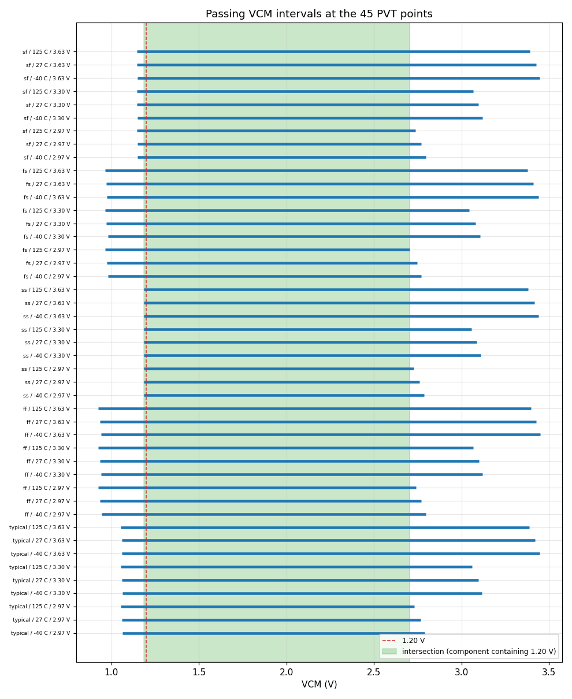
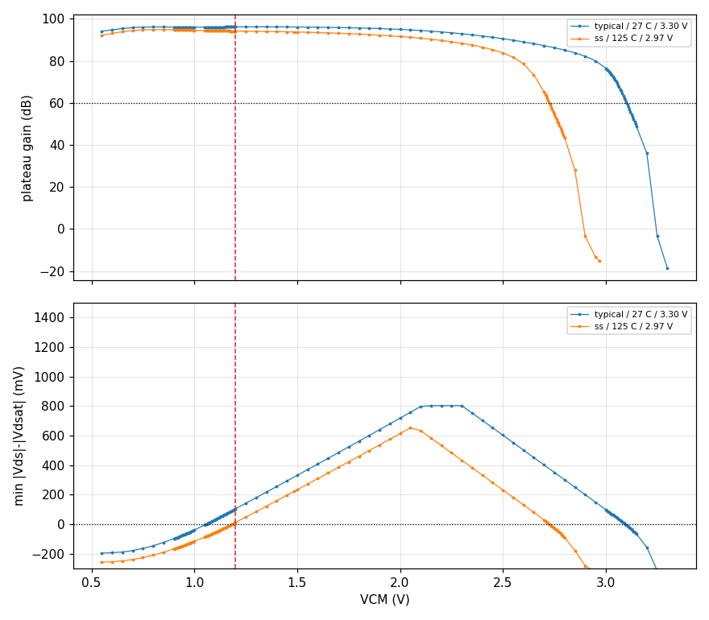

# Input common-mode range (ICMR) record `20261102-223808-79ec73a`

- **Date**: 2026-11-02 22:38 UTC; commit `79ec73a`; issue #60
- **DUT**: `design/netlist/opamp_two_stage.spice` (sha256 of the wrapper-normalised include `33b58dac62c747de`), unchanged; snapshot `netlist-snapshots/20261102-223808-79ec73a.spice`
- **Measurement fingerprint**: version 1, sha256 `5cee1ccee3cbccd8cf08a8d30c5512a03fdc5d797943209f1f40df5fd8f0d867` over the canonical inputs retained in the 'Measurement fingerprint inputs' section (bench content, `.ac` analysis (0.1-10 Hz) + operating-point print with device currents, excitation/servo values, VCM scan and refinement policy, control settings, corner axes, model library/sections; excludes record IDs, paths and backend scheduling)
- **PDK revision**: gf180mcuD, open_pdks `f6eeac7dad085ffcc829ccfd721f7b4ce39edcf7` (harness `find_pdk`, via ciel-default); the local single units are pinned to it (`models.pdk_root`).
  - klt's `provenance.pdk` and `environment.models_lib_sha256` in the grid reports are resolved on the SUBMITTING CLIENT (open_pdks f6eeac7dad085ffcc829ccfd721f7b4ce39edcf7 (search root: ~/.ciel)), not on the fleet runner, which uses its own install and (klt 0.5.0) does not report its revision. The fleet library is tied to the pinned revision indirectly: the local pinned units reproduce the grid's nominal point, and the scan's midrail samples reproduce the committed CMRR record (see Controls: midrail reproduction).
- **Tools**: ngspice local `ngspice-46 : Circuit level simulation program`, klt `klt 0.8.1.dev1124+g83a6073ff32a`, numpy `1.26.4`
- **Execution**: 4 `klt sim` corner requests (2 scan: one per excitation, crossing the 5 process corners x 3 temperatures with the paired VDD/VCM samples; 2 refinement over 1 round(s), one per excitation per round). Per request:
  - `scan-dm`: 2 fleet job(s) (`remote.hosts = 2`, contiguous shards merged by klt): `klt-sim-668eb7941f78`, `klt-sim-04151eef8438`; Spot m6i.4xlarge, state `failed`; runner klt `0.8.0` vs client `0.8.1.dev1124+g83a6073ff32a`; engine `ngspice 46`; client models staged (sm141064.ngspice, sm141064.spice, sm141064_mim.spice); wall 1337 s
  - `scan-cm`: 2 fleet job(s) (`remote.hosts = 2`, contiguous shards merged by klt): `klt-sim-a9206ffb1c1c`, `klt-sim-4265ee23ca6f`; Spot m6i.4xlarge, state `failed`; runner klt `0.8.0` vs client `0.8.1.dev1124+g83a6073ff32a`; engine `ngspice 46`; client models staged (sm141064.ngspice, sm141064.spice, sm141064_mim.spice); wall 1339 s
  - `refine1-dm`: 2 fleet job(s) (`remote.hosts = 2`, contiguous shards merged by klt): `klt-sim-849fa14620b8`, `klt-sim-45344cf0d75f`; Spot m7i.4xlarge, state `failed`; runner klt `0.8.0` vs client `0.8.1.dev1124+g83a6073ff32a`; engine `ngspice 46`; client models staged (sm141064.ngspice, sm141064.spice, sm141064_mim.spice); wall 1676 s
  - `refine1-cm`: 2 fleet job(s) (`remote.hosts = 2`, contiguous shards merged by klt): `klt-sim-bc03ef24dd12`, `klt-sim-edc4e416b5e4`; Spot c7i.8xlarge, state `failed`; runner klt `0.8.0` vs client `0.8.1.dev1124+g83a6073ff32a`; engine `ngspice 46`; client models staged (sm141064.ngspice, sm141064.spice, sm141064_mim.spice); wall 1707 s
  - Reports of `refine1-cm`, `refine1-dm`, `scan-cm`, `scan-dm` were reused from the `--keep-work` cache: byte-identical requests (netlist path aside) submitted by an earlier invocation of this driver on the same work directory; the job ids above are those submissions. Wall times are the original jobs'.
  - Local single units (controls) run with an empty `HOME` so no user `~/.spiceinit` applies (DR-0004).
- **Axes**: process typical, ff, ss, fs, sf; T -40 C, 27 C, 125 C; VDD 2.97 V, 3.30 V, 3.63 V; VCM scanned 0..VDD at <= 50 mV (explicit 1.20 V and VDD/2), transitions refined to <= 5 mV; ibias = 10 uA (ideal); CL = 2 pF. Every MOS corner uses `res_typical` + `mimcap_typical` (RZ/CC passive spread is NOT swept). `corners.supply_v` pairs `vdd` and `vcm` by index (each VDD repeated for each of its VCM samples).
- **Samples**: 6165 (PVT point, VCM) samples x 2 excitations: 3450 pass, 2247 fail, 468 invalid.

## Claim

**Measured, follower-biased ICMR of the schematic** (perfectly matched, passives at typical). It is the VCM range over which the input pair, tail, mirror and output stage stay saturated, the open-loop DC-plateau gain stays >= 60 dB and the follower output stays within 100 mV of VCM. It is not an arbitrary-output-voltage input range and not an offset-accuracy claim; the bench-validity tolerances (1 mV saturation tolerance, 0.10 V output tolerance) are not ratified performance bounds. Sampled coverage does not prove continuous behaviour between samples: endpoints are the nearest verified PASSING samples and the bracket to the adjacent non-passing sample is the stated uncertainty.

## Headline

- **Intersection over the 45 PVT points** (every contiguous component): [1.185, 2.705] V.
- **Component containing 1.20 V**: [1.185, 2.705] V; low endpoint 1.185 V set by ss / -40 C / 2.97 V (bracket 5 mV to a `fail` sample), high endpoint 2.705 V set by fs / 125 C / 2.97 V (bracket 5 mV to a `fail` sample).
- **1.20 V explicit sample at all 45 combinations**: **MEETS** (45 pass, 0 fail, 0 invalid/missing).
- Worst plateau gain at 1.20 V: 94.22 dB, limiting XM5 +11.7 mV at ss / 125 C / 2.97 V / VCM 1.200 V.
- Smallest device margin at 1.20 V: XM5 +11.1 mV (plateau gain 96.14 dB) at ss / -40 C / 2.97 V / VCM 1.200 V.
- Worst plateau gain inside the 1.20 V component (all 45 points, all samples in it): 60.93 dB, limiting XM6 +25.1 mV at fs / 125 C / 2.97 V / VCM 2.705 V.
- Smallest device margin inside that component: XM5 +0.6 mV (plateau gain 96.15 dB) at ss / -40 C / 2.97 V / VCM 1.185 V.

### Tolerance sensitivity (saturation tolerance 1 mV vs 0 mV)

- Intersection with the 1 mV tolerance: [1.185, 2.705] V; strict (0 mV): [1.185, 2.705] V.
- 1.20 V verdict with 1 mV: meets; strict: meets.
- Passing samples whose saturation margin is negative but inside the 1 mV tolerance: 15.
  - ff / -40 C / 3.30 V / VCM 0.940 V: XM5 (-0.854 mV)
  - ff / -40 C / 3.63 V / VCM 0.940 V: XM5 (-0.271 mV)
  - ff / 27 C / 2.97 V / VCM 0.935 V: XM5 (-0.128 mV)
  - ff / 125 C / 2.97 V / VCM 0.925 V: XM5 (-0.630 mV)
  - ff / 125 C / 3.30 V / VCM 0.925 V: XM5 (-0.037 mV)
  - fs / -40 C / 3.63 V / VCM 0.975 V: XM5 (-0.433 mV)
  - fs / 27 C / 3.30 V / VCM 0.970 V: XM5 (-0.714 mV)
  - fs / 27 C / 3.63 V / VCM 0.970 V: XM5 (-0.127 mV)
  - sf / -40 C / 2.97 V / VCM 2.795 V: XM6 (-0.531 mV)
  - sf / 27 C / 3.30 V / VCM 1.145 V: XM5 (-0.667 mV)
  - sf / 27 C / 3.63 V / VCM 1.145 V: XM5 (-0.092 mV)
  - ss / 27 C / 3.63 V / VCM 3.415 V: XM6 (-0.040 mV)
  - ss / 125 C / 3.30 V / VCM 3.055 V: XM6 (-0.393 mV)
  - typical / -40 C / 3.63 V / VCM 1.060 V: XM5 (-0.884 mV)
  - typical / 27 C / 3.30 V / VCM 3.095 V: XM6 (-0.839 mV)
- Interval endpoints (of 90) whose endpoint sample is inside the tolerance band: 15.

## Passing intervals at every PVT point

Every contiguous passing interval (adjacent valid passing samples; failed, invalid or missing samples are never bridged). Endpoints are the nearest passing samples; `unc` is the bracket to the adjacent non-passing sample (the true transition lies within it, on the non-passing side).

| PVT point | interval (V) | samples | low unc | low neighbour | high unc | high neighbour | 1.20 V | strict (0 mV) intervals |
|---|---|---|---|---|---|---|---|---|
| typical / -40 C / 2.97 V | [1.065, 2.790] V | 77 | 5 mV | fail | 5 mV | fail | pass | [1.065, 2.790] V |
| typical / 27 C / 2.97 V | [1.060, 2.765] V | 73 | 5 mV | fail | 5 mV | fail | pass | [1.060, 2.765] V |
| typical / 125 C / 2.97 V | [1.055, 2.730] V | 67 | 5 mV | fail | 5 mV | fail | pass | [1.055, 2.730] V |
| typical / -40 C / 3.30 V | [1.065, 3.115] V | 87 | 5 mV | fail | 5 mV | fail | pass | [1.065, 3.115] V |
| typical / 27 C / 3.30 V | [1.060, 3.095] V | 84 | 5 mV | fail | 5 mV | fail | pass | [1.060, 3.090] V |
| typical / 125 C / 3.30 V | [1.055, 3.060] V | 78 | 5 mV | fail | 5 mV | fail | pass | [1.055, 3.060] V |
| typical / -40 C / 3.63 V | [1.060, 3.445] V | 92 | 5 mV | fail | 5 mV | fail | pass | [1.065, 3.445] V |
| typical / 27 C / 3.63 V | [1.060, 3.420] V | 87 | 5 mV | fail | 5 mV | fail | pass | [1.060, 3.420] V |
| typical / 125 C / 3.63 V | [1.055, 3.385] V | 81 | 5 mV | fail | 5 mV | fail | pass | [1.055, 3.385] V |
| ff / -40 C / 2.97 V | [0.945, 2.795] V | 93 | 5 mV | fail | 5 mV | fail | pass | [0.945, 2.795] V |
| ff / 27 C / 2.97 V | [0.935, 2.770] V | 90 | 5 mV | fail | 5 mV | fail | pass | [0.940, 2.770] V |
| ff / 125 C / 2.97 V | [0.925, 2.740] V | 86 | 5 mV | fail | 5 mV | fail | pass | [0.930, 2.740] V |
| ff / -40 C / 3.30 V | [0.940, 3.120] V | 104 | 5 mV | fail | 5 mV | fail | pass | [0.945, 3.120] V |
| ff / 27 C / 3.30 V | [0.935, 3.100] V | 101 | 5 mV | fail | 5 mV | fail | pass | [0.935, 3.100] V |
| ff / 125 C / 3.30 V | [0.925, 3.065] V | 96 | 5 mV | fail | 5 mV | fail | pass | [0.930, 3.065] V |
| ff / -40 C / 3.63 V | [0.940, 3.450] V | 108 | 5 mV | fail | 5 mV | fail | pass | [0.945, 3.450] V |
| ff / 27 C / 3.63 V | [0.935, 3.425] V | 104 | 5 mV | fail | 5 mV | fail | pass | [0.935, 3.425] V |
| ff / 125 C / 3.63 V | [0.925, 3.395] V | 100 | 5 mV | fail | 5 mV | fail | pass | [0.925, 3.395] V |
| ss / -40 C / 2.97 V | [1.185, 2.785] V | 52 | 5 mV | fail | 5 mV | fail | pass | [1.185, 2.785] V |
| ss / 27 C / 2.97 V | [1.185, 2.760] V | 47 | 5 mV | fail | 5 mV | fail | pass | [1.185, 2.760] V |
| ss / 125 C / 2.97 V | [1.185, 2.725] V | 40 | 5 mV | fail | 5 mV | fail | pass | [1.185, 2.725] V |
| ss / -40 C / 3.30 V | [1.185, 3.110] V | 62 | 5 mV | fail | 5 mV | fail | pass | [1.185, 3.110] V |
| ss / 27 C / 3.30 V | [1.185, 3.085] V | 57 | 5 mV | fail | 5 mV | fail | pass | [1.185, 3.085] V |
| ss / 125 C / 3.30 V | [1.185, 3.055] V | 51 | 5 mV | fail | 5 mV | fail | pass | [1.185, 3.050] V |
| ss / -40 C / 3.63 V | [1.185, 3.440] V | 66 | 5 mV | fail | 5 mV | fail | pass | [1.185, 3.440] V |
| ss / 27 C / 3.63 V | [1.185, 3.415] V | 61 | 5 mV | fail | 5 mV | fail | pass | [1.185, 3.410] V |
| ss / 125 C / 3.63 V | [1.185, 3.380] V | 54 | 5 mV | fail | 5 mV | fail | pass | [1.185, 3.380] V |
| fs / -40 C / 2.97 V | [0.980, 2.770] V | 81 | 5 mV | fail | 5 mV | fail | pass | [0.980, 2.770] V |
| fs / 27 C / 2.97 V | [0.975, 2.745] V | 77 | 5 mV | fail | 5 mV | fail | pass | [0.975, 2.745] V |
| fs / 125 C / 2.97 V | [0.965, 2.705] V | 71 | 5 mV | fail | 5 mV | fail | pass | [0.965, 2.705] V |
| fs / -40 C / 3.30 V | [0.980, 3.105] V | 93 | 5 mV | fail | 5 mV | fail | pass | [0.980, 3.105] V |
| fs / 27 C / 3.30 V | [0.970, 3.080] V | 90 | 5 mV | fail | 5 mV | fail | pass | [0.975, 3.080] V |
| fs / 125 C / 3.30 V | [0.965, 3.045] V | 84 | 5 mV | fail | 5 mV | fail | pass | [0.965, 3.045] V |
| fs / -40 C / 3.63 V | [0.975, 3.440] V | 99 | 5 mV | fail | 5 mV | fail | pass | [0.980, 3.440] V |
| fs / 27 C / 3.63 V | [0.970, 3.410] V | 94 | 5 mV | fail | 5 mV | fail | pass | [0.975, 3.410] V |
| fs / 125 C / 3.63 V | [0.965, 3.375] V | 88 | 5 mV | fail | 5 mV | fail | pass | [0.965, 3.375] V |
| sf / -40 C / 2.97 V | [1.150, 2.795] V | 61 | 5 mV | fail | 5 mV | fail | pass | [1.150, 2.790] V |
| sf / 27 C / 2.97 V | [1.150, 2.770] V | 56 | 5 mV | fail | 5 mV | fail | pass | [1.150, 2.770] V |
| sf / 125 C / 2.97 V | [1.145, 2.735] V | 50 | 5 mV | fail | 5 mV | fail | pass | [1.145, 2.735] V |
| sf / -40 C / 3.30 V | [1.150, 3.120] V | 71 | 5 mV | fail | 5 mV | fail | pass | [1.150, 3.120] V |
| sf / 27 C / 3.30 V | [1.145, 3.095] V | 67 | 5 mV | fail | 5 mV | fail | pass | [1.150, 3.095] V |
| sf / 125 C / 3.30 V | [1.145, 3.065] V | 61 | 5 mV | fail | 5 mV | fail | pass | [1.145, 3.065] V |
| sf / -40 C / 3.63 V | [1.150, 3.445] V | 74 | 5 mV | fail | 5 mV | fail | pass | [1.150, 3.445] V |
| sf / 27 C / 3.63 V | [1.145, 3.425] V | 71 | 5 mV | fail | 5 mV | fail | pass | [1.150, 3.425] V |
| sf / 125 C / 3.63 V | [1.145, 3.390] V | 64 | 5 mV | fail | 5 mV | fail | pass | [1.145, 3.390] V |

## Explicit 1.20 V samples

| PVT point | status | plateau gain (dB) | limiting device | margin (mV) | vout - VCM (mV) | reasons |
|---|---|---|---|---|---|---|
| typical / -40 C / 2.97 V | pass | 96.39 | XM5 | +100.3 | -0.032 |  |
| typical / 27 C / 2.97 V | pass | 95.61 | XM5 | +103.4 | -0.016 |  |
| typical / 125 C / 2.97 V | pass | 94.50 | XM5 | +107.3 | +0.009 |  |
| typical / -40 C / 3.30 V | pass | 96.93 | XM5 | +100.9 | -0.030 |  |
| typical / 27 C / 3.30 V | pass | 96.20 | XM5 | +104.1 | -0.014 |  |
| typical / 125 C / 3.30 V | pass | 95.14 | XM5 | +107.9 | +0.012 |  |
| typical / -40 C / 3.63 V | pass | 96.98 | XM5 | +101.6 | -0.028 |  |
| typical / 27 C / 3.63 V | pass | 96.28 | XM5 | +104.7 | -0.012 |  |
| typical / 125 C / 3.63 V | pass | 95.26 | XM5 | +108.5 | +0.015 |  |
| ff / -40 C / 2.97 V | pass | 96.54 | XM5 | +193.3 | -0.029 |  |
| ff / 27 C / 2.97 V | pass | 95.72 | XM5 | +199.0 | -0.012 |  |
| ff / 125 C / 2.97 V | pass | 94.52 | XM5 | +206.6 | +0.014 |  |
| ff / -40 C / 3.30 V | pass | 97.03 | XM5 | +193.9 | -0.027 |  |
| ff / 27 C / 3.30 V | pass | 96.26 | XM5 | +199.6 | -0.010 |  |
| ff / 125 C / 3.30 V | pass | 95.11 | XM5 | +207.2 | +0.017 |  |
| ff / -40 C / 3.63 V | pass | 97.00 | XM5 | +194.6 | -0.025 |  |
| ff / 27 C / 3.63 V | pass | 96.25 | XM5 | +200.2 | -0.008 |  |
| ff / 125 C / 3.63 V | pass | 95.14 | XM5 | +207.8 | +0.021 |  |
| ss / -40 C / 2.97 V | pass | 96.14 | XM5 | +11.1 | -0.043 |  |
| ss / 27 C / 2.97 V | pass | 95.34 | XM5 | +11.7 | -0.028 |  |
| ss / 125 C / 2.97 V | pass | 94.22 | XM5 | +11.7 | -0.003 |  |
| ss / -40 C / 3.30 V | pass | 96.73 | XM5 | +11.8 | -0.040 |  |
| ss / 27 C / 3.30 V | pass | 95.99 | XM5 | +12.3 | -0.024 |  |
| ss / 125 C / 3.30 V | pass | 94.93 | XM5 | +12.3 | +0.000 |  |
| ss / -40 C / 3.63 V | pass | 96.87 | XM5 | +12.3 | -0.039 |  |
| ss / 27 C / 3.63 V | pass | 96.16 | XM5 | +12.9 | -0.022 |  |
| ss / 125 C / 3.63 V | pass | 95.14 | XM5 | +12.9 | +0.003 |  |
| fs / -40 C / 2.97 V | pass | 96.32 | XM5 | +165.4 | -0.032 |  |
| fs / 27 C / 2.97 V | pass | 95.58 | XM5 | +170.0 | -0.016 |  |
| fs / 125 C / 2.97 V | pass | 94.52 | XM5 | +175.9 | +0.009 |  |
| fs / -40 C / 3.30 V | pass | 96.96 | XM5 | +166.1 | -0.029 |  |
| fs / 27 C / 3.30 V | pass | 96.27 | XM5 | +170.6 | -0.013 |  |
| fs / 125 C / 3.30 V | pass | 95.28 | XM5 | +176.6 | +0.012 |  |
| fs / -40 C / 3.63 V | pass | 97.21 | XM5 | +166.7 | -0.028 |  |
| fs / 27 C / 3.63 V | pass | 96.57 | XM5 | +171.2 | -0.011 |  |
| fs / 125 C / 3.63 V | pass | 95.62 | XM5 | +177.2 | +0.015 |  |
| sf / -40 C / 2.97 V | pass | 96.37 | XM5 | +36.6 | -0.035 |  |
| sf / 27 C / 2.97 V | pass | 95.52 | XM5 | +38.3 | -0.019 |  |
| sf / 125 C / 2.97 V | pass | 94.31 | XM5 | +39.9 | +0.006 |  |
| sf / -40 C / 3.30 V | pass | 96.78 | XM5 | +37.2 | -0.033 |  |
| sf / 27 C / 3.30 V | pass | 95.98 | XM5 | +38.9 | -0.017 |  |
| sf / 125 C / 3.30 V | pass | 94.81 | XM5 | +40.6 | +0.009 |  |
| sf / -40 C / 3.63 V | pass | 96.58 | XM5 | +37.8 | -0.032 |  |
| sf / 27 C / 3.63 V | pass | 95.79 | XM5 | +39.5 | -0.015 |  |
| sf / 125 C / 3.63 V | pass | 94.64 | XM5 | +41.2 | +0.014 |  |

## Validity failures (preserved)

- 468 invalid sample(s) of 6165. Invalid samples are never passing and never bridged; they are listed in `corners/<rid>/samples.csv` with their reasons.
  - 468 x no Ad plateau over N-N Hz: varies by N dB (> N dB) (e.g. ff / -40 C / 2.97 V / VCM 0.000 V: no Ad plateau over 0.1-1 Hz: varies by 7.017 dB (> 0.1 dB))

## Method

- Per sample and excitation: `.ac dec 20 0.1 10` (41 points), then an `op` of the same deck whose printout (vout, vinp, vinn and every DUT MOSFET's vds, vdsat, id) is retained in the log (`analysis.args`, no fleet expression-measurement support needed). `dm`: vinp +0.5 V, vinn -0.5 V AC; `cm`: vinp = vinn = 1 V AC; same DC common mode.
- The DC loop is closed by the CMRR bench's ideal servo (`Esb` buffer -> `Rsv`/`Csv`, tau = 1e18 s -> `Esv` in series with the vinn AC source): a unity-gain-follower operating point at DC and an open loop at every swept frequency. Closed-loop follower gain is not what is measured. From the ACTUAL input phasors the two runs are solved jointly for Ad and Acm per frequency (the CMRR driver's exact solve).
- **Plateau gain** = the minimum of |Ad| (dB) over 0.1-1 Hz, valid only if |Ad| is flat there to 0.1 dB and has ~0 deg phase (a DC-plateau gain, not an exact zero-frequency measurement).
- **Saturation**: |Vds| - |Vdsat| >= -1 mV for the input pair (XM1, XM2), tail (XM5), mirror (XM3, XM4) and output stage (XM6, XM7); XM-B1 (the bias reference) is retained in the log and CSV but is not part of the criterion. Negative margins inside the tolerance are flagged; the analysis is repeated with 0 mV.
- **Rejected as INVALID**: missing/non-finite fields, an analysis that did not complete, incorrect AC excitation (differential within 1e-06 V of vd = 1, vc = 0; common mode within 1e-06 V of vc = 1 with |vd/vc| <= 1e-06), paired operating points disagreeing by > 1 uV, v(vinp) not at VCM, or no Ad plateau. **FAIL**: gain below 60 dB, |vout - VCM| > 100 mV, a device below saturation by more than the tolerance, or zero (< 1e-09 A) input-pair/tail current.
- **Refinement**: every adjacent pass/non-pass pair further apart than 5 mV is filled at 5 mV spacing by additional paired batch requests (1 round(s)); each round's request crosses the union of the needed (VDD, VCM) pairs with every process corner that needed one and every temperature, and all returned samples are kept.

## Controls

- **Nominal local unit** (typical / 27 C / 3.30 V, VCM 1.650 V): plateau gain 95.989 dB (min 95.988 dB).
- Local nominal unit vs the scan's nominal midrail sample: 0.0000 dB (tolerance 0.05 dB).
- **Midrail reproduction** of the committed CMRR record `20261018-215233-119ceb4` (mean Ad over 0.1-1 Hz at VDD/2): 45/45 points compared; max deviation 0.0000 dB at typical / 125 C / 3.30 V; nominal point 0.0000 dB (tolerance 0.05 dB).
- **Servo isolation**, servo tau = 1e+16 s: plateau gain moves 0.00000 dB (tolerance 0.01 dB).
- **Servo isolation**, servo tau = 1e+20 s: plateau gain moves 0.00000 dB (tolerance 0.01 dB).
- **Inadequate servo** (tau = 0.001 s): REJECTED (differential excitation off by 1 V (> 1e-06): servo isolation or wiring).
- **Unequal common-mode drive** (acp = 1, acn = 0.99): REJECTED (common-mode excitation off by 0.005 V (> 1e-06)).

## Independent recomputation

- After writing, every sample was re-derived from the RETAINED archives (24660 rawfile/log members in `corners/20261102-223808-79ec73a/data/`) through a separate read path (`--recompute 20261102-223808-79ec73a` repeats it) and compared with `samples.csv` (status, gain, margin) and with the headline numbers above: **identical**.

## Measurement fingerprint inputs

Canonical JSON (sorted keys, compact separators); its sha256 is the fingerprint in the header. Recompute with `sim/input-common-mode/measurement_config.py`.

```json
{"analysis":{"args":"dec 20 0.1 10\nop\nprint v(vout) v(vinp) v(vinn) @m.xdut.xm1.m0[vds] @m.xdut.xm1.m0[vdsat] @m.xdut.xm1.m0[id] @m.xdut.xm2.m0[vds] @m.xdut.xm2.m0[vdsat] @m.xdut.xm2.m0[id] @m.xdut.xm3.m0[vds] @m.xdut.xm3.m0[vdsat] @m.xdut.xm3.m0[id] @m.xdut.xm4.m0[vds] @m.xdut.xm4.m0[vdsat] @m.xdut.xm4.m0[id] @m.xdut.xm5.m0[vds] @m.xdut.xm5.m0[vdsat] @m.xdut.xm5.m0[id] @m.xdut.xm6.m0[vds] @m.xdut.xm6.m0[vdsat] @m.xdut.xm6.m0[id] @m.xdut.xm7.m0[vds] @m.xdut.xm7.m0[vdsat] @m.xdut.xm7.m0[id] @m.xdut.xmb1.m0[vds] @m.xdut.xmb1.m0[vdsat] @m.xdut.xmb1.m0[id]\nsetplot ac1","kind":"ac"},"bench":[".include 'design.ngspice'",".include 'opamp_two_stage.dut.spice'",".param acp=0.5 acn=-0.5 rsv=1e9 csv=1e9","vdd vdd 0 dc 3.3","vcm vinp 0 dc 1.65 ac {acp}","ibias vdd ibias dc 10u","xdut vdd 0 vinp vinn vout ibias opamp_two_stage","esb vsb 0 vout 0 1","rsv vsb vsv {rsv}","csv vsv 0 {csv}","esv vinn vnac vsv 0 1","vnac vnac 0 dc 0 ac {acn}","cl vout 0 2p"],"controls":{"isolation_csv":[10000000.0,100000000000.0],"isolation_inadequate_csv":1e-12,"unequal_cm":{"acn":0.99,"acp":1.0}},"corners":{"passive_sections":["res_typical","mimcap_typical"],"process":["typical","ff","ss","fs","sf"],"supply_v":[2.97,3.3,3.63],"temperature_c":[-40.0,27.0,125.0]},"excitation":{"modes":{"cm":{"acn":1.0,"acp":1.0},"dm":{"acn":-0.5,"acp":0.5}},"servo":{"csv":1000000000.0,"rsv":1000000000.0}},"experiment":"input-common-mode","fingerprint_version":1,"models":{"lib":"libs.tech/ngspice/sm141064.ngspice","pdk_variant":"gf180mcuD"},"refinement":{"max_rounds":3,"step_mv":5},"scan":{"explicit_mv":["vdd","vdd/2",1200],"vcm_step_mv":50}}
```

## Plots




## Reproduce / evidence

```
python3 sim/input-common-mode/run_input_common_mode.py            # full scan + refinement + a new record
python3 sim/input-common-mode/run_input_common_mode.py --smoke    # nominal point, local, no record
python3 sim/input-common-mode/run_input_common_mode.py --recompute 20261102-223808-79ec73a
```

- `corners/20261102-223808-79ec73a/samples.csv` (every sample, with margins and currents of every MOSFET), `corners/20261102-223808-79ec73a/data/*.tar.gz` (retained `.raw` and `.log` per sample and excitation), `corners/20261102-223808-79ec73a/requests/*.json.gz` and `reports/*.json.gz` (every klt request and sanitised report), `corners/20261102-223808-79ec73a/controls/` (local control logs).
- Testbench `sim/input-common-mode/testbench/tb_input_common_mode.spice`; driver `sim/input-common-mode/run_input_common_mode.py`; measurement configuration `sim/input-common-mode/measurement_config.py` (recomputes the measurement fingerprint above); tests `sim/input-common-mode/test_input_common_mode.py`.
- Timestamp / author: 2026-11-02T22:38:08Z, agent-builder (issue #60)

## Stored evidence

The per-corner bytes of this run are in the fleet artifact store, not in git (issue #271). Manifest: `manifests/artifacts/input-common-mode-20261102-223808-79ec73a.manifest.json` (64 objects, 18762533 B). Paths cited above are the manifest `name`s. Fetch one, hash-verified, with `klt artifact get <manifest>#<name> -o <out>`; check them all with `klt artifact verify <manifest>`.

| name | size (B) | sha256 |
|---|---:|---|
| `sim/input-common-mode/corners/20261102-223808-79ec73a/controls/iso-csv1e+07-cm.log` | 1371 | `d002a95abb82febf2380fce47c441177682b24c56dd0563cfb2c823c1d34e521` |
| `sim/input-common-mode/corners/20261102-223808-79ec73a/controls/iso-csv1e+07-dm.log` | 1371 | `d2d8bbe9e7a415759257e2435f3e2c38960c68b86abd0aecaa5e41de9a567db0` |
| `sim/input-common-mode/corners/20261102-223808-79ec73a/controls/iso-csv1e+11-cm.log` | 1371 | `66c3f7cf5038b6e8ef69ab2a88b73cb858e56bfac82106232a5a8f947aca7226` |
| `sim/input-common-mode/corners/20261102-223808-79ec73a/controls/iso-csv1e+11-dm.log` | 1371 | `222e1eff3af33ae01d842a99e0bfdbe14b1bb2ebc229768a64bd51d182bde664` |
| `sim/input-common-mode/corners/20261102-223808-79ec73a/controls/iso-inadequate-cm.log` | 1373 | `c26a4c7c3cbc1ae3d7f3491c8bd50655bff1621f50922392c3027326a5c62e7d` |
| `sim/input-common-mode/corners/20261102-223808-79ec73a/controls/iso-inadequate-dm.log` | 1373 | `f4dfdac6e6b4f2f5e1ffe7ef03fd320a06a07d5f5d57deb283ba928be1d00aec` |
| `sim/input-common-mode/corners/20261102-223808-79ec73a/controls/nominal-cm.log` | 1366 | `9c775a64381b31926f40cf95f6bb9235300465472c11c3675383d1cf77519ea7` |
| `sim/input-common-mode/corners/20261102-223808-79ec73a/controls/nominal-dm.log` | 1366 | `fad8668c2e461f62fb5f4e388a4bc361b647cfd91ddf59e3193b26649b3c110c` |
| `sim/input-common-mode/corners/20261102-223808-79ec73a/controls/unequal-cm-cm.log` | 1369 | `f054a71d5057d6ec2076740844ec024cd29b4cdf84b5a4eb94ca319ad10f9a74` |
| `sim/input-common-mode/corners/20261102-223808-79ec73a/controls/unequal-cm-dm.log` | 1369 | `1b83a89a97acf556dcbadad74b10d7da2b91a32ac8ac389e034dc3d98cb5b78c` |
| `sim/input-common-mode/corners/20261102-223808-79ec73a/data/ff_-40c_2.97v.tar.gz` | 342853 | `551e6e2a67b4aa47c65454145828d95ccd84e7eaad7ca15afe8a617d3c499ae4` |
| `sim/input-common-mode/corners/20261102-223808-79ec73a/data/ff_-40c_3.30v.tar.gz` | 381541 | `b3372b23bd693aba8690a585c8cfab7de87de6f7494f6689e88d1cd60bd00729` |
| `sim/input-common-mode/corners/20261102-223808-79ec73a/data/ff_-40c_3.63v.tar.gz` | 402514 | `a13de661d6c0c5b284457aaa74f005c79e57698178ce5f7e063acefbcc3e107d` |
| `sim/input-common-mode/corners/20261102-223808-79ec73a/data/ff_125c_2.97v.tar.gz` | 341353 | `b7468ff77ff9ba463292a9a7218cf7614de7ebe1239142040d779c2e1e9d635d` |
| `sim/input-common-mode/corners/20261102-223808-79ec73a/data/ff_125c_3.30v.tar.gz` | 379834 | `e820848dcf9400c5da2792c17463819a97e918b32fac135feaf7ca34d7bf1acc` |
| `sim/input-common-mode/corners/20261102-223808-79ec73a/data/ff_125c_3.63v.tar.gz` | 402080 | `77971dd49bba35249277cbd0a56da9c149332ed621baaa722a008777071666d0` |
| `sim/input-common-mode/corners/20261102-223808-79ec73a/data/ff_27c_2.97v.tar.gz` | 344587 | `a0f0c7fbefb6d133127b93c29192e3c9d7e7d047b7b7601d0dd8e13928282870` |
| `sim/input-common-mode/corners/20261102-223808-79ec73a/data/ff_27c_3.30v.tar.gz` | 382915 | `b06a77134463ffd48fd7809fb324f2958b92736733ae6173abb38123b685d062` |
| `sim/input-common-mode/corners/20261102-223808-79ec73a/data/ff_27c_3.63v.tar.gz` | 404415 | `b631d54af99795fa7a62cd862e4bd69b85e4f6e3171be6d43f4bbcb217780ceb` |
| `sim/input-common-mode/corners/20261102-223808-79ec73a/data/fs_-40c_2.97v.tar.gz` | 343262 | `873b67cd18b76ec94f11153e50c13b8a2386b6e3b1539b268cdda5258b8d8ba0` |
| `sim/input-common-mode/corners/20261102-223808-79ec73a/data/fs_-40c_3.30v.tar.gz` | 381467 | `045ae97c676cdcc3347ff547adde94b5ba47aee3bace9a60cc9390cf577ca557` |
| `sim/input-common-mode/corners/20261102-223808-79ec73a/data/fs_-40c_3.63v.tar.gz` | 403025 | `b49501e9dca98e2ff7f82e5ad0248e514c2a39486740c3f0aee3a9f63e1391c8` |
| `sim/input-common-mode/corners/20261102-223808-79ec73a/data/fs_125c_2.97v.tar.gz` | 339615 | `dcedc0bea2fb88f4eb5e2fc3844369db531b09dc38397aa9a35db9d4c7bd133d` |
| `sim/input-common-mode/corners/20261102-223808-79ec73a/data/fs_125c_3.30v.tar.gz` | 378620 | `27c59d9685bf1af7edfff53b3a4baafb70bfd5b1a0a60938daa4e3872b27d927` |
| `sim/input-common-mode/corners/20261102-223808-79ec73a/data/fs_125c_3.63v.tar.gz` | 400740 | `74138ab85ab5296eaabbcfb439c884793141b990d84b6dc4c39528b096f51e11` |
| `sim/input-common-mode/corners/20261102-223808-79ec73a/data/fs_27c_2.97v.tar.gz` | 342873 | `fe7a344698b7315eb4b0531194a1d3797ea23734f6dfefe6ee5ab08fa6d3eeb7` |
| `sim/input-common-mode/corners/20261102-223808-79ec73a/data/fs_27c_3.30v.tar.gz` | 381283 | `25ca7eded5e878ccfe4bed8fdb35bb85626893d26811c477bd1405374a3ef970` |
| `sim/input-common-mode/corners/20261102-223808-79ec73a/data/fs_27c_3.63v.tar.gz` | 403670 | `18226f7cb0f5ddc3dd38e5c304298d729640927b51848c6cebd53f4a660c13d0` |
| `sim/input-common-mode/corners/20261102-223808-79ec73a/data/sf_-40c_2.97v.tar.gz` | 348182 | `0f1ae6f6653e15ad96fdb1ec713b3e3e1bc27906be246f4ceafe09bc2e3388bc` |
| `sim/input-common-mode/corners/20261102-223808-79ec73a/data/sf_-40c_3.30v.tar.gz` | 384586 | `cd1eb6671586351ac8d9f1c61d23ecfc70cba55ed22a9e09dd2b7d8d9be80bc2` |
| `sim/input-common-mode/corners/20261102-223808-79ec73a/data/sf_-40c_3.63v.tar.gz` | 405188 | `6151bd15621079977e3a5f8cef9bc6928ddab812653567c15089210f42fc9e10` |
| `sim/input-common-mode/corners/20261102-223808-79ec73a/data/sf_125c_2.97v.tar.gz` | 346961 | `ecd73ee711907218dc5dba68b4149e6008877c551548b2246f1a66c32ba8d6b0` |
| `sim/input-common-mode/corners/20261102-223808-79ec73a/data/sf_125c_3.30v.tar.gz` | 383740 | `95fde126e7df7af51e256656f6b11a77be99fda0fcdcfcd196fe7b8d05c3e823` |
| `sim/input-common-mode/corners/20261102-223808-79ec73a/data/sf_125c_3.63v.tar.gz` | 405255 | `f7349539ab6d246d8f2f09bd22ab9871e9c0da948ba45b01b2b0b31d2c1c6986` |
| `sim/input-common-mode/corners/20261102-223808-79ec73a/data/sf_27c_2.97v.tar.gz` | 348600 | `837ad51563ef682654e74f71a5280f30b6b69d52ed08a6e2c18b466334fc34d1` |
| `sim/input-common-mode/corners/20261102-223808-79ec73a/data/sf_27c_3.30v.tar.gz` | 385356 | `1ec43b59156d1011087f30d91d64dbd3515618c4b72415f77f734b184e691483` |
| `sim/input-common-mode/corners/20261102-223808-79ec73a/data/sf_27c_3.63v.tar.gz` | 405857 | `b142a5763c76e11c01b364d15a0e67e8f1ef3999d844b6b2420e9b76e8abe33a` |
| `sim/input-common-mode/corners/20261102-223808-79ec73a/data/ss_-40c_2.97v.tar.gz` | 349433 | `eb796900afa45a00f975f536bd45bccfc3c94182b26d66a5bdd50a429aa94c31` |
| `sim/input-common-mode/corners/20261102-223808-79ec73a/data/ss_-40c_3.30v.tar.gz` | 385996 | `025120da1a8c843fda9c49df0b7090042b5656d3956083c9521890f5c1cafd84` |
| `sim/input-common-mode/corners/20261102-223808-79ec73a/data/ss_-40c_3.63v.tar.gz` | 406207 | `77d61435b695cac3ae601018dc7c77554dc5f4e388fd7005a225e7374c13ff58` |
| `sim/input-common-mode/corners/20261102-223808-79ec73a/data/ss_125c_2.97v.tar.gz` | 346103 | `4d4f80722a6f05334fb4a1bfe539d1af9f05b06cdb160d250f5722cb00f47239` |
| `sim/input-common-mode/corners/20261102-223808-79ec73a/data/ss_125c_3.30v.tar.gz` | 383358 | `7d749dc738a85eb3f1f100a5260b052f43b988c83b059c75609d0cfad43047aa` |
| `sim/input-common-mode/corners/20261102-223808-79ec73a/data/ss_125c_3.63v.tar.gz` | 405011 | `6dbeb576e31440cd6a3e6fcd1f42d2d91aa653f75f8d02e4f802110eb4e7160d` |
| `sim/input-common-mode/corners/20261102-223808-79ec73a/data/ss_27c_2.97v.tar.gz` | 346654 | `1d3b3d3ebd5b9c3077c68890e36b75f79c2ed9ae2e83f05a162c0345280725d5` |
| `sim/input-common-mode/corners/20261102-223808-79ec73a/data/ss_27c_3.30v.tar.gz` | 383564 | `5ccc32f89e66e36fe389de526bdb3c171a586c6dd71f654a24c120b72284e907` |
| `sim/input-common-mode/corners/20261102-223808-79ec73a/data/ss_27c_3.63v.tar.gz` | 403497 | `db14493519bf947e8ef477429a3a0a04c6903bf93af8c18392b5d8e6178e3c64` |
| `sim/input-common-mode/corners/20261102-223808-79ec73a/data/typical_-40c_2.97v.tar.gz` | 345963 | `c1bc7f27b93b3819a6854e1032953dcf29627eddba615b33e12b8fcb686d8387` |
| `sim/input-common-mode/corners/20261102-223808-79ec73a/data/typical_-40c_3.30v.tar.gz` | 383698 | `daafd49625df678830a3e9759544bee006b782c050f2adcbe1455ffc440566be` |
| `sim/input-common-mode/corners/20261102-223808-79ec73a/data/typical_-40c_3.63v.tar.gz` | 404329 | `2b2f157a7b646b9c5171cfdf8892d3a868ac3b04f217440695ac32e52ea30e36` |
| `sim/input-common-mode/corners/20261102-223808-79ec73a/data/typical_125c_2.97v.tar.gz` | 344179 | `dcaf247e32b50b4c2e9af23eae3f5eafcbf64fbe4ede7eb5077826b56d183a69` |
| `sim/input-common-mode/corners/20261102-223808-79ec73a/data/typical_125c_3.30v.tar.gz` | 381573 | `a6fc993809c9f9a2ac4d3c421c2473f430a5c2b228d9f1c1154eba04eb2ab9c4` |
| `sim/input-common-mode/corners/20261102-223808-79ec73a/data/typical_125c_3.63v.tar.gz` | 404013 | `f183d677d644cd9f8680e9e1ea6278a29e9903e398f35429f7a5a5fc7eea786a` |
| `sim/input-common-mode/corners/20261102-223808-79ec73a/data/typical_27c_2.97v.tar.gz` | 346285 | `aa4739978af4c42c68df33713ad412b70f56522e5e51e9c06e6833c8bd1947db` |
| `sim/input-common-mode/corners/20261102-223808-79ec73a/data/typical_27c_3.30v.tar.gz` | 383823 | `a4c756936a4f9abf6831bc9418930308cc271cffa1fad59aa0a15464c9b89130` |
| `sim/input-common-mode/corners/20261102-223808-79ec73a/data/typical_27c_3.63v.tar.gz` | 405698 | `fce7d6f83b37a57672fe3d7f315ad066d483a7505d5328b82f2c370eea0cd9dc` |
| `sim/input-common-mode/corners/20261102-223808-79ec73a/reports/refine1-cm.report.json.gz` | 37170 | `b3d36a3b69584c40e0b5190a3d11b2b5c6b0b81cdd5f8770d17f5bff43c6b66d` |
| `sim/input-common-mode/corners/20261102-223808-79ec73a/reports/refine1-dm.report.json.gz` | 37230 | `394c9565894a6b78c8f8d97c41694b05addadc7c24e7217fee57e1fe6e0c08c3` |
| `sim/input-common-mode/corners/20261102-223808-79ec73a/reports/scan-cm.report.json.gz` | 36078 | `190f9d01c9bdc4ccaff60e5de19aa89584e89a84ee238e84e1176216b4c49b7c` |
| `sim/input-common-mode/corners/20261102-223808-79ec73a/reports/scan-dm.report.json.gz` | 36066 | `2163ae6c4147f969d4d5d8063adb1851d97151ce0756935b7eaeadb873b4301c` |
| `sim/input-common-mode/corners/20261102-223808-79ec73a/requests/refine1-cm.request.json.gz` | 753 | `7c7dac9f6be1377d3f82b94611ef04f7fa0f168b2caa1bc536348921406abbc3` |
| `sim/input-common-mode/corners/20261102-223808-79ec73a/requests/refine1-dm.request.json.gz` | 753 | `d5d7a86303766e42d1e1c4401dfb071062f2d0c3c37f75ee4716732c41c31e5f` |
| `sim/input-common-mode/corners/20261102-223808-79ec73a/requests/scan-cm.request.json.gz` | 710 | `d3be75eaf11b1ccc70f5f5935ac139bcf05321d6bc4c93ab0a80d736c29fbfbb` |
| `sim/input-common-mode/corners/20261102-223808-79ec73a/requests/scan-dm.request.json.gz` | 710 | `70c42ba567ea91848a23c9ca1fc3a6eceb07f12aaf5b037000c73f9070dab437` |
| `sim/input-common-mode/corners/20261102-223808-79ec73a/samples.csv` | 1619607 | `671389fea0d5528e8c3f2f9decbc70868e3bdedd5ea746fcb22e64e744b7d313` |
