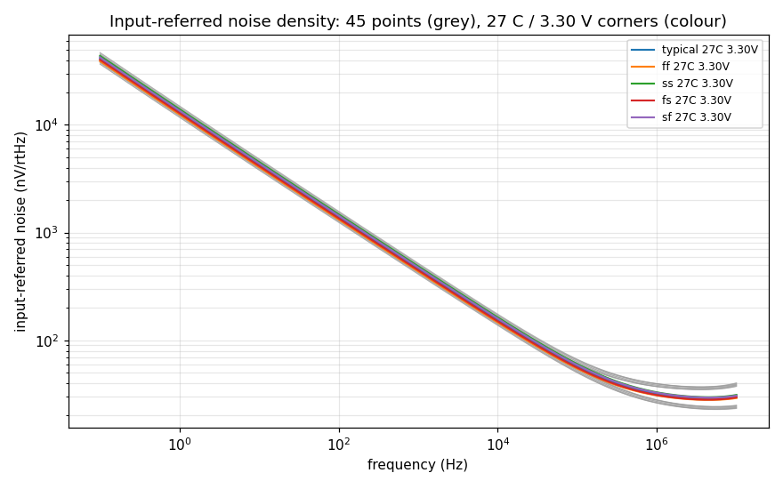
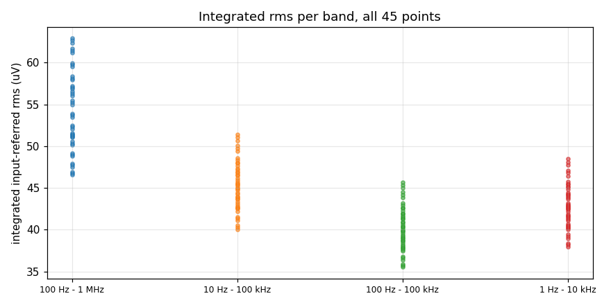

# Noise record `20261010-163507-0127eb7`

- **Date**: 2026-10-10 16:35 UTC; commit `0127eb7`; issue #46
- **DUT**: `design/netlist/opamp_two_stage.spice` (sha256 of the wrapper-normalised include `33b58dac62c747de`), unchanged
- **Measurement fingerprint**: version 1, sha256 `33de8feba00cb8e250c775f92248fa3183f2d6ca90ddf0d8c1d247715fc53b4a` over the canonical inputs retained in the 'Measurement fingerprint inputs' section (bench content, `.noise` analysis, integration bands/spot/fit settings, control settings, corner axes, model library/sections; excludes record IDs, paths and backend scheduling)
- **PDK**: gf180mcuD (open_pdks `c6d73a35f524070e85faff4a6a9eef49553ebc2b`); tools: ngspice local `ngspice-46 : Circuit level simulation program`, klt `klt 0.7.0+g21e45ce7233b`
- **Execution**: `klt sim` backend `aws-batch-fleet`, job `klt-sim-c8225b512df0`, Spot m6i.4xlarge; runner klt `0.5.0` vs client `0.7.0+g21e45ce7233b`
- **Request**: the 45-point grid (5 MOS corners x 3 T x 3 VDD, vcm = VDD/2) as ONE `klt sim` request, `.noise v(vout) Vcm dec 20 0.1 1e+07`, wall time 52 s (client-side)
- **Passive sections**: every corner uses `res_typical` + `mimcap_typical`; RZ/CC passive spread is NOT swept.

## Claim

**Measured, no pass or fail verdict: the row's bound is not ratified** (DR-3 residual (e1)); neither is the integration band. The bands below are candidates so the choice can be argued from data. `spec/target-spec.md` is untouched.

## Flicker (1/f) noise is modelled and visible

**Not thermal-only.** The 1/f term exceeds the thermal floor by >= 10x at 1 Hz at all 45 points; the fitted 1/f corner and floor are reported below. A figure rated against the row may therefore use the flicker-inclusive numbers.

### Model audit (pinned library, read by the driver)

- Library `sm141064.ngspice`, open_pdks `c6d73a35f524070e85faff4a6a9eef49553ebc2b`; `fnoicor = 0` in `design.ngspice` (0 = as-extracted, 1 = worst-case flicker).
- Corner sections that pull in `.lib noise_corner`: `typical` yes, `ff` yes, `ss` yes, `fs` yes, `sf` yes.
  - `nfet_03v3_noia` = `(fnoicor==0)*3.2e+041 + (fnoicor==1)*3.5e+042`
  - `nfet_03v3_noib` = `(fnoicor==0)*1.2e+020 + (fnoicor==1)*1.2e+020`
  - `nfet_03v3_noic` = `(fnoicor==0)*6.0e+008 + (fnoicor==1)*6.0e+008`
  - `pfet_03v3_noia` = `(fnoicor==0)*3.2e+041 + (fnoicor==1)*4.0e+042`
  - `pfet_03v3_noib` = `(fnoicor==0)*1.8e+020 + (fnoicor==1)*1.8e+020`
  - `pfet_03v3_noic` = `(fnoicor==0)*3.0e+009 + (fnoicor==1)*6.0e+009`

| model | .model cards | fnoimod | ef | noia | noib | noic |
|---|---|---|---|---|---|---|
| `nfet_03v3` | 96 | 1 | 0.95 | nfet_03v3_noia | nfet_03v3_noib | nfet_03v3_noic |
| `pfet_03v3` | 96 | 1 | 1.12 | pfet_03v3_noia | pfet_03v3_noib | pfet_03v3_noic |

`fnoimod = 1` selects the BSIM4 unified flicker model (`noia/noib/noic`, exponent `ef`), so MOS flicker noise is part of every `.noise` run; thermal noise is on by default and the resistor RZ contributes thermal noise only.

## Nominal point (typical, 27 C, 3.30 V)

| quantity | value |
|---|---|
| density @ 10 Hz | 4274.60 nV/rtHz |
| density @ 100 Hz | 1397.48 nV/rtHz |
| density @ 1000 Hz | 460.81 nV/rtHz |
| density @ 10000 Hz | 154.62 nV/rtHz |
| density @ 100000 Hz | 57.32 nV/rtHz |
| rms 100 Hz - 1 MHz | 53.727 uV |
| rms 10 Hz - 100 kHz | 45.224 uV |
| rms 100 Hz - 100 kHz | 40.135 uV |
| rms 1 Hz - 10 kHz | 42.771 uV |
| thermal floor | 27.67 nV/rtHz |
| 1/f corner | 342.1 kHz |

## Spot densities (nV/rtHz, input-referred) -- all points

| point | 10 Hz | 100 Hz | 1000 Hz | 10000 Hz | 100000 Hz |
|---|---|---|---|---|---|
| ff / -40 C / 2.97 V | 3794.47 | 1241.51 | 409.51 | 137.11 | 49.87 |
| ff / -40 C / 3.30 V | 3815.43 | 1248.85 | 412.04 | 137.94 | 50.07 |
| ff / -40 C / 3.63 V | 3833.90 | 1255.33 | 414.27 | 138.67 | 50.25 |
| ff / 27 C / 2.97 V | 4019.32 | 1313.52 | 433.06 | 145.46 | 54.39 |
| ff / 27 C / 3.30 V | 4044.22 | 1322.17 | 436.02 | 146.43 | 54.61 |
| ff / 27 C / 3.63 V | 4066.31 | 1329.84 | 438.64 | 147.29 | 54.81 |
| ff / 125 C / 2.97 V | 4266.79 | 1391.82 | 458.53 | 154.78 | 60.16 |
| ff / 125 C / 3.30 V | 4294.05 | 1401.24 | 461.74 | 155.82 | 60.39 |
| ff / 125 C / 3.63 V | 4318.44 | 1409.66 | 464.61 | 156.75 | 60.60 |
| fs / -40 C / 2.97 V | 3899.53 | 1274.58 | 420.08 | 140.50 | 50.91 |
| fs / -40 C / 3.30 V | 3922.62 | 1282.68 | 422.87 | 141.42 | 51.13 |
| fs / -40 C / 3.63 V | 3942.93 | 1289.81 | 425.33 | 142.24 | 51.33 |
| fs / 27 C / 2.97 V | 4133.64 | 1349.63 | 444.63 | 149.17 | 55.50 |
| fs / 27 C / 3.30 V | 4160.98 | 1359.14 | 447.88 | 150.24 | 55.75 |
| fs / 27 C / 3.63 V | 4185.16 | 1367.55 | 450.77 | 151.19 | 55.98 |
| fs / 125 C / 2.97 V | 4391.15 | 1431.22 | 471.18 | 158.82 | 61.34 |
| fs / 125 C / 3.30 V | 4421.14 | 1441.59 | 474.71 | 159.98 | 61.60 |
| fs / 125 C / 3.63 V | 4447.87 | 1450.84 | 477.87 | 161.00 | 61.83 |
| sf / -40 C / 2.97 V | 4108.33 | 1344.84 | 443.71 | 148.49 | 53.74 |
| sf / -40 C / 3.30 V | 4134.53 | 1353.98 | 446.85 | 149.53 | 54.00 |
| sf / -40 C / 3.63 V | 4157.36 | 1361.95 | 449.59 | 150.43 | 54.22 |
| sf / 27 C / 2.97 V | 4361.45 | 1426.23 | 470.39 | 157.89 | 58.63 |
| sf / 27 C / 3.30 V | 4392.86 | 1437.10 | 474.10 | 159.11 | 58.93 |
| sf / 27 C / 3.63 V | 4420.45 | 1446.64 | 477.36 | 160.18 | 59.19 |
| sf / 125 C / 2.97 V | 4643.70 | 1516.01 | 499.67 | 168.49 | 64.89 |
| sf / 125 C / 3.30 V | 4678.33 | 1527.93 | 503.72 | 169.81 | 65.20 |
| sf / 125 C / 3.63 V | 4709.05 | 1538.51 | 507.32 | 170.98 | 65.47 |
| ss / -40 C / 2.97 V | 4218.51 | 1379.12 | 454.57 | 151.96 | 54.80 |
| ss / -40 C / 3.30 V | 4246.95 | 1389.05 | 457.99 | 153.09 | 55.09 |
| ss / -40 C / 3.63 V | 4271.78 | 1397.74 | 460.98 | 154.08 | 55.34 |
| ss / 27 C / 2.97 V | 4482.30 | 1463.97 | 482.38 | 161.72 | 59.78 |
| ss / 27 C / 3.30 V | 4516.33 | 1475.76 | 486.40 | 163.05 | 60.11 |
| ss / 27 C / 3.63 V | 4546.21 | 1486.12 | 489.95 | 164.21 | 60.41 |
| ss / 125 C / 2.97 V | 4776.63 | 1557.68 | 512.94 | 172.72 | 66.13 |
| ss / 125 C / 3.30 V | 4814.26 | 1570.65 | 517.35 | 174.16 | 66.48 |
| ss / 125 C / 3.63 V | 4847.58 | 1582.14 | 521.27 | 175.44 | 66.78 |
| typical / -40 C / 2.97 V | 4002.39 | 1309.32 | 431.80 | 144.46 | 52.31 |
| typical / -40 C / 3.30 V | 4026.87 | 1317.88 | 434.74 | 145.44 | 52.55 |
| typical / -40 C / 3.63 V | 4048.39 | 1325.42 | 437.33 | 146.30 | 52.76 |
| typical / 27 C / 2.97 V | 4245.43 | 1387.36 | 457.35 | 153.48 | 57.04 |
| typical / 27 C / 3.30 V | 4274.60 | 1397.48 | 460.81 | 154.62 | 57.32 |
| typical / 27 C / 3.63 V | 4300.39 | 1406.43 | 463.87 | 155.63 | 57.56 |
| typical / 125 C / 2.97 V | 4514.52 | 1472.80 | 485.19 | 163.58 | 63.08 |
| typical / 125 C / 3.30 V | 4546.60 | 1483.86 | 488.95 | 164.81 | 63.37 |
| typical / 125 C / 3.63 V | 4575.20 | 1493.73 | 492.32 | 165.90 | 63.62 |

## Integrated input-referred rms (uV) -- all points

Exact piecewise power-law integration of density^2 between sweep points.

| point | 100 Hz - 1 MHz | 10 Hz - 100 kHz | 100 Hz - 100 kHz | 1 Hz - 10 kHz |
|---|---|---|---|---|
| ff / -40 C / 2.97 V | 46.586 | 40.061 | 35.529 | 37.981 |
| ff / -40 C / 3.30 V | 46.749 | 40.293 | 35.735 | 38.203 |
| ff / -40 C / 3.63 V | 46.891 | 40.498 | 35.917 | 38.398 |
| ff / 27 C / 2.97 V | 51.056 | 42.564 | 37.786 | 40.209 |
| ff / 27 C / 3.30 V | 51.242 | 42.835 | 38.027 | 40.471 |
| ff / 27 C / 3.63 V | 51.404 | 43.076 | 38.239 | 40.702 |
| ff / 125 C / 2.97 V | 56.852 | 45.391 | 40.355 | 42.647 |
| ff / 125 C / 3.30 V | 57.038 | 45.682 | 40.612 | 42.932 |
| ff / 125 C / 3.63 V | 57.201 | 45.943 | 40.842 | 43.186 |
| fs / -40 C / 2.97 V | 47.540 | 41.073 | 36.408 | 38.994 |
| fs / -40 C / 3.30 V | 47.727 | 41.330 | 36.637 | 39.238 |
| fs / -40 C / 3.63 V | 47.890 | 41.557 | 36.839 | 39.454 |
| fs / 27 C / 2.97 V | 52.076 | 43.668 | 38.746 | 41.314 |
| fs / 27 C / 3.30 V | 52.288 | 43.967 | 39.011 | 41.601 |
| fs / 27 C / 3.63 V | 52.473 | 44.232 | 39.246 | 41.856 |
| fs / 125 C / 2.97 V | 57.930 | 46.591 | 41.398 | 43.852 |
| fs / 125 C / 3.30 V | 58.142 | 46.913 | 41.682 | 44.165 |
| fs / 125 C / 3.63 V | 58.329 | 47.200 | 41.936 | 44.444 |
| sf / -40 C / 2.97 V | 50.143 | 43.369 | 38.459 | 41.136 |
| sf / -40 C / 3.30 V | 50.358 | 43.659 | 38.716 | 41.413 |
| sf / -40 C / 3.63 V | 50.544 | 43.912 | 38.941 | 41.654 |
| sf / 27 C / 2.97 V | 54.965 | 46.176 | 40.986 | 43.651 |
| sf / 27 C / 3.30 V | 55.216 | 46.518 | 41.289 | 43.980 |
| sf / 27 C / 3.63 V | 55.434 | 46.818 | 41.556 | 44.268 |
| sf / 125 C / 2.97 V | 61.218 | 49.375 | 43.886 | 46.440 |
| sf / 125 C / 3.30 V | 61.475 | 49.746 | 44.214 | 46.800 |
| sf / 125 C / 3.63 V | 61.701 | 50.075 | 44.505 | 47.120 |
| ss / -40 C / 2.97 V | 51.130 | 44.411 | 39.361 | 42.187 |
| ss / -40 C / 3.30 V | 51.370 | 44.728 | 39.643 | 42.488 |
| ss / -40 C / 3.63 V | 51.580 | 45.004 | 39.889 | 42.751 |
| ss / 27 C / 2.97 V | 56.032 | 47.323 | 41.979 | 44.807 |
| ss / 27 C / 3.30 V | 56.310 | 47.695 | 42.310 | 45.164 |
| ss / 27 C / 3.63 V | 56.553 | 48.022 | 42.600 | 45.477 |
| ss / 125 C / 2.97 V | 62.362 | 50.637 | 44.980 | 47.715 |
| ss / 125 C / 3.30 V | 62.648 | 51.043 | 45.338 | 48.108 |
| ss / 125 C / 3.63 V | 62.901 | 51.402 | 45.656 | 48.455 |
| typical / -40 C / 2.97 V | 48.825 | 42.211 | 37.425 | 40.053 |
| typical / -40 C / 3.30 V | 49.025 | 42.482 | 37.667 | 40.311 |
| typical / -40 C / 3.63 V | 49.199 | 42.721 | 37.879 | 40.539 |
| typical / 27 C / 2.97 V | 53.497 | 44.906 | 39.852 | 42.465 |
| typical / 27 C / 3.30 V | 53.727 | 45.224 | 40.135 | 42.771 |
| typical / 27 C / 3.63 V | 53.928 | 45.506 | 40.384 | 43.041 |
| typical / 125 C / 2.97 V | 59.540 | 47.958 | 42.621 | 45.120 |
| typical / 125 C / 3.30 V | 59.773 | 48.302 | 42.925 | 45.455 |
| typical / 125 C / 3.63 V | 59.978 | 48.609 | 43.196 | 45.753 |

Spread across the grid (min .. max):

- 100 Hz - 1 MHz: 46.586 uV (ff / -40 C / 2.97 V) .. 62.901 uV (ss / 125 C / 3.63 V); max/min = 1.35
- 10 Hz - 100 kHz: 40.061 uV (ff / -40 C / 2.97 V) .. 51.402 uV (ss / 125 C / 3.63 V); max/min = 1.28
- 100 Hz - 100 kHz: 35.529 uV (ff / -40 C / 2.97 V) .. 45.656 uV (ss / 125 C / 3.63 V); max/min = 1.29
- 1 Hz - 10 kHz: 37.981 uV (ff / -40 C / 2.97 V) .. 48.455 uV (ss / 125 C / 3.63 V); max/min = 1.28

## Thermal floor and 1/f corner

Method: least-squares fit of S(f) = Sw + K / f^a to the density^2 over 1 Hz - 1e+07 Hz with relative-error weights (exponent `a` scanned 0.5..1.5, step 0.005, Sw and K from linear least squares). Thermal floor = sqrt(Sw); corner = (K/Sw)^(1/a), where the 1/f power equals the thermal power. A fit is reported only when its rms relative residual of S is <= 5%.

| point | floor (nV/rtHz) | corner (kHz) | a | K/Sw at 1 Hz | fit resid |
|---|---|---|---|---|---|
| ff / -40 C / 2.97 V | 22.01 | 430.8 | 0.965 | 2.74e+05 | 1.51% |
| ff / -40 C / 3.30 V | 21.86 | 442.3 | 0.965 | 2.81e+05 | 1.48% |
| ff / -40 C / 3.63 V | 21.72 | 453.1 | 0.965 | 2.87e+05 | 1.46% |
| ff / 27 C / 2.97 V | 27.28 | 298.9 | 0.970 | 2.05e+05 | 1.94% |
| ff / 27 C / 3.30 V | 26.95 | 322.1 | 0.965 | 2.07e+05 | 1.92% |
| ff / 27 C / 3.63 V | 26.82 | 329.4 | 0.965 | 2.11e+05 | 1.90% |
| ff / 125 C / 2.97 V | 34.21 | 210.7 | 0.970 | 1.46e+05 | 2.41% |
| ff / 125 C / 3.30 V | 34.07 | 215.4 | 0.970 | 1.49e+05 | 2.40% |
| ff / 125 C / 3.63 V | 33.95 | 219.8 | 0.970 | 1.52e+05 | 2.41% |
| fs / -40 C / 2.97 V | 22.10 | 450.8 | 0.965 | 2.86e+05 | 1.73% |
| fs / -40 C / 3.30 V | 21.95 | 463.5 | 0.965 | 2.94e+05 | 1.69% |
| fs / -40 C / 3.63 V | 21.80 | 475.3 | 0.965 | 3.01e+05 | 1.66% |
| fs / 27 C / 2.97 V | 27.41 | 312.8 | 0.970 | 2.14e+05 | 2.09% |
| fs / 27 C / 3.30 V | 27.26 | 321.0 | 0.970 | 2.19e+05 | 2.10% |
| fs / 27 C / 3.63 V | 27.13 | 328.5 | 0.970 | 2.24e+05 | 2.12% |
| fs / 125 C / 2.97 V | 34.39 | 220.7 | 0.970 | 1.53e+05 | 2.70% |
| fs / 125 C / 3.30 V | 34.25 | 225.9 | 0.970 | 1.56e+05 | 2.69% |
| fs / 125 C / 3.63 V | 34.12 | 230.8 | 0.970 | 1.59e+05 | 2.68% |
| sf / -40 C / 2.97 V | 23.10 | 460.1 | 0.965 | 2.91e+05 | 1.49% |
| sf / -40 C / 3.30 V | 22.93 | 473.6 | 0.965 | 3e+05 | 1.47% |
| sf / -40 C / 3.63 V | 22.78 | 486.0 | 0.965 | 3.07e+05 | 1.46% |
| sf / 27 C / 2.97 V | 28.45 | 336.8 | 0.965 | 2.16e+05 | 1.93% |
| sf / 27 C / 3.30 V | 28.30 | 346.1 | 0.965 | 2.21e+05 | 1.90% |
| sf / 27 C / 3.63 V | 28.16 | 354.6 | 0.965 | 2.27e+05 | 1.87% |
| sf / 125 C / 2.97 V | 35.98 | 226.5 | 0.970 | 1.56e+05 | 2.43% |
| sf / 125 C / 3.30 V | 35.84 | 232.1 | 0.970 | 1.6e+05 | 2.44% |
| sf / 125 C / 3.63 V | 35.71 | 237.3 | 0.970 | 1.64e+05 | 2.44% |
| ss / -40 C / 2.97 V | 23.21 | 479.6 | 0.965 | 3.03e+05 | 1.73% |
| ss / -40 C / 3.30 V | 23.04 | 494.4 | 0.965 | 3.12e+05 | 1.69% |
| ss / -40 C / 3.63 V | 22.88 | 508.0 | 0.965 | 3.21e+05 | 1.66% |
| ss / 27 C / 2.97 V | 28.80 | 334.1 | 0.970 | 2.28e+05 | 2.13% |
| ss / 27 C / 3.30 V | 28.64 | 343.6 | 0.970 | 2.34e+05 | 2.14% |
| ss / 27 C / 3.63 V | 28.29 | 371.1 | 0.965 | 2.37e+05 | 2.16% |
| ss / 125 C / 2.97 V | 36.19 | 236.6 | 0.970 | 1.63e+05 | 2.71% |
| ss / 125 C / 3.30 V | 36.04 | 242.8 | 0.970 | 1.67e+05 | 2.71% |
| ss / 125 C / 3.63 V | 35.89 | 248.6 | 0.970 | 1.71e+05 | 2.71% |
| typical / -40 C / 2.97 V | 22.58 | 456.0 | 0.965 | 2.89e+05 | 1.60% |
| typical / -40 C / 3.30 V | 22.42 | 469.0 | 0.965 | 2.97e+05 | 1.57% |
| typical / -40 C / 3.63 V | 22.28 | 481.2 | 0.965 | 3.04e+05 | 1.54% |
| typical / 27 C / 2.97 V | 28.01 | 316.8 | 0.970 | 2.17e+05 | 2.04% |
| typical / 27 C / 3.30 V | 27.67 | 342.1 | 0.965 | 2.19e+05 | 2.04% |
| typical / 27 C / 3.63 V | 27.53 | 350.4 | 0.965 | 2.24e+05 | 2.01% |
| typical / 125 C / 2.97 V | 35.16 | 223.7 | 0.970 | 1.55e+05 | 2.55% |
| typical / 125 C / 3.30 V | 35.02 | 229.1 | 0.970 | 1.58e+05 | 2.55% |
| typical / 125 C / 3.63 V | 34.89 | 234.2 | 0.970 | 1.62e+05 | 2.55% |

Over 45 fitted points: floor 21.72 .. 36.19 nV/rtHz; corner 210.7 .. 508.0 kHz.

## Extraction validation

- **Output total**: our integral of `onoise_spectrum` vs ngspice `onoise_total` (printed in each point's log): max |dev| = 0.000% (tolerance 0.5%).
- **Input total**: our integral of `inoise_spectrum` vs ngspice `inoise_total`: -5.18% .. -4.70% at 20 pts/dec (tolerance 8%). ngspice integrates the input-referred total with a rule that depends on the sweep density; it converges to our value when the sweep is refined (dense control below), so our integral is the reported one.
- **Input reference**: 20 log10(onoise/inoise) from the noise run vs the gain bench's committed |vout/vdiff| (`sim/gain-gbw-pm/corners/20261010-161514-0127eb7`) at the same frequencies, all 45 points: max deviation 0.0000 dB (tolerance 0.05 dB). The noise is therefore referred to the differential input with the loop open, as in the gain bench.
- **Sweep**: 20 points/decade over 0.1 Hz - 1e+07 Hz (161 points); every band edge lies on or is log-log interpolated between sweep points.

### Controls (local single units, nominal point)

- **Dense sweep** (200 pts/dec): 100 Hz - 1 MHz rms 53.7240 uV vs 53.7266 uV on the grid (-0.005%); our full-range integral vs ngspice `inoise_total`: -0.501% (grid: -4.92%).
- **Isolation** `nominal point, Lfb = Cfb = 1e+08`: max spot-density change 0.002%, 100 Hz - 1 MHz rms change +0.001%.
- **Isolation** `nominal point, Lfb = Cfb = 1e+10`: max spot-density change 0.002%, 100 Hz - 1 MHz rms change +0.001%.

## Reproduce

```
python3 sim/noise/run_noise.py            # full grid + a new record
python3 sim/noise/run_noise.py --smoke    # one nominal local point
```

Evidence: `corners/20261010-163507-0127eb7/` (per point `.dat` = freq, inoise, onoise; ngspice `.log` with the integrated totals; klt-generated `.cir` deck), `netlist-snapshots/20261010-163507-0127eb7.spice`.

## Measurement fingerprint inputs

Canonical JSON (sorted keys, compact separators); its sha256 is the fingerprint in the header. Recompute with `sim/noise/measurement_config.py`.

```json
{"analysis":{"args":"v(vout) Vcm dec 20 0.1 1e+07\nprint noise2.inoise_total noise2.onoise_total\nsetplot noise1","kind":"noise"},"bands":{"fit_hz":[1.0,10000000.0],"integration":[["100 Hz - 1 MHz",100.0,1000000.0],["10 Hz - 100 kHz",10.0,100000.0],["100 Hz - 100 kHz",100.0,100000.0],["1 Hz - 10 kHz",1.0,10000.0]],"primary":"100 Hz - 1 MHz","spot_hz":[10.0,100.0,1000.0,10000.0,100000.0]},"bench":[".include 'design.ngspice'",".include 'opamp_two_stage.dut.spice'",".param lfb=1e9 cfb=1e9","vdd vdd 0 dc 3.3","vcm vinp 0 dc 1.65 ac 1","ibias vdd ibias dc 10u","xdut vdd 0 vinp vinn vout ibias opamp_two_stage","lfb vout vinn {lfb}","cfb vinn 0 {cfb}","cl vout 0 2p"],"controls":{"dense_ppd":200,"isolation_lfb_cfb":[100000000.0,10000000000.0]},"corners":{"passive_sections":["res_typical","mimcap_typical"],"process":["typical","ff","ss","fs","sf"],"supply_v":[2.97,3.3,3.63],"temperature_c":[-40.0,27.0,125.0],"vcm_rule":"vdd/2"},"experiment":"noise","fingerprint_version":1,"models":{"lib":"libs.tech/ngspice/sm141064.ngspice","pdk_variant":"gf180mcuD"}}
```



