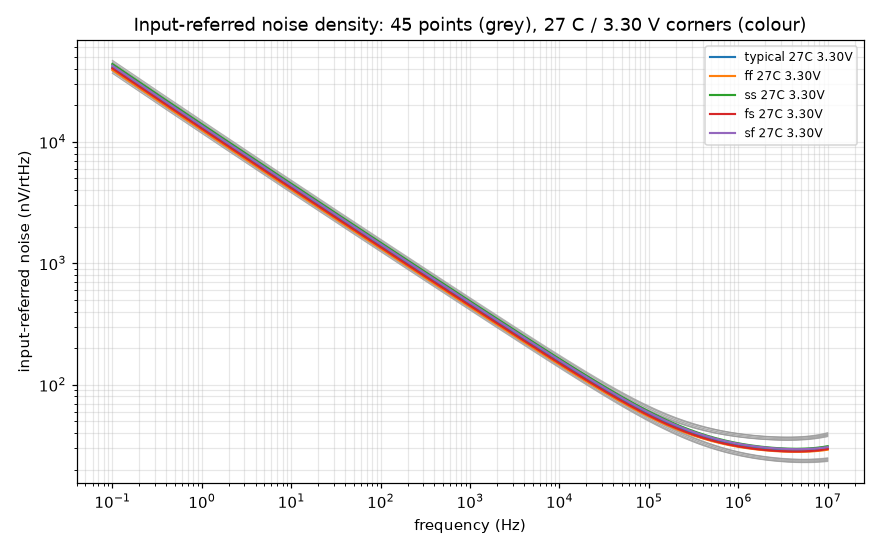
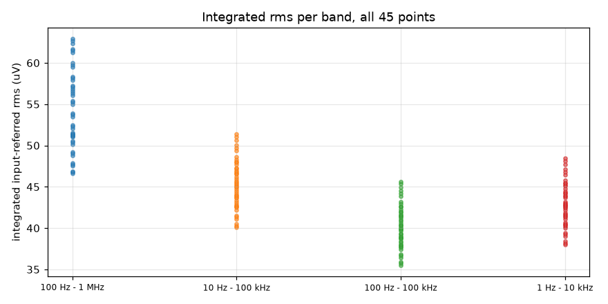

# Noise record `20261018-215228-119ceb4`

- **Date**: 2026-10-18 21:52 UTC; commit `119ceb4`; issue #46
- **DUT**: `design/netlist/opamp_two_stage.spice` (sha256 of the wrapper-normalised include `33b58dac62c747de`), unchanged
- **Measurement fingerprint**: version 1, sha256 `33de8feba00cb8e250c775f92248fa3183f2d6ca90ddf0d8c1d247715fc53b4a` over the canonical inputs retained in the 'Measurement fingerprint inputs' section (bench content, `.noise` analysis, integration bands/spot/fit settings, control settings, corner axes, model library/sections; excludes record IDs, paths and backend scheduling)
- **PDK**: gf180mcuD (open_pdks `f6eeac7dad085ffcc829ccfd721f7b4ce39edcf7`); tools: ngspice local `ngspice-42 : Circuit level simulation program`, klt `klt 0.7.1.dev2209+g176045737916`
- **Execution**: `klt sim` backend `aws-batch-fleet`, job `klt-sim-1bb404c8af99`, Spot m7i.4xlarge; runner klt `0.7.0` vs client `0.7.1.dev2209+g176045737916`
- **Request**: the 45-point grid (5 MOS corners x 3 T x 3 VDD, vcm = VDD/2) as ONE `klt sim` request, `.noise v(vout) Vcm dec 20 0.1 1e+07`, wall time 59 s (client-side)
- **Passive sections**: every corner uses `res_typical` + `mimcap_typical`; RZ/CC passive spread is NOT swept.

## Claim

**Measured, no pass or fail verdict: the row's bound is not ratified** (DR-3 residual (e1)); neither is the integration band. The bands below are candidates so the choice can be argued from data. `spec/target-spec.md` is untouched.

## Flicker (1/f) noise is modelled and visible

**Not thermal-only.** The 1/f term exceeds the thermal floor by >= 10x at 1 Hz at all 45 points; the fitted 1/f corner and floor are reported below. A figure rated against the row may therefore use the flicker-inclusive numbers.

### Model audit (pinned library, read by the driver)

- Library `sm141064.ngspice`, open_pdks `f6eeac7dad085ffcc829ccfd721f7b4ce39edcf7`; `fnoicor = unknown` in `design.ngspice` (0 = as-extracted, 1 = worst-case flicker).
- Corner sections that pull in `.lib noise_corner`: `typical` yes, `ff` yes, `ss` yes, `fs` yes, `sf` yes.

| model | .model cards | fnoimod | ef | noia | noib | noic |
|---|---|---|---|---|---|---|
| `nfet_03v3` | 192 | 1 | 0.95 | 'nfet_03v3_noia' | 'nfet_03v3_noib' | 'nfet_03v3_noic' |
| `pfet_03v3` | 192 | 1 | 1.12 | 'pfet_03v3_noia' | 'pfet_03v3_noib' | 'pfet_03v3_noic' |

`fnoimod = 1` selects the BSIM4 unified flicker model (`noia/noib/noic`, exponent `ef`), so MOS flicker noise is part of every `.noise` run; thermal noise is on by default and the resistor RZ contributes thermal noise only.

## Nominal point (typical, 27 C, 3.30 V)

| quantity | value |
|---|---|
| density @ 10 Hz | 4274.60 nV/rtHz |
| density @ 100 Hz | 1397.48 nV/rtHz |
| density @ 1000 Hz | 460.81 nV/rtHz |
| density @ 10000 Hz | 154.62 nV/rtHz |
| density @ 100000 Hz | 57.32 nV/rtHz |
| rms 100 Hz - 1 MHz | 53.727 uV |
| rms 10 Hz - 100 kHz | 45.224 uV |
| rms 100 Hz - 100 kHz | 40.135 uV |
| rms 1 Hz - 10 kHz | 42.771 uV |
| thermal floor | 27.67 nV/rtHz |
| 1/f corner | 342.1 kHz |

## Spot densities (nV/rtHz, input-referred) -- all points

| point | 10 Hz | 100 Hz | 1000 Hz | 10000 Hz | 100000 Hz |
|---|---|---|---|---|---|
| ff / -40 C / 2.97 V | 3794.47 | 1241.51 | 409.51 | 137.11 | 49.87 |
| ff / -40 C / 3.30 V | 3815.43 | 1248.85 | 412.04 | 137.94 | 50.07 |
| ff / -40 C / 3.63 V | 3833.90 | 1255.33 | 414.27 | 138.67 | 50.25 |
| ff / 27 C / 2.97 V | 4019.32 | 1313.52 | 433.06 | 145.46 | 54.39 |
| ff / 27 C / 3.30 V | 4044.22 | 1322.17 | 436.02 | 146.43 | 54.61 |
| ff / 27 C / 3.63 V | 4066.31 | 1329.84 | 438.64 | 147.29 | 54.81 |
| ff / 125 C / 2.97 V | 4266.79 | 1391.82 | 458.53 | 154.78 | 60.16 |
| ff / 125 C / 3.30 V | 4294.05 | 1401.24 | 461.74 | 155.82 | 60.39 |
| ff / 125 C / 3.63 V | 4318.44 | 1409.66 | 464.61 | 156.75 | 60.60 |
| fs / -40 C / 2.97 V | 3899.53 | 1274.58 | 420.08 | 140.50 | 50.91 |
| fs / -40 C / 3.30 V | 3922.62 | 1282.68 | 422.87 | 141.42 | 51.13 |
| fs / -40 C / 3.63 V | 3942.93 | 1289.81 | 425.33 | 142.24 | 51.33 |
| fs / 27 C / 2.97 V | 4133.64 | 1349.63 | 444.63 | 149.17 | 55.50 |
| fs / 27 C / 3.30 V | 4160.98 | 1359.14 | 447.88 | 150.24 | 55.75 |
| fs / 27 C / 3.63 V | 4185.16 | 1367.55 | 450.77 | 151.19 | 55.98 |
| fs / 125 C / 2.97 V | 4391.15 | 1431.22 | 471.18 | 158.82 | 61.34 |
| fs / 125 C / 3.30 V | 4421.14 | 1441.59 | 474.71 | 159.98 | 61.60 |
| fs / 125 C / 3.63 V | 4447.87 | 1450.84 | 477.87 | 161.00 | 61.83 |
| sf / -40 C / 2.97 V | 4108.33 | 1344.84 | 443.71 | 148.49 | 53.74 |
| sf / -40 C / 3.30 V | 4134.53 | 1353.98 | 446.85 | 149.53 | 54.00 |
| sf / -40 C / 3.63 V | 4157.36 | 1361.95 | 449.59 | 150.43 | 54.22 |
| sf / 27 C / 2.97 V | 4361.45 | 1426.23 | 470.39 | 157.89 | 58.63 |
| sf / 27 C / 3.30 V | 4392.86 | 1437.10 | 474.10 | 159.11 | 58.93 |
| sf / 27 C / 3.63 V | 4420.45 | 1446.64 | 477.36 | 160.18 | 59.19 |
| sf / 125 C / 2.97 V | 4643.70 | 1516.01 | 499.67 | 168.49 | 64.89 |
| sf / 125 C / 3.30 V | 4678.33 | 1527.93 | 503.72 | 169.81 | 65.20 |
| sf / 125 C / 3.63 V | 4709.05 | 1538.51 | 507.32 | 170.98 | 65.47 |
| ss / -40 C / 2.97 V | 4218.51 | 1379.12 | 454.57 | 151.96 | 54.80 |
| ss / -40 C / 3.30 V | 4246.95 | 1389.05 | 457.99 | 153.09 | 55.09 |
| ss / -40 C / 3.63 V | 4271.78 | 1397.74 | 460.98 | 154.08 | 55.34 |
| ss / 27 C / 2.97 V | 4482.30 | 1463.97 | 482.38 | 161.72 | 59.78 |
| ss / 27 C / 3.30 V | 4516.33 | 1475.76 | 486.40 | 163.05 | 60.11 |
| ss / 27 C / 3.63 V | 4546.21 | 1486.12 | 489.95 | 164.21 | 60.41 |
| ss / 125 C / 2.97 V | 4776.63 | 1557.68 | 512.94 | 172.72 | 66.13 |
| ss / 125 C / 3.30 V | 4814.26 | 1570.65 | 517.35 | 174.16 | 66.48 |
| ss / 125 C / 3.63 V | 4847.58 | 1582.14 | 521.27 | 175.44 | 66.78 |
| typical / -40 C / 2.97 V | 4002.39 | 1309.32 | 431.80 | 144.46 | 52.31 |
| typical / -40 C / 3.30 V | 4026.87 | 1317.88 | 434.74 | 145.44 | 52.55 |
| typical / -40 C / 3.63 V | 4048.39 | 1325.42 | 437.33 | 146.30 | 52.76 |
| typical / 27 C / 2.97 V | 4245.43 | 1387.36 | 457.35 | 153.48 | 57.04 |
| typical / 27 C / 3.30 V | 4274.60 | 1397.48 | 460.81 | 154.62 | 57.32 |
| typical / 27 C / 3.63 V | 4300.39 | 1406.43 | 463.87 | 155.63 | 57.56 |
| typical / 125 C / 2.97 V | 4514.52 | 1472.80 | 485.19 | 163.58 | 63.08 |
| typical / 125 C / 3.30 V | 4546.60 | 1483.86 | 488.95 | 164.81 | 63.37 |
| typical / 125 C / 3.63 V | 4575.20 | 1493.73 | 492.32 | 165.90 | 63.62 |

## Integrated input-referred rms (uV) -- all points

Exact piecewise power-law integration of density^2 between sweep points.

| point | 100 Hz - 1 MHz | 10 Hz - 100 kHz | 100 Hz - 100 kHz | 1 Hz - 10 kHz |
|---|---|---|---|---|
| ff / -40 C / 2.97 V | 46.586 | 40.061 | 35.529 | 37.981 |
| ff / -40 C / 3.30 V | 46.749 | 40.293 | 35.735 | 38.203 |
| ff / -40 C / 3.63 V | 46.891 | 40.498 | 35.917 | 38.398 |
| ff / 27 C / 2.97 V | 51.056 | 42.564 | 37.786 | 40.209 |
| ff / 27 C / 3.30 V | 51.242 | 42.835 | 38.027 | 40.471 |
| ff / 27 C / 3.63 V | 51.404 | 43.076 | 38.239 | 40.702 |
| ff / 125 C / 2.97 V | 56.852 | 45.391 | 40.355 | 42.647 |
| ff / 125 C / 3.30 V | 57.038 | 45.682 | 40.612 | 42.932 |
| ff / 125 C / 3.63 V | 57.201 | 45.943 | 40.842 | 43.186 |
| fs / -40 C / 2.97 V | 47.540 | 41.073 | 36.408 | 38.994 |
| fs / -40 C / 3.30 V | 47.727 | 41.330 | 36.637 | 39.238 |
| fs / -40 C / 3.63 V | 47.890 | 41.557 | 36.839 | 39.454 |
| fs / 27 C / 2.97 V | 52.076 | 43.668 | 38.746 | 41.314 |
| fs / 27 C / 3.30 V | 52.288 | 43.967 | 39.011 | 41.601 |
| fs / 27 C / 3.63 V | 52.473 | 44.232 | 39.246 | 41.856 |
| fs / 125 C / 2.97 V | 57.930 | 46.591 | 41.398 | 43.852 |
| fs / 125 C / 3.30 V | 58.142 | 46.913 | 41.682 | 44.165 |
| fs / 125 C / 3.63 V | 58.329 | 47.200 | 41.936 | 44.444 |
| sf / -40 C / 2.97 V | 50.143 | 43.369 | 38.459 | 41.136 |
| sf / -40 C / 3.30 V | 50.358 | 43.659 | 38.716 | 41.413 |
| sf / -40 C / 3.63 V | 50.544 | 43.912 | 38.941 | 41.654 |
| sf / 27 C / 2.97 V | 54.965 | 46.176 | 40.986 | 43.651 |
| sf / 27 C / 3.30 V | 55.216 | 46.518 | 41.289 | 43.980 |
| sf / 27 C / 3.63 V | 55.434 | 46.818 | 41.556 | 44.268 |
| sf / 125 C / 2.97 V | 61.218 | 49.375 | 43.886 | 46.440 |
| sf / 125 C / 3.30 V | 61.475 | 49.746 | 44.214 | 46.800 |
| sf / 125 C / 3.63 V | 61.701 | 50.075 | 44.505 | 47.120 |
| ss / -40 C / 2.97 V | 51.130 | 44.411 | 39.361 | 42.187 |
| ss / -40 C / 3.30 V | 51.370 | 44.728 | 39.643 | 42.488 |
| ss / -40 C / 3.63 V | 51.580 | 45.004 | 39.889 | 42.751 |
| ss / 27 C / 2.97 V | 56.032 | 47.323 | 41.979 | 44.807 |
| ss / 27 C / 3.30 V | 56.310 | 47.695 | 42.310 | 45.164 |
| ss / 27 C / 3.63 V | 56.553 | 48.022 | 42.600 | 45.477 |
| ss / 125 C / 2.97 V | 62.362 | 50.637 | 44.980 | 47.715 |
| ss / 125 C / 3.30 V | 62.648 | 51.043 | 45.338 | 48.108 |
| ss / 125 C / 3.63 V | 62.901 | 51.402 | 45.656 | 48.455 |
| typical / -40 C / 2.97 V | 48.825 | 42.211 | 37.425 | 40.053 |
| typical / -40 C / 3.30 V | 49.025 | 42.482 | 37.667 | 40.311 |
| typical / -40 C / 3.63 V | 49.199 | 42.721 | 37.879 | 40.539 |
| typical / 27 C / 2.97 V | 53.497 | 44.906 | 39.852 | 42.465 |
| typical / 27 C / 3.30 V | 53.727 | 45.224 | 40.135 | 42.771 |
| typical / 27 C / 3.63 V | 53.928 | 45.506 | 40.384 | 43.041 |
| typical / 125 C / 2.97 V | 59.540 | 47.958 | 42.621 | 45.120 |
| typical / 125 C / 3.30 V | 59.773 | 48.302 | 42.925 | 45.455 |
| typical / 125 C / 3.63 V | 59.978 | 48.609 | 43.196 | 45.753 |

Spread across the grid (min .. max):

- 100 Hz - 1 MHz: 46.586 uV (ff / -40 C / 2.97 V) .. 62.901 uV (ss / 125 C / 3.63 V); max/min = 1.35
- 10 Hz - 100 kHz: 40.061 uV (ff / -40 C / 2.97 V) .. 51.402 uV (ss / 125 C / 3.63 V); max/min = 1.28
- 100 Hz - 100 kHz: 35.529 uV (ff / -40 C / 2.97 V) .. 45.656 uV (ss / 125 C / 3.63 V); max/min = 1.29
- 1 Hz - 10 kHz: 37.981 uV (ff / -40 C / 2.97 V) .. 48.455 uV (ss / 125 C / 3.63 V); max/min = 1.28

## Thermal floor and 1/f corner

Method: least-squares fit of S(f) = Sw + K / f^a to the density^2 over 1 Hz - 1e+07 Hz with relative-error weights (exponent `a` scanned 0.5..1.5, step 0.005, Sw and K from linear least squares). Thermal floor = sqrt(Sw); corner = (K/Sw)^(1/a), where the 1/f power equals the thermal power. A fit is reported only when its rms relative residual of S is <= 5%.

| point | floor (nV/rtHz) | corner (kHz) | a | K/Sw at 1 Hz | fit resid |
|---|---|---|---|---|---|
| ff / -40 C / 2.97 V | 22.01 | 430.8 | 0.965 | 2.74e+05 | 1.51% |
| ff / -40 C / 3.30 V | 21.86 | 442.3 | 0.965 | 2.81e+05 | 1.48% |
| ff / -40 C / 3.63 V | 21.72 | 453.1 | 0.965 | 2.87e+05 | 1.46% |
| ff / 27 C / 2.97 V | 27.28 | 298.9 | 0.970 | 2.05e+05 | 1.94% |
| ff / 27 C / 3.30 V | 26.95 | 322.1 | 0.965 | 2.07e+05 | 1.92% |
| ff / 27 C / 3.63 V | 26.82 | 329.4 | 0.965 | 2.11e+05 | 1.90% |
| ff / 125 C / 2.97 V | 34.21 | 210.7 | 0.970 | 1.46e+05 | 2.41% |
| ff / 125 C / 3.30 V | 34.07 | 215.4 | 0.970 | 1.49e+05 | 2.40% |
| ff / 125 C / 3.63 V | 33.95 | 219.8 | 0.970 | 1.52e+05 | 2.41% |
| fs / -40 C / 2.97 V | 22.10 | 450.8 | 0.965 | 2.86e+05 | 1.73% |
| fs / -40 C / 3.30 V | 21.95 | 463.5 | 0.965 | 2.94e+05 | 1.69% |
| fs / -40 C / 3.63 V | 21.80 | 475.3 | 0.965 | 3.01e+05 | 1.66% |
| fs / 27 C / 2.97 V | 27.41 | 312.8 | 0.970 | 2.14e+05 | 2.09% |
| fs / 27 C / 3.30 V | 27.26 | 321.0 | 0.970 | 2.19e+05 | 2.10% |
| fs / 27 C / 3.63 V | 27.13 | 328.5 | 0.970 | 2.24e+05 | 2.12% |
| fs / 125 C / 2.97 V | 34.39 | 220.7 | 0.970 | 1.53e+05 | 2.70% |
| fs / 125 C / 3.30 V | 34.25 | 225.9 | 0.970 | 1.56e+05 | 2.69% |
| fs / 125 C / 3.63 V | 34.12 | 230.8 | 0.970 | 1.59e+05 | 2.68% |
| sf / -40 C / 2.97 V | 23.10 | 460.1 | 0.965 | 2.91e+05 | 1.49% |
| sf / -40 C / 3.30 V | 22.93 | 473.6 | 0.965 | 3e+05 | 1.47% |
| sf / -40 C / 3.63 V | 22.78 | 486.0 | 0.965 | 3.07e+05 | 1.46% |
| sf / 27 C / 2.97 V | 28.45 | 336.8 | 0.965 | 2.16e+05 | 1.93% |
| sf / 27 C / 3.30 V | 28.30 | 346.1 | 0.965 | 2.21e+05 | 1.90% |
| sf / 27 C / 3.63 V | 28.16 | 354.6 | 0.965 | 2.27e+05 | 1.87% |
| sf / 125 C / 2.97 V | 35.98 | 226.5 | 0.970 | 1.56e+05 | 2.43% |
| sf / 125 C / 3.30 V | 35.84 | 232.1 | 0.970 | 1.6e+05 | 2.44% |
| sf / 125 C / 3.63 V | 35.71 | 237.3 | 0.970 | 1.64e+05 | 2.44% |
| ss / -40 C / 2.97 V | 23.21 | 479.6 | 0.965 | 3.03e+05 | 1.73% |
| ss / -40 C / 3.30 V | 23.04 | 494.4 | 0.965 | 3.12e+05 | 1.69% |
| ss / -40 C / 3.63 V | 22.88 | 508.0 | 0.965 | 3.21e+05 | 1.66% |
| ss / 27 C / 2.97 V | 28.80 | 334.1 | 0.970 | 2.28e+05 | 2.13% |
| ss / 27 C / 3.30 V | 28.64 | 343.6 | 0.970 | 2.34e+05 | 2.14% |
| ss / 27 C / 3.63 V | 28.29 | 371.1 | 0.965 | 2.37e+05 | 2.16% |
| ss / 125 C / 2.97 V | 36.19 | 236.6 | 0.970 | 1.63e+05 | 2.71% |
| ss / 125 C / 3.30 V | 36.04 | 242.8 | 0.970 | 1.67e+05 | 2.71% |
| ss / 125 C / 3.63 V | 35.89 | 248.6 | 0.970 | 1.71e+05 | 2.71% |
| typical / -40 C / 2.97 V | 22.58 | 456.0 | 0.965 | 2.89e+05 | 1.60% |
| typical / -40 C / 3.30 V | 22.42 | 469.0 | 0.965 | 2.97e+05 | 1.57% |
| typical / -40 C / 3.63 V | 22.28 | 481.2 | 0.965 | 3.04e+05 | 1.54% |
| typical / 27 C / 2.97 V | 28.01 | 316.8 | 0.970 | 2.17e+05 | 2.04% |
| typical / 27 C / 3.30 V | 27.67 | 342.1 | 0.965 | 2.19e+05 | 2.04% |
| typical / 27 C / 3.63 V | 27.53 | 350.4 | 0.965 | 2.24e+05 | 2.01% |
| typical / 125 C / 2.97 V | 35.16 | 223.7 | 0.970 | 1.55e+05 | 2.55% |
| typical / 125 C / 3.30 V | 35.02 | 229.1 | 0.970 | 1.58e+05 | 2.55% |
| typical / 125 C / 3.63 V | 34.89 | 234.2 | 0.970 | 1.62e+05 | 2.55% |

Over 45 fitted points: floor 21.72 .. 36.19 nV/rtHz; corner 210.7 .. 508.0 kHz.

## Extraction validation

- **Output total**: our integral of `onoise_spectrum` vs ngspice `onoise_total` (printed in each point's log): max |dev| = 0.000% (tolerance 0.5%).
- **Input total**: our integral of `inoise_spectrum` vs ngspice `inoise_total`: -5.18% .. -4.70% at 20 pts/dec (tolerance 8%). ngspice integrates the input-referred total with a rule that depends on the sweep density; it converges to our value when the sweep is refined (dense control below), so our integral is the reported one.
- **Input reference**: 20 log10(onoise/inoise) from the noise run vs the gain bench's committed |vout/vdiff| (`sim/gain-gbw-pm/corners/20261018-060639-afc17a1`) at the same frequencies, all 45 points: max deviation 0.0000 dB (tolerance 0.05 dB). The noise is therefore referred to the differential input with the loop open, as in the gain bench.
- **Sweep**: 20 points/decade over 0.1 Hz - 1e+07 Hz (161 points); every band edge lies on or is log-log interpolated between sweep points.

### Controls (local single units, nominal point)

- **Dense sweep** (200 pts/dec): 100 Hz - 1 MHz rms 53.7233 uV vs 53.7266 uV on the grid (-0.006%); our full-range integral vs ngspice `inoise_total`: -0.500% (grid: -4.92%).
- **Isolation** `nominal point, Lfb = Cfb = 1e+08`: max spot-density change 0.000%, 100 Hz - 1 MHz rms change +0.000%.
- **Isolation** `nominal point, Lfb = Cfb = 1e+10`: max spot-density change 0.000%, 100 Hz - 1 MHz rms change -0.000%.

## Reproduce

```
python3 sim/noise/run_noise.py            # full grid + a new record
python3 sim/noise/run_noise.py --smoke    # one nominal local point
```

Evidence: `corners/20261018-215228-119ceb4/` (per point `.dat` = freq, inoise, onoise; ngspice `.log` with the integrated totals; klt-generated `.cir` deck), `netlist-snapshots/20261018-215228-119ceb4.spice`.

## Measurement fingerprint inputs

Canonical JSON (sorted keys, compact separators); its sha256 is the fingerprint in the header. Recompute with `sim/noise/measurement_config.py`.

```json
{"analysis":{"args":"v(vout) Vcm dec 20 0.1 1e+07\nprint noise2.inoise_total noise2.onoise_total\nsetplot noise1","kind":"noise"},"bands":{"fit_hz":[1.0,10000000.0],"integration":[["100 Hz - 1 MHz",100.0,1000000.0],["10 Hz - 100 kHz",10.0,100000.0],["100 Hz - 100 kHz",100.0,100000.0],["1 Hz - 10 kHz",1.0,10000.0]],"primary":"100 Hz - 1 MHz","spot_hz":[10.0,100.0,1000.0,10000.0,100000.0]},"bench":[".include 'design.ngspice'",".include 'opamp_two_stage.dut.spice'",".param lfb=1e9 cfb=1e9","vdd vdd 0 dc 3.3","vcm vinp 0 dc 1.65 ac 1","ibias vdd ibias dc 10u","xdut vdd 0 vinp vinn vout ibias opamp_two_stage","lfb vout vinn {lfb}","cfb vinn 0 {cfb}","cl vout 0 2p"],"controls":{"dense_ppd":200,"isolation_lfb_cfb":[100000000.0,10000000000.0]},"corners":{"passive_sections":["res_typical","mimcap_typical"],"process":["typical","ff","ss","fs","sf"],"supply_v":[2.97,3.3,3.63],"temperature_c":[-40.0,27.0,125.0],"vcm_rule":"vdd/2"},"experiment":"noise","fingerprint_version":1,"models":{"lib":"libs.tech/ngspice/sm141064.ngspice","pdk_variant":"gf180mcuD"}}
```




## Stored evidence

The per-corner bytes of this run are in the fleet artifact store, not in git (issue #271). Manifest: `manifests/artifacts/noise-20261018-215228-119ceb4.manifest.json` (97 objects, 85549 B). Paths cited above are the manifest `name`s. Fetch one, hash-verified, with `klt artifact get <manifest>#<name> -o <out>`; check them all with `klt artifact verify <manifest>`.

| name | size (B) | sha256 |
|---|---:|---|
| `sim/noise/corners/20261018-215228-119ceb4/controls/dense.cir` | 604 | `5b19fda43a70a38d2c04cc207dbf3c192132499db8f360c16b1ee1c24c9acc06` |
| `sim/noise/corners/20261018-215228-119ceb4/controls/dense.log` | 421 | `6d1eabd1f16a2d10762aaedaf0054551b757059bfc68a5e42d3d0ba6ffa21312` |
| `sim/noise/corners/20261018-215228-119ceb4/controls/iso_lfb1e+08.cir` | 617 | `702b63482c0c53fcfc16c21a265ef25133e77de0cb7c8def132e2cc34296ff89` |
| `sim/noise/corners/20261018-215228-119ceb4/controls/iso_lfb1e+08.log` | 427 | `7083c41f3c3e68e45086281c59f000d2a5ecf423f3d259e8578c600e852e1320` |
| `sim/noise/corners/20261018-215228-119ceb4/controls/iso_lfb1e+10.cir` | 617 | `8214f13f200ace05b4fb6f54893100656b7f63499a6a22cfd583a446b2f4ac46` |
| `sim/noise/corners/20261018-215228-119ceb4/controls/iso_lfb1e+10.log` | 427 | `eae319688f3431c26f10f421430556c6f9faa5ad30f3d6cf78fd9d7768cd68e4` |
| `sim/noise/corners/20261018-215228-119ceb4/ff_-40c_2.97v.cir` | 639 | `1fd830a8ed60b8d2f7a29aa523328fe540bf1b77d55f24963965a4042076bc1a` |
| `sim/noise/corners/20261018-215228-119ceb4/ff_-40c_2.97v.log` | 443 | `aa6c4522165b9fcf014d58e4051400952e38b74072f58d02d3048ea5028c53cb` |
| `sim/noise/corners/20261018-215228-119ceb4/ff_-40c_3.30v.cir` | 637 | `eafb5c94335fe5d2a34398af36a2152fa1003d028a5c3053f04821de466a4a2a` |
| `sim/noise/corners/20261018-215228-119ceb4/ff_-40c_3.30v.log` | 443 | `0971786e49fe5961aacd2c6d9a2eff70109a5e8f93a8980c23695eafbc7fd5b4` |
| `sim/noise/corners/20261018-215228-119ceb4/ff_-40c_3.63v.cir` | 639 | `714199609db814a2848b5f50082abb42f526fc9898a8075a84ad509bf7bc0543` |
| `sim/noise/corners/20261018-215228-119ceb4/ff_-40c_3.63v.log` | 443 | `fbad554c5e12f62798dda484ed46070d3418537e462afad9e08057a31f5ac697` |
| `sim/noise/corners/20261018-215228-119ceb4/ff_125c_2.97v.cir` | 639 | `5686d0af153f6fcfddaf666d4dc566df0f735535b706533130a65a15effaa95b` |
| `sim/noise/corners/20261018-215228-119ceb4/ff_125c_2.97v.log` | 518 | `4da0df5bc904629f104bc35b725dfb9bc7b2063a734170afdd4c15b45f20139e` |
| `sim/noise/corners/20261018-215228-119ceb4/ff_125c_3.30v.cir` | 637 | `925efac29451e7037b48f5bfcd90f94d2e0f9fed1e5b0e241ddfc68dfd5ae1eb` |
| `sim/noise/corners/20261018-215228-119ceb4/ff_125c_3.30v.log` | 443 | `c74189f5284a0bb5136453fd834a7457f2d2344a8e22fd315420d946199d55b8` |
| `sim/noise/corners/20261018-215228-119ceb4/ff_125c_3.63v.cir` | 639 | `e6fc247f9d91638fd9e8d0204e6ef1891897dccf8b93d4b2d6210cf02de4978c` |
| `sim/noise/corners/20261018-215228-119ceb4/ff_125c_3.63v.log` | 518 | `a572713aa29b43cfcb76a0dd08f77d09273697280466fa416d3a935634096fc4` |
| `sim/noise/corners/20261018-215228-119ceb4/ff_27c_2.97v.cir` | 637 | `a803cd61511b848423d0c9e79ac8bac498988799c8ac24cdf9adf64a9a8c24b1` |
| `sim/noise/corners/20261018-215228-119ceb4/ff_27c_2.97v.log` | 516 | `dcb3c5ad9e0edc802efb8eacc81c5f4218ee53ec20784c3e5e5e89171060a125` |
| `sim/noise/corners/20261018-215228-119ceb4/ff_27c_3.30v.cir` | 635 | `f98664332f7e76e2dbd72701b5c766ce77e25cb8dd1988afc7fb84860804790c` |
| `sim/noise/corners/20261018-215228-119ceb4/ff_27c_3.30v.log` | 441 | `7f19ed868b6c487e94665f4f1363fdcc83e6a1844276d81d0fb9129cca29fd4b` |
| `sim/noise/corners/20261018-215228-119ceb4/ff_27c_3.63v.cir` | 637 | `b3e260f44c3a9ac53fbb99702590cc8506bd658b09b957db8c97108cf8f6243f` |
| `sim/noise/corners/20261018-215228-119ceb4/ff_27c_3.63v.log` | 516 | `d61ff7182ca06823cd66bbb7b02081e305b8dcb5abd412dc0ae21b9595eb13b3` |
| `sim/noise/corners/20261018-215228-119ceb4/fs_-40c_2.97v.cir` | 639 | `22f5dd06697ab4e32269ebdbb39380c12ac3a8c9c57fadc77455453035e72b95` |
| `sim/noise/corners/20261018-215228-119ceb4/fs_-40c_2.97v.log` | 443 | `f60388b6bf8c5afb4acc982c30701edbb3ff525bc3bcc5810bb720461a0e2ecc` |
| `sim/noise/corners/20261018-215228-119ceb4/fs_-40c_3.30v.cir` | 637 | `8d18ea54e7521ff94848d4004a6a259ff0ab829880cdb7458c0c3db8ca6341a1` |
| `sim/noise/corners/20261018-215228-119ceb4/fs_-40c_3.30v.log` | 443 | `8756520220c5f33bc446de6338ef2a6918c77fa6e48b015582d6b7a02289b613` |
| `sim/noise/corners/20261018-215228-119ceb4/fs_-40c_3.63v.cir` | 639 | `8d12479d4d9a9ed9bc6412cb542f1bb5c8b0f9804b40b51cdd256b3581222009` |
| `sim/noise/corners/20261018-215228-119ceb4/fs_-40c_3.63v.log` | 443 | `ee5f9374a798d3c7a9a8acce97745f5f3ebfc23c15bf1d961cdecd8988e9a359` |
| `sim/noise/corners/20261018-215228-119ceb4/fs_125c_2.97v.cir` | 639 | `46dc808d18b1a57c5882d2f20d5e402d1571627525967d180d9e7f323f8005f1` |
| `sim/noise/corners/20261018-215228-119ceb4/fs_125c_2.97v.log` | 518 | `f760f8250865d95adb8ae2776ba8b36a642525f915640b33aef68a9d37756d25` |
| `sim/noise/corners/20261018-215228-119ceb4/fs_125c_3.30v.cir` | 637 | `6a07add71d7da18264a31045a1b65c8ace22980336629e59f358e1ac4202de33` |
| `sim/noise/corners/20261018-215228-119ceb4/fs_125c_3.30v.log` | 443 | `da5a3d5b30f67c3af7fe66d87a4f3e36322ce148cbb0b1b6e77e8a891db422a1` |
| `sim/noise/corners/20261018-215228-119ceb4/fs_125c_3.63v.cir` | 639 | `9ebfd7ade9135171784f8e532a5fc4b41e47724ebfe253c2d7c5fe44603a74e0` |
| `sim/noise/corners/20261018-215228-119ceb4/fs_125c_3.63v.log` | 518 | `dad47ecd2b2beed7b7ea0dcf707a0c754ff28e685611f463154444346d5febdf` |
| `sim/noise/corners/20261018-215228-119ceb4/fs_27c_2.97v.cir` | 637 | `b1adb56e4bee25569d57b69c87eee6d084359aa0bd110f5fa8222a1b2f1dad51` |
| `sim/noise/corners/20261018-215228-119ceb4/fs_27c_2.97v.log` | 441 | `bf851627381abf3a992e4556a3f303e415b7cb33650597953b1e22ed7d3777d6` |
| `sim/noise/corners/20261018-215228-119ceb4/fs_27c_3.30v.cir` | 635 | `f61d1b400031fc6ec2c1a29b2f131997ec8939b65723d405fe56d424679a1ccc` |
| `sim/noise/corners/20261018-215228-119ceb4/fs_27c_3.30v.log` | 441 | `2e1016f81a812395f3a2d724c81eec8ca15ce11b2b874847bb73cf2eb03fb74b` |
| `sim/noise/corners/20261018-215228-119ceb4/fs_27c_3.63v.cir` | 637 | `889889343e5e6af746c25c89ad707dfcf57f9ae80dcf256be999a43524149fcf` |
| `sim/noise/corners/20261018-215228-119ceb4/fs_27c_3.63v.log` | 516 | `aa56ea1ae227484571a64a2b7b854b2bc6cdc87aef8a46556fce8c8708f564e8` |
| `sim/noise/corners/20261018-215228-119ceb4/klt-report.json` | 32351 | `93c9a9400d309577bd08644bd2a6bd9abb09258b1d94abb6186800325c3225dc` |
| `sim/noise/corners/20261018-215228-119ceb4/sf_-40c_2.97v.cir` | 639 | `8face69ea43247a2ea41226cd25244e8117052fcc1e7fedbf555d615ac7e312b` |
| `sim/noise/corners/20261018-215228-119ceb4/sf_-40c_2.97v.log` | 443 | `a3fcfd228b5361bba8b76dfc03697af589205206dba3b45b92364ea8e5c9e42b` |
| `sim/noise/corners/20261018-215228-119ceb4/sf_-40c_3.30v.cir` | 637 | `f945d70c02208d452633ee65d1b068d7e042df9136e5d21051761204721986e2` |
| `sim/noise/corners/20261018-215228-119ceb4/sf_-40c_3.30v.log` | 443 | `2c04f163c3bc82fea27ec9ce7c059496a6d250c1e2accf4f4f3b5dd9f35b9ee7` |
| `sim/noise/corners/20261018-215228-119ceb4/sf_-40c_3.63v.cir` | 639 | `f068d9169f2b2a9eb41e73fa2f7580a7cbd67a155dc0d50a2b2b082ff8aedaf5` |
| `sim/noise/corners/20261018-215228-119ceb4/sf_-40c_3.63v.log` | 443 | `823a457d62b661e5866ef6914439aed39794c1544c953d875d7d26675dccb347` |
| `sim/noise/corners/20261018-215228-119ceb4/sf_125c_2.97v.cir` | 639 | `965030406fe7104b30fc7b667bf42805e2da8bc078f98d2fd1530974ca9c4203` |
| `sim/noise/corners/20261018-215228-119ceb4/sf_125c_2.97v.log` | 518 | `f21ac076b4d81378c1ad507036f9fad9649fa59b5cbc526997df4b12b3639500` |
| `sim/noise/corners/20261018-215228-119ceb4/sf_125c_3.30v.cir` | 637 | `bc08d6456454cdf883c829e7382cacb4c3834808636711730c33d62b35b60f78` |
| `sim/noise/corners/20261018-215228-119ceb4/sf_125c_3.30v.log` | 443 | `91cfcb59adf89719717010f6d004ee70a1ad223a22084d95714436f10e673db6` |
| `sim/noise/corners/20261018-215228-119ceb4/sf_125c_3.63v.cir` | 639 | `038f0353d29f2b244beeae4a426913be0cbe27756aaaec1a6c2e1925b4cda00a` |
| `sim/noise/corners/20261018-215228-119ceb4/sf_125c_3.63v.log` | 518 | `6de848aede2b8a2fe69c008779dde05f9050c22f003f9a7768d4822ec4711309` |
| `sim/noise/corners/20261018-215228-119ceb4/sf_27c_2.97v.cir` | 637 | `042bcea4e21b3e06554271e13e88c3d293ac4aa0bce14ab10421cdbe3a073cda` |
| `sim/noise/corners/20261018-215228-119ceb4/sf_27c_2.97v.log` | 516 | `f1960424e26828e688bd2de727db90405c7c2aea7a7a9354d670ed4784f87e23` |
| `sim/noise/corners/20261018-215228-119ceb4/sf_27c_3.30v.cir` | 635 | `a9d0d1ac93af86736b72b41ee7ad4686cd9cd794d2ee5aaa88b6caba3f59d064` |
| `sim/noise/corners/20261018-215228-119ceb4/sf_27c_3.30v.log` | 516 | `a041e800f370cca32fe1b749b2514fd7c435792aea8fe9f63fa8efe8c4599b67` |
| `sim/noise/corners/20261018-215228-119ceb4/sf_27c_3.63v.cir` | 637 | `3c1d381bbc6b569db9c2264e65e4196d70c83462dda187d719ffa0bc31c94f19` |
| `sim/noise/corners/20261018-215228-119ceb4/sf_27c_3.63v.log` | 516 | `23537b28f7ade0aa1372a6d317d4fed89b7ef8329a34498736f0be8c898d7267` |
| `sim/noise/corners/20261018-215228-119ceb4/ss_-40c_2.97v.cir` | 639 | `49480d5fa82aef6575001fd15deee1b1aafb1088fa122fa873f8c8f7576b3143` |
| `sim/noise/corners/20261018-215228-119ceb4/ss_-40c_2.97v.log` | 518 | `f7e24c28e8c9f02342e7f307868e502b5cb821355193c259930b937e249f9030` |
| `sim/noise/corners/20261018-215228-119ceb4/ss_-40c_3.30v.cir` | 637 | `68859606ec8cafb9b6165715673ea2d45e071c817e4bcbad6947a3266a806705` |
| `sim/noise/corners/20261018-215228-119ceb4/ss_-40c_3.30v.log` | 443 | `ed3821a60681fbee1a3a6a348a6863fceed187236bf20cd51acc1883731815e2` |
| `sim/noise/corners/20261018-215228-119ceb4/ss_-40c_3.63v.cir` | 639 | `bc70e9a5eb5e89ae5ec076cdf93218b1d9ccbc488872871e1787f48e544f2e09` |
| `sim/noise/corners/20261018-215228-119ceb4/ss_-40c_3.63v.log` | 443 | `1a8fa75434b32509f8c0fcec480958fd12d86b940f7d9163a637cdf6bdaa8519` |
| `sim/noise/corners/20261018-215228-119ceb4/ss_125c_2.97v.cir` | 639 | `fb069cff741dfc0f26c34baf63ae603fbe23201dc7d6fb2521b7c0169fb92fdc` |
| `sim/noise/corners/20261018-215228-119ceb4/ss_125c_2.97v.log` | 443 | `2a3acca48db67bec96327f78b7395bfeb898e92a4c78c1dd214d05f8d1c72c14` |
| `sim/noise/corners/20261018-215228-119ceb4/ss_125c_3.30v.cir` | 637 | `168a2dd834a673d4ffaa0a0663c03b9f1435b993aa9d3882b48a776aa3903e09` |
| `sim/noise/corners/20261018-215228-119ceb4/ss_125c_3.30v.log` | 443 | `26ee4d469c74bf1f9df691bd2697ce9a05dc7d42458cf3a320f137cdd9e2e5e4` |
| `sim/noise/corners/20261018-215228-119ceb4/ss_125c_3.63v.cir` | 639 | `85fecaff8432aa5984b1990b8c6b7c1f59b9f786047910ee41e010dc234c026c` |
| `sim/noise/corners/20261018-215228-119ceb4/ss_125c_3.63v.log` | 518 | `7023ed5e9d5b82920e504a477a3596c18b66a94c44a214273b9ad84cdd37498e` |
| `sim/noise/corners/20261018-215228-119ceb4/ss_27c_2.97v.cir` | 637 | `459eb3125eab9203cfcf97ee223711fff4527ae0d42004aea9587753d413c761` |
| `sim/noise/corners/20261018-215228-119ceb4/ss_27c_2.97v.log` | 441 | `d2f47cd7ee056263b0c9619f10194117a010c517a63b4d3edf4dffeca06a0936` |
| `sim/noise/corners/20261018-215228-119ceb4/ss_27c_3.30v.cir` | 635 | `ae90816edb60fea36d87a252d89bde8bf0a8cd194d3e198a7bfdbff71ea887cc` |
| `sim/noise/corners/20261018-215228-119ceb4/ss_27c_3.30v.log` | 441 | `f960031cdab79ad405aaa9a1d9044c194ad552a721f62b6f15d88fb3a8dd5b7d` |
| `sim/noise/corners/20261018-215228-119ceb4/ss_27c_3.63v.cir` | 637 | `e50f32cdae64b913549a5f6a9161105cd3fb39e97792be251be6fe6df73efe80` |
| `sim/noise/corners/20261018-215228-119ceb4/ss_27c_3.63v.log` | 441 | `2c2d9dc098c10ff724d9fd017d5620710fae8695c78e200ee9baef1faf277d05` |
| `sim/noise/corners/20261018-215228-119ceb4/typical_-40c_2.97v.cir` | 649 | `068a9df066c525b91bbf17134cd20908607def9a7f64404e616883138430a6fc` |
| `sim/noise/corners/20261018-215228-119ceb4/typical_-40c_2.97v.log` | 448 | `eedf773c56fe2c512f8bd0dab8ab3f76d84e7d56bc6386226b737ed6ee19f63f` |
| `sim/noise/corners/20261018-215228-119ceb4/typical_-40c_3.30v.cir` | 647 | `a53f2985eaa970d154778671238bb4ea7940ec27a21b0e0aa191c78923ecb1d7` |
| `sim/noise/corners/20261018-215228-119ceb4/typical_-40c_3.30v.log` | 448 | `8476c00303b50a03824c74395d93f6bc822d4c54b7c7b465494106d2e8c5891f` |
| `sim/noise/corners/20261018-215228-119ceb4/typical_-40c_3.63v.cir` | 649 | `50e500286b31d60cb171560fa049c0b69638d2d746cc1c1e04cddec0f3d80e1c` |
| `sim/noise/corners/20261018-215228-119ceb4/typical_-40c_3.63v.log` | 448 | `29d21ec3cb4650d98f4f7f04dd048f9109e078917ec26151a72f298d751c5fd9` |
| `sim/noise/corners/20261018-215228-119ceb4/typical_125c_2.97v.cir` | 649 | `0db2cff2bf92bcd24031ee02608d4ce598e882edde45fc7dfd5613f324eab7ce` |
| `sim/noise/corners/20261018-215228-119ceb4/typical_125c_2.97v.log` | 523 | `7cb9c35e9cbc7566299bb6d473c0d2e285b3894e3e489973f0b0cbb8e1e280af` |
| `sim/noise/corners/20261018-215228-119ceb4/typical_125c_3.30v.cir` | 647 | `e336c5f11450c9558cc5c1bce636001e65015327cdb66d7da5827acc18ef83ce` |
| `sim/noise/corners/20261018-215228-119ceb4/typical_125c_3.30v.log` | 523 | `ed257fa27edda0cf079c40218293148c0592fb43ca18dbdbd8d60558ad82d60b` |
| `sim/noise/corners/20261018-215228-119ceb4/typical_125c_3.63v.cir` | 649 | `279e199807d8819c10fe80352b5c78a209afa7e3c651b0f021b2af6fe27ab444` |
| `sim/noise/corners/20261018-215228-119ceb4/typical_125c_3.63v.log` | 523 | `25131b21342442da8b45c8945260c6b818939bee67ea383e909f3ca33e0ca8d0` |
| `sim/noise/corners/20261018-215228-119ceb4/typical_27c_2.97v.cir` | 647 | `7decdb756902a7149dd48e96d30f055c716417824daeaf01dfe2c7dd2c93ca4f` |
| `sim/noise/corners/20261018-215228-119ceb4/typical_27c_2.97v.log` | 446 | `691fa691baf12d0fca6eb8093e4745ab0390285ad4a994cea9ba06458e1805d2` |
| `sim/noise/corners/20261018-215228-119ceb4/typical_27c_3.30v.cir` | 645 | `72d2b8328aeccdbeb0a069eef141ebb331197a6f1d0ae8c0f4683ffdc4def43e` |
| `sim/noise/corners/20261018-215228-119ceb4/typical_27c_3.30v.log` | 446 | `295ab7ee708a6a26c410e969cbed7721fd5d60aa793eec61f07391565eed6752` |
| `sim/noise/corners/20261018-215228-119ceb4/typical_27c_3.63v.cir` | 647 | `614cfbe2f0e933ea3ea7be1e818a76c5eca00dedeeefe0bed57e044980a06b85` |
| `sim/noise/corners/20261018-215228-119ceb4/typical_27c_3.63v.log` | 521 | `495b1457df2d0bb6b93069b11e7f93fedb2f4325ea8132ced6a0771f1a7c1184` |

48 further files of this run are byte-identical (same size and sha256) to files already tracked in git (48 in 20261018-060933-afc17a1) and are not duplicated in the store; they are not listed here.
