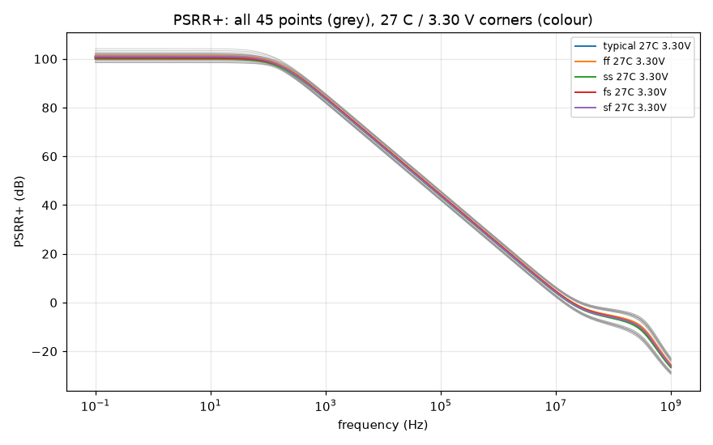
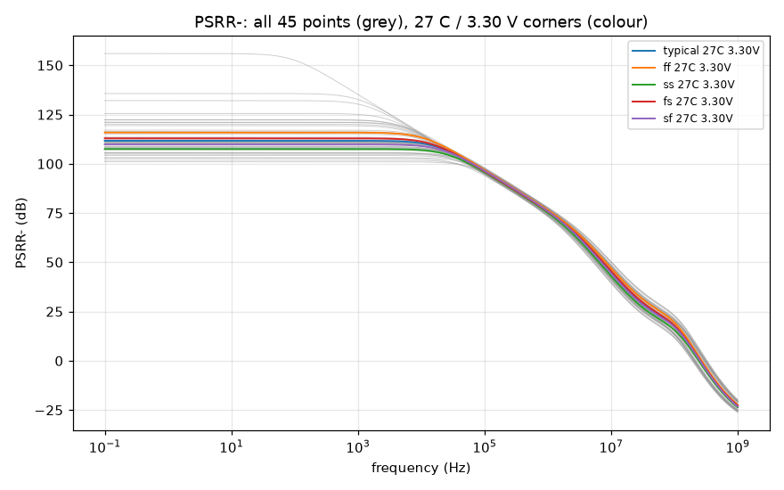
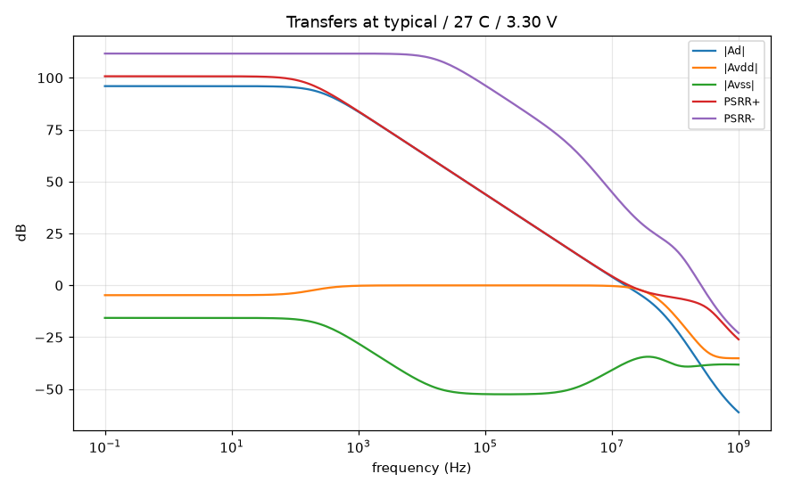

# PSRR record `20261018-062257-afc17a1`

- **Date**: 2026-10-18 06:22 UTC; commit `afc17a1`; issue #39
- **DUT**: `design/netlist/opamp_two_stage.spice` (sha256 of the wrapper-normalised include `33b58dac62c747de`), unchanged; snapshot `netlist-snapshots/20261018-062257-afc17a1.spice`
- **Measurement fingerprint**: version 1, sha256 `dd5160da057749da9ace5d6fd8bf1bf715538f5d25724e13b7ca20c9d1dde37e` over the canonical inputs retained in the 'Measurement fingerprint inputs' section (bench content, `.ac` analysis + operating-point print, rail/input excitation modes, servo and isolation values, feedthrough fixture, corner axes, model library/sections; excludes record IDs, paths and backend scheduling)
- **PDK revision**: gf180mcuD, open_pdks `f6eeac7dad085ffcc829ccfd721f7b4ce39edcf7` (harness `find_pdk`, via ciel-default); the local single units are pinned to it (`models.pdk_root`).
  - klt's `provenance.pdk` and `environment.models_lib_sha256` in the grid reports are resolved on the SUBMITTING CLIENT (open_pdks f6eeac7dad085ffcc829ccfd721f7b4ce39edcf7 (search root: ~/.ciel)), not on the fleet runner, which uses its own install and (klt 0.5.0) does not report its revision. The fleet library is tied to the pinned revision indirectly: the local pinned units reproduce the grid's nominal point, and the grid's open-loop response reproduces the committed gain-bench record (see Cross-checks).
- **Tools**: ngspice local `ngspice-42 : Circuit level simulation program`, klt `klt 0.7.1.dev1911+g02c9f6b8ebab`, numpy `2.5.4`
- **Execution**: three `klt sim` corner requests (one per excitation), 45 points each:
  - `dm`: backend `aws-batch-fleet`, job `klt-sim-7e97a2cac665`, Spot m7i.4xlarge, state `failed`, runner klt `0.7.0` vs client `0.7.1.dev1911+g02c9f6b8ebab` (compatibility `match`); engine `ngspice 46`; wall 82 s
  - `vdd`: backend `aws-batch-fleet`, job `klt-sim-57c283a52de2`, Spot m7i.4xlarge, state `failed`, runner klt `0.7.0` vs client `0.7.1.dev1911+g02c9f6b8ebab` (compatibility `match`); engine `ngspice 46`; wall 143 s
  - `vss`: backend `aws-batch-fleet`, job `klt-sim-804b71242a98`, Spot c7i.4xlarge, state `failed`, runner klt `0.7.0` vs client `0.7.1.dev1911+g02c9f6b8ebab` (compatibility `match`); engine `ngspice 46`; wall 84 s
  - Local single units (studies/controls below) run with an empty `HOME` so no user `~/.spiceinit` applies (the fleet grid runs without one; DR-0004).
- **Corner matrix**: process typical, ff, ss, fs, sf; T -40 C, 27 C, 125 C; VDD 2.97 V, 3.30 V, 3.63 V (DC input common mode = VDD/2); ibias = 10 uA (ideal); CL = 2 pF. Every MOS corner uses `res_typical` + `mimcap_typical` (RZ/CC passive spread is NOT swept).

## Claim

**Measured, no pass or fail verdict: the row's bound is not ratified** (DR-3 residual (e4)). `spec/target-spec.md` and the decision records are untouched; a proposed bound citing this record is a separate decision-record issue for a human to ratify.

**Definitions and references.** Input-referred PSRR+/- = 20 log10 |Ad / Asupply|, Asupply = vout / v(rail) with one rail driven (1 V AC) at a time, the other rail and both inputs AC-quiet. Inputs (`Vcm`, the servo), the load CL and `Vdd` are referenced to simulator ground; for PSRR- the DUT's `vss` port is a driven node (`Vss vss 0 dc 0 ac 1`), so only the DUT's ground rail moves. The output supply feedthrough -20 log10 |Asupply| is a different quantity and is reported separately below. The ideal 10 uA bias source has zero small-signal current: **bias-generator supply rejection is excluded** (an on-chip reference would add its own). Matched devices: the figures are systematic, not mismatch-limited.

## PSRR+ worst case over the 45 points

| PSRR+ figure | worst (lowest) value (dB) | worst-case corner (process / T / VDD) | best (dB) | points without the figure |
|---|---|---|---|---|
| DC plateau (0.1-1 Hz) | **98.45** | fs / -40 C / 2.97 V | 104.22 | 0 |
| 1 kHz | **81.82** | ss / 125 C / 2.97 V | 85.80 | 0 |
| 10 kHz | **61.90** | ss / 125 C / 2.97 V | 65.87 | 0 |
| 100 kHz | **41.90** | ss / 125 C / 2.97 V | 45.87 | 0 |
| 1 MHz | **21.90** | ss / 125 C / 2.97 V | 25.88 | 0 |
| at f_u (differential unity gain) | **0.73** | sf / 27 C / 2.97 V | 0.94 | 0 |

- Plateau verified at 45/45 points; lower bounds (numerical floor): 0/45.
- Avdd keeps one sign (plateau phase ~0 deg) at all 45 points; no PSRR+ value exceeds the grid median (100.7 dB) by more than 20 dB.
- Output supply feedthrough -20 log10 |Avdd| at the plateau (NOT PSRR): 2.45 dB (fs / -40 C / 2.97 V) .. 7.04 dB (sf / -40 C / 3.63 V).

## PSRR- worst case over the 45 points

| PSRR- figure | worst (lowest) value (dB) | worst-case corner (process / T / VDD) | best (dB) | points without the figure |
|---|---|---|---|---|
| DC plateau (0.1-1 Hz) | **101.01** | ss / -40 C / 2.97 V | 155.96 | 0 |
| 1 kHz | **101.01** | ss / -40 C / 2.97 V | 135.21 | 0 |
| 10 kHz | **100.90** | ss / -40 C / 2.97 V | 115.58 | 0 |
| 100 kHz | **93.90** | ss / 125 C / 2.97 V | 97.97 | 0 |
| 1 MHz | **73.15** | ss / 125 C / 2.97 V | 77.87 | 0 |
| at f_u (differential unity gain) | **35.10** | ss / -40 C / 2.97 V | 39.55 | 0 |

- Plateau verified at 45/45 points; lower bounds (numerical floor): 0/45.
- **Avss changes sign across the grid**: its plateau phase is ~180 deg at 41 points and ~0 deg at 4 (ff / 125 C / 3.30 V, ff / 125 C / 3.63 V, fs / 125 C / 3.63 V, typical / 125 C / 3.63 V). The systematic Avss passes through zero somewhere in PVT, so near the flip the low-frequency PSRR- is a cancellation.
  - ff / 125 C / 3.30 V: PSRR- 135.7 dB at 0.1 Hz, 24.8 dB above the grid median; |Avss| = 0.00916 V/V, 7.8 decades above the numerical floor (numerically resolved).
  - fs / 125 C / 3.30 V: PSRR- 132.1 dB at 0.1 Hz, 21.2 dB above the grid median; |Avss| = 0.0139 V/V, 8.0 decades above the numerical floor (numerically resolved).
  - typical / 125 C / 3.63 V: PSRR- 156.0 dB at 0.1 Hz, 45.1 dB above the grid median; |Avss| = 0.000945 V/V, 6.8 decades above the numerical floor (numerically resolved).
- Such values are numerically real for the matched schematic but are NOT design margin: a mismatch-sized perturbation of the cancelling terms removes them. Use the worst-case figure.
- Output supply feedthrough -20 log10 |Avss| at the plateau (NOT PSRR): 5.19 dB (ss / -40 C / 2.97 V) .. 60.49 dB (typical / 125 C / 3.63 V).

- f_u over the grid: 11.906 .. 24.437 MHz; Ad plateau 93.79 .. 97.41 dB.

## Method

- `.ac dec 20 0.1 1e+09` (201 points) per point and excitation (`dm`, `vdd`, `vss`), the CMRR bench's DC servo (unity-buffer DC point, open loop at every swept frequency, vout unloaded).
- Ad = v(vout) / (v(vinp) - v(vinn)) of the `dm` run (actual phasors); Asupply = v(vout) / v(rail) of the supply run (actual rail phasor).
- **DC** = mean PSRR over 0.1-1 Hz, valid only if the PSRR and |Asupply| are flat there to 0.1 dB (else reported unavailable). Spot values and the value at f_u: linear interpolation in (log10 f, dB); f_u = first descending 0 dB crossing of |Ad| (the gain driver's extraction).
- **Numerical floor**: |Asupply| below 10 x the demonstrated superposition residual (= 1.45e-10 V/V) is clamped and the figure reported as a lower bound (`>=`).
- **Blocking validation**: 45/45 points per excitation, identical frequency axes, finite data; `dm`: vd = 1 V, vc = 0, rails quiet (all to 1e-06 V); supply runs: driven rail = 1 V, other rail quiet (to 1e-06 V), both inputs quiet to 1e-09 V and the input-leak term |Ad vd| below 1e-06 of the output; operating point; Ad vs the gain bench; local vs grid; studies/controls.

## Excitation and cross-checks

- Max excitation error 1.18e-13 V; max input phasor in the supply runs 1.2e-18 V; max input-leak fraction 1.18e-13.
- **Ad vs the gain bench** (`sim/gain-gbw-pm/corners/20261018-060639-afc17a1`), all 45 points, 0.1 Hz to f_u: max deviation 2.95e-03 dB (tolerance 0.05 dB). The gain bench drives vinp alone, so its response is Ad + Acm/2; below f_u the Acm/2 term is negligible (the CMRR record compares the exact Ad + Acm/2 over the whole sweep).
- **Local nominal unit vs the grid's nominal point**: PSRR+/- differ by at most 0.0000 dB (tolerance 0.05 dB).

## Operating point (every point, every excitation)

The analysis line prints the DC operating point of the same deck after the `.ac` sweep (`op` + `print`, retained in each point's log). Blocking: the operating point is returned, |vout - VCM| <= 100 mV (no saturated or differently biased DUT), and every excitation of a point sits at the same DC vout to 1 uV. Recorded: each DUT MOSFET's saturation margin |Vds| - |Vdsat|.

- max |vout - VCM| over the grid: 0.035 mV; max DC vout disagreement between excitations: 0.0000 uV.
- smallest device saturation margin: 220 mV at ss / -40 C / 2.97 V.
- points with a device below saturation: 0/45

## PSRR+ at all 45 points (dB, input-referred)

| point | PSRR+ DC | 1 kHz | 10 kHz | 100 kHz | 1 MHz | at f_u | f_u (MHz) | note |
|---|---|---|---|---|---|---|---|---|
| typical / -40 C / 2.97 V | 99.28 | 85.25 | 65.43 | 45.43 | 25.43 | 0.83 | 22.110 |  |
| typical / 27 C / 2.97 V | 99.34 | 83.80 | 63.92 | 43.92 | 23.93 | 0.81 | 16.305 |  |
| typical / 125 C / 2.97 V | 100.28 | 82.20 | 62.27 | 42.27 | 22.28 | 0.84 | 12.544 |  |
| typical / -40 C / 3.30 V | 100.95 | 85.36 | 65.48 | 45.48 | 25.48 | 0.83 | 22.319 |  |
| typical / 27 C / 3.30 V | 100.74 | 83.87 | 63.96 | 43.96 | 23.96 | 0.81 | 16.399 |  |
| typical / 125 C / 3.30 V | 101.17 | 82.24 | 62.30 | 42.30 | 22.30 | 0.84 | 12.592 |  |
| typical / -40 C / 3.63 V | 102.88 | 85.45 | 65.52 | 45.52 | 25.53 | 0.84 | 22.509 |  |
| typical / 27 C / 3.63 V | 102.05 | 83.93 | 63.99 | 43.99 | 24.00 | 0.81 | 16.485 |  |
| typical / 125 C / 3.63 V | 101.53 | 82.27 | 62.32 | 42.32 | 22.33 | 0.84 | 12.634 |  |
| ff / -40 C / 2.97 V | 99.94 | 85.62 | 65.78 | 45.78 | 25.79 | 0.81 | 23.999 |  |
| ff / 27 C / 2.97 V | 99.92 | 84.16 | 64.28 | 44.28 | 24.28 | 0.78 | 17.346 |  |
| ff / 125 C / 2.97 V | 100.66 | 82.57 | 62.64 | 42.64 | 22.64 | 0.83 | 13.219 |  |
| ff / -40 C / 3.30 V | 101.55 | 85.71 | 65.83 | 45.83 | 25.84 | 0.82 | 24.226 |  |
| ff / 27 C / 3.30 V | 101.22 | 84.23 | 64.31 | 44.31 | 24.32 | 0.78 | 17.445 |  |
| ff / 125 C / 3.30 V | 101.38 | 82.60 | 62.66 | 42.66 | 22.67 | 0.83 | 13.266 |  |
| ff / -40 C / 3.63 V | 103.48 | 85.80 | 65.87 | 45.87 | 25.88 | 0.82 | 24.437 |  |
| ff / 27 C / 3.63 V | 102.40 | 84.28 | 64.35 | 44.35 | 24.35 | 0.78 | 17.536 |  |
| ff / 125 C / 3.63 V | 101.48 | 82.63 | 62.68 | 42.68 | 22.69 | 0.83 | 13.310 |  |
| ss / -40 C / 2.97 V | 98.45 | 84.87 | 65.06 | 45.06 | 25.07 | 0.85 | 20.454 |  |
| ss / 27 C / 2.97 V | 98.49 | 83.42 | 63.55 | 43.55 | 23.56 | 0.83 | 15.351 |  |
| ss / 125 C / 2.97 V | 99.41 | 81.82 | 61.90 | 41.90 | 21.90 | 0.86 | 11.906 |  |
| ss / -40 C / 3.30 V | 100.20 | 84.98 | 65.12 | 45.12 | 25.12 | 0.85 | 20.655 |  |
| ss / 27 C / 3.30 V | 100.02 | 83.50 | 63.60 | 43.60 | 23.60 | 0.83 | 15.447 |  |
| ss / 125 C / 3.30 V | 100.52 | 81.87 | 61.93 | 41.93 | 21.93 | 0.86 | 11.955 |  |
| ss / -40 C / 3.63 V | 102.12 | 85.08 | 65.17 | 45.17 | 25.17 | 0.86 | 20.832 |  |
| ss / 27 C / 3.63 V | 101.43 | 83.56 | 63.63 | 43.63 | 23.64 | 0.83 | 15.530 |  |
| ss / 125 C / 3.63 V | 101.15 | 81.90 | 61.95 | 41.96 | 21.96 | 0.86 | 11.998 |  |
| fs / -40 C / 2.97 V | 98.45 | 85.40 | 65.61 | 45.62 | 25.62 | 0.93 | 22.421 |  |
| fs / 27 C / 2.97 V | 98.80 | 83.96 | 64.11 | 44.11 | 24.11 | 0.89 | 16.539 |  |
| fs / 125 C / 2.97 V | 100.51 | 82.39 | 62.46 | 42.46 | 22.46 | 0.91 | 12.723 |  |
| fs / -40 C / 3.30 V | 100.18 | 85.52 | 65.67 | 45.67 | 25.68 | 0.93 | 22.632 |  |
| fs / 27 C / 3.30 V | 100.33 | 84.04 | 64.15 | 44.15 | 24.15 | 0.89 | 16.637 |  |
| fs / 125 C / 3.30 V | 101.53 | 82.43 | 62.49 | 42.49 | 22.49 | 0.91 | 12.773 |  |
| fs / -40 C / 3.63 V | 101.85 | 85.61 | 65.72 | 45.72 | 25.72 | 0.94 | 22.825 |  |
| fs / 27 C / 3.63 V | 101.67 | 84.11 | 64.18 | 44.18 | 24.19 | 0.89 | 16.726 |  |
| fs / 125 C / 3.63 V | 102.23 | 82.47 | 62.51 | 42.51 | 22.52 | 0.91 | 12.817 |  |
| sf / -40 C / 2.97 V | 99.92 | 85.08 | 65.23 | 45.23 | 25.24 | 0.73 | 21.757 |  |
| sf / 27 C / 2.97 V | 99.63 | 83.62 | 63.73 | 43.73 | 23.73 | 0.73 | 16.050 |  |
| sf / 125 C / 2.97 V | 99.84 | 82.01 | 62.08 | 42.08 | 22.08 | 0.78 | 12.352 |  |
| sf / -40 C / 3.30 V | 101.74 | 85.18 | 65.28 | 45.28 | 25.29 | 0.74 | 21.967 |  |
| sf / 27 C / 3.30 V | 100.99 | 83.68 | 63.76 | 43.76 | 23.77 | 0.73 | 16.143 |  |
| sf / 125 C / 3.30 V | 100.49 | 82.04 | 62.10 | 42.10 | 22.11 | 0.78 | 12.398 |  |
| sf / -40 C / 3.63 V | 104.22 | 85.27 | 65.33 | 45.33 | 25.33 | 0.74 | 22.155 |  |
| sf / 27 C / 3.63 V | 102.25 | 83.74 | 63.80 | 43.80 | 23.80 | 0.73 | 16.227 |  |
| sf / 125 C / 3.63 V | 100.26 | 82.06 | 62.13 | 42.13 | 22.13 | 0.77 | 12.439 |  |

## PSRR- at all 45 points (dB, input-referred)

| point | PSRR- DC | 1 kHz | 10 kHz | 100 kHz | 1 MHz | at f_u | f_u (MHz) | note |
|---|---|---|---|---|---|---|---|---|
| typical / -40 C / 2.97 V | 104.83 | 104.83 | 104.60 | 96.76 | 77.08 | 36.20 | 22.110 |  |
| typical / 27 C / 2.97 V | 107.01 | 107.00 | 106.53 | 95.97 | 75.69 | 37.20 | 16.305 |  |
| typical / 125 C / 2.97 V | 110.64 | 110.62 | 109.27 | 94.80 | 73.95 | 37.75 | 12.544 |  |
| typical / -40 C / 3.30 V | 108.04 | 108.04 | 107.59 | 97.25 | 77.23 | 36.42 | 22.319 |  |
| typical / 27 C / 3.30 V | 111.69 | 111.67 | 110.45 | 96.35 | 75.87 | 37.43 | 16.399 |  |
| typical / 125 C / 3.30 V | 120.13 | 119.99 | 113.94 | 95.12 | 74.18 | 37.98 | 12.592 |  |
| typical / -40 C / 3.63 V | 110.89 | 110.88 | 110.06 | 97.45 | 77.28 | 36.58 | 22.509 |  |
| typical / 27 C / 3.63 V | 116.30 | 116.26 | 113.40 | 96.48 | 75.94 | 37.61 | 16.485 |  |
| typical / 125 C / 3.63 V | 155.96 | 135.21 | 115.24 | 95.23 | 74.31 | 38.18 | 12.634 |  |
| ff / -40 C / 2.97 V | 107.68 | 107.68 | 107.29 | 97.51 | 77.67 | 37.51 | 23.999 |  |
| ff / 27 C / 2.97 V | 111.46 | 111.45 | 110.34 | 96.64 | 76.35 | 38.54 | 17.346 |  |
| ff / 125 C / 2.97 V | 121.05 | 120.89 | 114.35 | 95.38 | 74.72 | 39.08 | 13.219 |  |
| ff / -40 C / 3.30 V | 110.25 | 110.24 | 109.59 | 97.83 | 77.83 | 37.72 | 24.226 |  |
| ff / 27 C / 3.30 V | 115.87 | 115.83 | 113.37 | 96.90 | 76.54 | 38.77 | 17.445 |  |
| ff / 125 C / 3.30 V | 135.66 | 132.63 | 115.58 | 95.61 | 74.95 | 39.33 | 13.266 |  |
| ff / -40 C / 3.63 V | 112.87 | 112.86 | 111.73 | 97.97 | 77.87 | 37.91 | 24.437 |  |
| ff / 27 C / 3.63 V | 121.07 | 120.96 | 115.57 | 96.98 | 76.61 | 38.98 | 17.536 |  |
| ff / 125 C / 3.63 V | 122.36 | 122.16 | 114.86 | 95.70 | 75.07 | 39.55 | 13.310 |  |
| ss / -40 C / 2.97 V | 101.01 | 101.01 | 100.90 | 95.61 | 76.47 | 35.10 | 20.454 |  |
| ss / 27 C / 2.97 V | 101.84 | 101.84 | 101.68 | 94.93 | 75.00 | 36.05 | 15.351 |  |
| ss / 125 C / 2.97 V | 102.84 | 102.84 | 102.55 | 93.90 | 73.15 | 36.61 | 11.906 |  |
| ss / -40 C / 3.30 V | 105.43 | 105.42 | 105.15 | 96.58 | 76.61 | 35.35 | 20.655 |  |
| ss / 27 C / 3.30 V | 107.53 | 107.52 | 106.95 | 95.73 | 75.17 | 36.30 | 15.447 |  |
| ss / 125 C / 3.30 V | 110.78 | 110.76 | 109.30 | 94.56 | 73.37 | 36.86 | 11.955 |  |
| ss / -40 C / 3.63 V | 108.72 | 108.71 | 108.14 | 96.90 | 76.66 | 35.52 | 20.832 |  |
| ss / 27 C / 3.63 V | 112.20 | 112.19 | 110.71 | 95.97 | 75.25 | 36.48 | 15.530 |  |
| ss / 125 C / 3.63 V | 119.37 | 119.25 | 113.48 | 94.75 | 73.51 | 37.04 | 11.998 |  |
| fs / -40 C / 2.97 V | 105.71 | 105.71 | 105.42 | 96.71 | 76.95 | 36.69 | 22.421 |  |
| fs / 27 C / 2.97 V | 108.86 | 108.85 | 108.12 | 95.90 | 75.60 | 37.64 | 16.539 |  |
| fs / 125 C / 2.97 V | 116.15 | 116.09 | 112.38 | 94.71 | 73.93 | 38.16 | 12.723 |  |
| fs / -40 C / 3.30 V | 108.29 | 108.29 | 107.79 | 97.10 | 77.11 | 36.89 | 22.632 |  |
| fs / 27 C / 3.30 V | 112.94 | 112.92 | 111.29 | 96.21 | 75.79 | 37.85 | 16.637 |  |
| fs / 125 C / 3.30 V | 132.08 | 130.28 | 114.89 | 94.97 | 74.17 | 38.40 | 12.773 |  |
| fs / -40 C / 3.63 V | 110.57 | 110.56 | 109.76 | 97.25 | 77.16 | 37.06 | 22.825 |  |
| fs / 27 C / 3.63 V | 117.09 | 117.04 | 113.70 | 96.32 | 75.87 | 38.05 | 16.726 |  |
| fs / 125 C / 3.63 V | 125.53 | 125.07 | 114.70 | 95.07 | 74.30 | 38.60 | 12.817 |  |
| sf / -40 C / 2.97 V | 103.14 | 103.14 | 102.99 | 96.63 | 77.21 | 35.78 | 21.757 |  |
| sf / 27 C / 2.97 V | 104.25 | 104.24 | 104.00 | 95.86 | 75.78 | 36.82 | 16.050 |  |
| sf / 125 C / 2.97 V | 105.52 | 105.52 | 105.07 | 94.74 | 73.97 | 37.40 | 12.352 |  |
| sf / -40 C / 3.30 V | 107.39 | 107.38 | 107.01 | 97.38 | 77.35 | 36.02 | 21.967 |  |
| sf / 27 C / 3.30 V | 109.83 | 109.82 | 109.02 | 96.47 | 75.94 | 37.07 | 16.143 |  |
| sf / 125 C / 3.30 V | 113.51 | 113.48 | 111.31 | 95.24 | 74.18 | 37.64 | 12.398 |  |
| sf / -40 C / 3.63 V | 111.10 | 111.10 | 110.27 | 97.65 | 77.40 | 36.19 | 22.155 |  |
| sf / 27 C / 3.63 V | 114.95 | 114.92 | 112.74 | 96.66 | 76.02 | 37.25 | 16.227 |  |
| sf / 125 C / 3.63 V | 122.26 | 122.06 | 114.60 | 95.39 | 74.31 | 37.83 | 12.439 |  |

## Ad, Avdd, Avss at the plateau (dB)

| point | Ad | Avdd | Avss | PSRR+ DC | PSRR- DC |
|---|---|---|---|---|---|
| typical / -40 C / 2.97 V | 96.12 | -3.16 | -8.71 | 99.28 | 104.83 |
| typical / 27 C / 2.97 V | 95.28 | -4.06 | -11.73 | 99.34 | 107.01 |
| typical / 125 C / 2.97 V | 94.14 | -6.14 | -16.50 | 100.28 | 110.64 |
| typical / -40 C / 3.30 V | 96.79 | -4.15 | -11.25 | 100.95 | 108.04 |
| typical / 27 C / 3.30 V | 95.99 | -4.75 | -15.70 | 100.74 | 111.69 |
| typical / 125 C / 3.30 V | 94.89 | -6.28 | -25.23 | 101.17 | 120.13 |
| typical / -40 C / 3.63 V | 97.29 | -5.59 | -13.60 | 102.88 | 110.89 |
| typical / 27 C / 3.63 V | 96.52 | -5.52 | -19.77 | 102.05 | 116.30 |
| typical / 125 C / 3.63 V | 95.47 | -6.06 | -60.49 | 101.53 | 155.96 |
| ff / -40 C / 2.97 V | 96.29 | -3.65 | -11.39 | 99.94 | 107.68 |
| ff / 27 C / 2.97 V | 95.42 | -4.51 | -16.04 | 99.92 | 111.46 |
| ff / 125 C / 2.97 V | 94.19 | -6.48 | -26.86 | 100.66 | 121.05 |
| ff / -40 C / 3.30 V | 96.94 | -4.61 | -13.31 | 101.55 | 110.25 |
| ff / 27 C / 3.30 V | 96.10 | -5.12 | -19.77 | 101.22 | 115.87 |
| ff / 125 C / 3.30 V | 94.90 | -6.48 | -40.76 | 101.38 | 135.66 |
| ff / -40 C / 3.63 V | 97.41 | -6.07 | -15.46 | 103.48 | 112.87 |
| ff / 27 C / 3.63 V | 96.60 | -5.80 | -24.47 | 102.40 | 121.07 |
| ff / 125 C / 3.63 V | 95.44 | -6.03 | -26.91 | 101.48 | 122.36 |
| ss / -40 C / 2.97 V | 95.81 | -2.64 | -5.19 | 98.45 | 101.01 |
| ss / 27 C / 2.97 V | 94.95 | -3.53 | -6.89 | 98.49 | 101.84 |
| ss / 125 C / 2.97 V | 93.79 | -5.62 | -9.05 | 99.41 | 102.84 |
| ss / -40 C / 3.30 V | 96.52 | -3.68 | -8.91 | 100.20 | 105.43 |
| ss / 27 C / 3.30 V | 95.70 | -4.32 | -11.83 | 100.02 | 107.53 |
| ss / 125 C / 3.30 V | 94.59 | -5.94 | -16.20 | 100.52 | 110.78 |
| ss / -40 C / 3.63 V | 97.05 | -5.07 | -11.67 | 102.12 | 108.72 |
| ss / 27 C / 3.63 V | 96.27 | -5.16 | -15.94 | 101.43 | 112.20 |
| ss / 125 C / 3.63 V | 95.21 | -5.94 | -24.17 | 101.15 | 119.37 |
| fs / -40 C / 2.97 V | 96.00 | -2.45 | -9.70 | 98.45 | 105.71 |
| fs / 27 C / 2.97 V | 95.20 | -3.60 | -13.67 | 98.80 | 108.86 |
| fs / 125 C / 2.97 V | 94.10 | -6.41 | -22.05 | 100.51 | 116.15 |
| fs / -40 C / 3.30 V | 96.73 | -3.45 | -11.56 | 100.18 | 108.29 |
| fs / 27 C / 3.30 V | 95.96 | -4.37 | -16.98 | 100.33 | 112.94 |
| fs / 125 C / 3.30 V | 94.91 | -6.62 | -37.17 | 101.53 | 132.08 |
| fs / -40 C / 3.63 V | 97.28 | -4.57 | -13.29 | 101.85 | 110.57 |
| fs / 27 C / 3.63 V | 96.55 | -5.11 | -20.53 | 101.67 | 117.09 |
| fs / 125 C / 3.63 V | 95.56 | -6.67 | -29.97 | 102.23 | 125.53 |
| sf / -40 C / 2.97 V | 96.13 | -3.79 | -7.01 | 99.92 | 103.14 |
| sf / 27 C / 2.97 V | 95.23 | -4.40 | -9.01 | 99.63 | 104.25 |
| sf / 125 C / 2.97 V | 93.99 | -5.85 | -11.53 | 99.84 | 105.52 |
| sf / -40 C / 3.30 V | 96.75 | -4.99 | -10.63 | 101.74 | 107.39 |
| sf / 27 C / 3.30 V | 95.88 | -5.11 | -13.95 | 100.99 | 109.83 |
| sf / 125 C / 3.30 V | 94.68 | -5.80 | -18.83 | 100.49 | 113.51 |
| sf / -40 C / 3.63 V | 97.18 | -7.04 | -13.93 | 104.22 | 111.10 |
| sf / 27 C / 3.63 V | 96.34 | -5.91 | -18.61 | 102.25 | 114.95 |
| sf / 125 C / 3.63 V | 95.19 | -5.08 | -27.07 | 100.26 | 122.26 |

## Studies and negative controls (local single units, typical / 27 C / 3.30 V)

- **Numerical floor (superposition)**: |vout(both rails) - vout(vdd only) - vout(vss only)| max 1.45e-11 V; floor = max(10 x that, 1e-15) = 1.45e-10 V/V. Grid |Asupply| minimum: 0.000945 V/V.

| study / control | condition | outcome | PSRR+ 0.1 Hz | PSRR+ at f_u | PSRR- 0.1 Hz | PSRR- at f_u | criterion |
|---|---|---|---|---|---|---|---|
| isolation (nominal) | tau = 1e18 s | valid | 100.739 | 0.808 | 111.687 | 37.428 | reference |
| isolation | tau = 1e+16 s | valid | 100.739 | 0.808 | 111.687 | 37.428 | moves <= 0.01 dB |
| isolation | tau = 1e+20 s | valid | 100.739 | 0.808 | 111.687 | 37.428 | moves <= 0.01 dB |
| inadequate isolation | tau = 1e-3 s | **rejected**: differential excitation off by 111 V (> 1e-06): servo isolation or wiring; [vdd] inputs not AC-quiet (0.352 V > 1e-09): servo isolation or reference; [vss] inpu | | | | | must be rejected |
| **negative control**: vdd feedthrough | fixture `Rft vdd vout 100000` | valid | 79.997 | 1.014 | 97.734 | 36.789 | PSRR+ drops >= 6 dB |
| **negative control**: vss feedthrough | fixture `Rft vss vout 100000` | valid | 93.654 | 0.768 | 84.421 | 30.444 | PSRR- drops >= 6 dB |

- vdd feedthrough fixture: PSRR+ at 0.1 Hz 80.00 dB vs 100.74 dB (drop 20.74 dB). The fixture is a resistor appended to the bench for the control only (all three excitations of the control carry it); the production DUT and the baseline bench are unchanged. Diagnostic only.
- vss feedthrough fixture: PSRR- at 0.1 Hz 84.42 dB vs 111.69 dB (drop 27.27 dB). The fixture is a resistor appended to the bench for the control only (all three excitations of the control carry it); the production DUT and the baseline bench are unchanged. Diagnostic only.

## Measurement fingerprint inputs

Canonical JSON (sorted keys, compact separators); its sha256 is the fingerprint in the header. Recompute with `sim/psrr/measurement_config.py`.

```json
{"analysis":{"args":"dec 20 0.1 1e+09\nop\nprint v(vout) v(vinp) v(vinn) @m.xdut.xm1.m0[vds] @m.xdut.xm1.m0[vdsat] @m.xdut.xm2.m0[vds] @m.xdut.xm2.m0[vdsat] @m.xdut.xm3.m0[vds] @m.xdut.xm3.m0[vdsat] @m.xdut.xm4.m0[vds] @m.xdut.xm4.m0[vdsat] @m.xdut.xm5.m0[vds] @m.xdut.xm5.m0[vdsat] @m.xdut.xm6.m0[vds] @m.xdut.xm6.m0[vdsat] @m.xdut.xm7.m0[vds] @m.xdut.xm7.m0[vdsat] @m.xdut.xmb1.m0[vds] @m.xdut.xmb1.m0[vdsat]\nsetplot ac1","kind":"ac"},"bench":[".include 'design.ngspice'",".include 'opamp_two_stage.dut.spice'",".param acp=0.5 acn=-0.5 acdd=0 acss=0 rsv=1e9 csv=1e9","vdd vdd 0 dc 3.3 ac {acdd}","vss vss 0 dc 0 ac {acss}","vcm vinp 0 dc 1.65 ac {acp}","ibias vdd ibias dc 10u","xdut vdd vss vinp vinn vout ibias opamp_two_stage","esb vsb 0 vout 0 1","rsv vsb vsv {rsv}","csv vsv 0 {csv}","esv vinn vnac vsv 0 1","vnac vnac 0 dc 0 ac {acn}","cl vout 0 2p"],"controls":{"feedthrough_r_ohm":100000.0,"isolation_csv":[10000000.0,100000000000.0],"isolation_inadequate_csv":1e-12},"corners":{"passive_sections":["res_typical","mimcap_typical"],"process":["typical","ff","ss","fs","sf"],"supply_v":[2.97,3.3,3.63],"temperature_c":[-40.0,27.0,125.0],"vcm_rule":"vdd/2"},"excitation":{"modes":{"dm":{"acdd":0.0,"acn":-0.5,"acp":0.5,"acss":0.0},"vdd":{"acdd":1.0,"acn":0.0,"acp":0.0,"acss":0.0},"vss":{"acdd":0.0,"acn":0.0,"acp":0.0,"acss":1.0}},"servo":{"csv":1000000000.0,"rsv":1000000000.0}},"experiment":"psrr","fingerprint_version":1,"models":{"lib":"libs.tech/ngspice/sm141064.ngspice","pdk_variant":"gf180mcuD"}}
```

## Plots





## Reproduce / evidence

```
python3 sim/psrr/run_psrr.py            # full grid + a new record
python3 sim/psrr/run_psrr.py --smoke    # nominal point, local, no record
```

- Per point and excitation: `corners/20261018-062257-afc17a1/<point>.<dm|vdd|vss>.{dat,log,cir}` (actual vout, vinp, vinn, vdd, vss phasors; log with the printed operating point; klt deck); derived curves `<point>.psrr.dat` (freq, |Ad|, |Avdd|, |Avss|, PSRR+, PSRR- in dB); sanitised klt reports; studies/controls under `controls/`.
- Testbench `sim/psrr/testbench/tb_psrr.spice`; driver `sim/psrr/run_psrr.py`; tests `sim/psrr/test_psrr.py`.
- Timestamp / author: 2026-10-18T06:22:57Z, agent-builder (issue #39)
