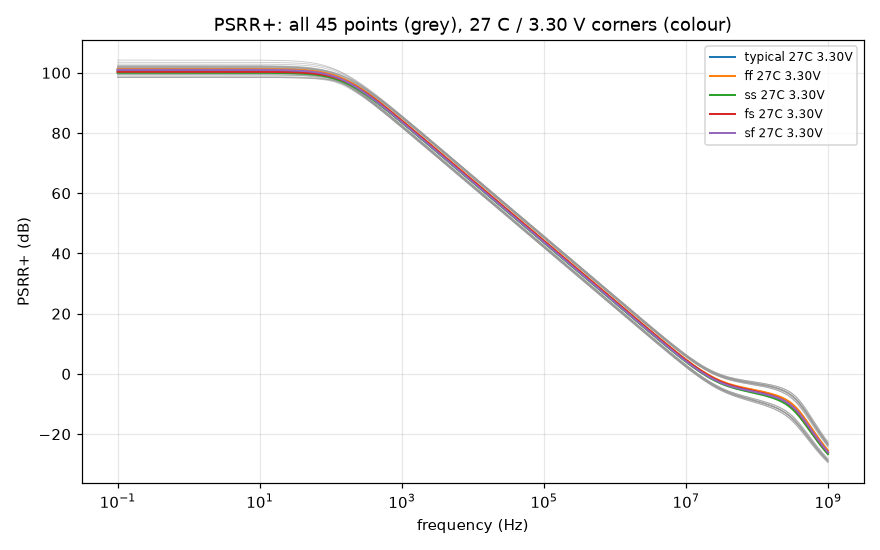
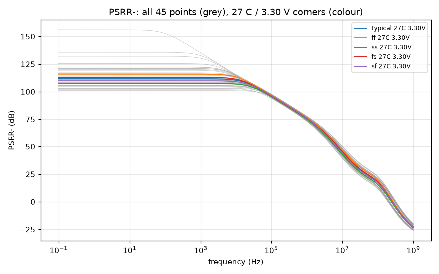
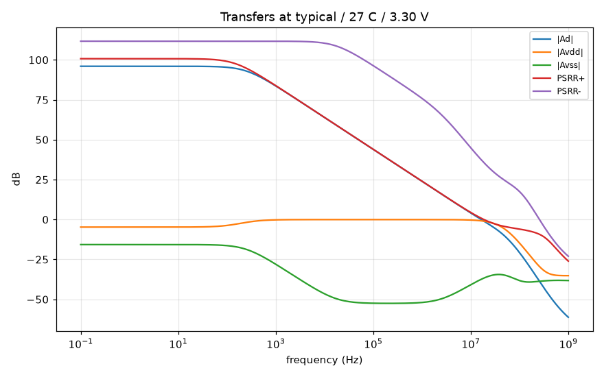

# PSRR record `20261018-215235-119ceb4`

- **Date**: 2026-10-18 21:52 UTC; commit `119ceb4`; issue #39
- **DUT**: `design/netlist/opamp_two_stage.spice` (sha256 of the wrapper-normalised include `33b58dac62c747de`), unchanged; snapshot `netlist-snapshots/20261018-215235-119ceb4.spice`
- **Measurement fingerprint**: version 1, sha256 `dd5160da057749da9ace5d6fd8bf1bf715538f5d25724e13b7ca20c9d1dde37e` over the canonical inputs retained in the 'Measurement fingerprint inputs' section (bench content, `.ac` analysis + operating-point print, rail/input excitation modes, servo and isolation values, feedthrough fixture, corner axes, model library/sections; excludes record IDs, paths and backend scheduling)
- **PDK revision**: gf180mcuD, open_pdks `f6eeac7dad085ffcc829ccfd721f7b4ce39edcf7` (harness `find_pdk`, via ciel-default); the local single units are pinned to it (`models.pdk_root`).
  - klt's `provenance.pdk` and `environment.models_lib_sha256` in the grid reports are resolved on the SUBMITTING CLIENT (open_pdks f6eeac7dad085ffcc829ccfd721f7b4ce39edcf7 (search root: ~/.ciel)), not on the fleet runner, which uses its own install and (klt 0.5.0) does not report its revision. The fleet library is tied to the pinned revision indirectly: the local pinned units reproduce the grid's nominal point, and the grid's open-loop response reproduces the committed gain-bench record (see Cross-checks).
- **Tools**: ngspice local `ngspice-42 : Circuit level simulation program`, klt `klt 0.7.1.dev2209+g176045737916`, numpy `2.5.4`
- **Execution**: three `klt sim` corner requests (one per excitation), 45 points each:
  - `dm`: backend `aws-batch-fleet`, job `klt-sim-f781dc3964ff`, Spot m7i.4xlarge, state `failed`, runner klt `0.7.0` vs client `0.7.1.dev2209+g176045737916` (compatibility `match`); engine `ngspice 46`; wall 91 s
  - `vdd`: backend `aws-batch-fleet`, job `klt-sim-fca30687d06d`, Spot c7i.4xlarge, state `failed`, runner klt `0.7.0` vs client `0.7.1.dev2209+g176045737916` (compatibility `match`); engine `ngspice 46`; wall 90 s
  - `vss`: backend `aws-batch-fleet`, job `klt-sim-71dda276f74d`, Spot m7i.4xlarge, state `failed`, runner klt `0.7.0` vs client `0.7.1.dev2209+g176045737916` (compatibility `match`); engine `ngspice 46`; wall 90 s
  - Local single units (studies/controls below) run with an empty `HOME` so no user `~/.spiceinit` applies (the fleet grid runs without one; DR-0004).
- **Corner matrix**: process typical, ff, ss, fs, sf; T -40 C, 27 C, 125 C; VDD 2.97 V, 3.30 V, 3.63 V (DC input common mode = VDD/2); ibias = 10 uA (ideal); CL = 2 pF. Every MOS corner uses `res_typical` + `mimcap_typical` (RZ/CC passive spread is NOT swept).

## Claim

**Measured, no pass or fail verdict: the row's bound is not ratified** (DR-3 residual (e4)). `spec/target-spec.md` and the decision records are untouched; a proposed bound citing this record is a separate decision-record issue for a human to ratify.

**Definitions and references.** Input-referred PSRR+/- = 20 log10 |Ad / Asupply|, Asupply = vout / v(rail) with one rail driven (1 V AC) at a time, the other rail and both inputs AC-quiet. Inputs (`Vcm`, the servo), the load CL and `Vdd` are referenced to simulator ground; for PSRR- the DUT's `vss` port is a driven node (`Vss vss 0 dc 0 ac 1`), so only the DUT's ground rail moves. The output supply feedthrough -20 log10 |Asupply| is a different quantity and is reported separately below. The ideal 10 uA bias source has zero small-signal current: **bias-generator supply rejection is excluded** (an on-chip reference would add its own). Matched devices: the figures are systematic, not mismatch-limited.

## PSRR+ worst case over the 45 points

| PSRR+ figure | worst (lowest) value (dB) | worst-case corner (process / T / VDD) | best (dB) | points without the figure |
|---|---|---|---|---|
| DC plateau (0.1-1 Hz) | **98.45** | fs / -40 C / 2.97 V | 104.22 | 0 |
| 1 kHz | **81.82** | ss / 125 C / 2.97 V | 85.80 | 0 |
| 10 kHz | **61.90** | ss / 125 C / 2.97 V | 65.87 | 0 |
| 100 kHz | **41.90** | ss / 125 C / 2.97 V | 45.87 | 0 |
| 1 MHz | **21.90** | ss / 125 C / 2.97 V | 25.88 | 0 |
| at f_u (differential unity gain) | **0.73** | sf / 27 C / 2.97 V | 0.94 | 0 |

- Plateau verified at 45/45 points; lower bounds (numerical floor): 0/45.
- Avdd keeps one sign (plateau phase ~0 deg) at all 45 points; no PSRR+ value exceeds the grid median (100.7 dB) by more than 20 dB.
- Output supply feedthrough -20 log10 |Avdd| at the plateau (NOT PSRR): 2.45 dB (fs / -40 C / 2.97 V) .. 7.04 dB (sf / -40 C / 3.63 V).

## PSRR- worst case over the 45 points

| PSRR- figure | worst (lowest) value (dB) | worst-case corner (process / T / VDD) | best (dB) | points without the figure |
|---|---|---|---|---|
| DC plateau (0.1-1 Hz) | **101.01** | ss / -40 C / 2.97 V | 155.96 | 0 |
| 1 kHz | **101.01** | ss / -40 C / 2.97 V | 135.21 | 0 |
| 10 kHz | **100.90** | ss / -40 C / 2.97 V | 115.58 | 0 |
| 100 kHz | **93.90** | ss / 125 C / 2.97 V | 97.97 | 0 |
| 1 MHz | **73.15** | ss / 125 C / 2.97 V | 77.87 | 0 |
| at f_u (differential unity gain) | **35.10** | ss / -40 C / 2.97 V | 39.55 | 0 |

- Plateau verified at 45/45 points; lower bounds (numerical floor): 0/45.
- **Avss changes sign across the grid**: its plateau phase is ~180 deg at 41 points and ~0 deg at 4 (ff / 125 C / 3.30 V, ff / 125 C / 3.63 V, fs / 125 C / 3.63 V, typical / 125 C / 3.63 V). The systematic Avss passes through zero somewhere in PVT, so near the flip the low-frequency PSRR- is a cancellation.
  - ff / 125 C / 3.30 V: PSRR- 135.7 dB at 0.1 Hz, 24.8 dB above the grid median; |Avss| = 0.00916 V/V, 7.8 decades above the numerical floor (numerically resolved).
  - fs / 125 C / 3.30 V: PSRR- 132.1 dB at 0.1 Hz, 21.2 dB above the grid median; |Avss| = 0.0139 V/V, 8.0 decades above the numerical floor (numerically resolved).
  - typical / 125 C / 3.63 V: PSRR- 156.0 dB at 0.1 Hz, 45.1 dB above the grid median; |Avss| = 0.000945 V/V, 6.8 decades above the numerical floor (numerically resolved).
- Such values are numerically real for the matched schematic but are NOT design margin: a mismatch-sized perturbation of the cancelling terms removes them. Use the worst-case figure.
- Output supply feedthrough -20 log10 |Avss| at the plateau (NOT PSRR): 5.19 dB (ss / -40 C / 2.97 V) .. 60.49 dB (typical / 125 C / 3.63 V).

- f_u over the grid: 11.906 .. 24.437 MHz; Ad plateau 93.79 .. 97.41 dB.

## Method

- `.ac dec 20 0.1 1e+09` (201 points) per point and excitation (`dm`, `vdd`, `vss`), the CMRR bench's DC servo (unity-buffer DC point, open loop at every swept frequency, vout unloaded).
- Ad = v(vout) / (v(vinp) - v(vinn)) of the `dm` run (actual phasors); Asupply = v(vout) / v(rail) of the supply run (actual rail phasor).
- **DC** = mean PSRR over 0.1-1 Hz, valid only if the PSRR and |Asupply| are flat there to 0.1 dB (else reported unavailable). Spot values and the value at f_u: linear interpolation in (log10 f, dB); f_u = first descending 0 dB crossing of |Ad| (the gain driver's extraction).
- **Numerical floor**: |Asupply| below 10 x the demonstrated superposition residual (= 1.45e-10 V/V) is clamped and the figure reported as a lower bound (`>=`).
- **Blocking validation**: 45/45 points per excitation, identical frequency axes, finite data; `dm`: vd = 1 V, vc = 0, rails quiet (all to 1e-06 V); supply runs: driven rail = 1 V, other rail quiet (to 1e-06 V), both inputs quiet to 1e-09 V and the input-leak term |Ad vd| below 1e-06 of the output; operating point; Ad vs the gain bench; local vs grid; studies/controls.

## Excitation and cross-checks

- Max excitation error 1.18e-13 V; max input phasor in the supply runs 1.2e-18 V; max input-leak fraction 1.18e-13.
- **Ad vs the gain bench** (`sim/gain-gbw-pm/corners/20261018-060639-afc17a1`), all 45 points, 0.1 Hz to f_u: max deviation 2.95e-03 dB (tolerance 0.05 dB). The gain bench drives vinp alone, so its response is Ad + Acm/2; below f_u the Acm/2 term is negligible (the CMRR record compares the exact Ad + Acm/2 over the whole sweep).
- **Local nominal unit vs the grid's nominal point**: PSRR+/- differ by at most 0.0000 dB (tolerance 0.05 dB).

## Operating point (every point, every excitation)

The analysis line prints the DC operating point of the same deck after the `.ac` sweep (`op` + `print`, retained in each point's log). Blocking: the operating point is returned, |vout - VCM| <= 100 mV (no saturated or differently biased DUT), and every excitation of a point sits at the same DC vout to 1 uV. Recorded: each DUT MOSFET's saturation margin |Vds| - |Vdsat|.

- max |vout - VCM| over the grid: 0.035 mV; max DC vout disagreement between excitations: 0.0000 uV.
- smallest device saturation margin: 220 mV at ss / -40 C / 2.97 V.
- points with a device below saturation: 0/45

## PSRR+ at all 45 points (dB, input-referred)

| point | PSRR+ DC | 1 kHz | 10 kHz | 100 kHz | 1 MHz | at f_u | f_u (MHz) | note |
|---|---|---|---|---|---|---|---|---|
| typical / -40 C / 2.97 V | 99.28 | 85.25 | 65.43 | 45.43 | 25.43 | 0.83 | 22.110 |  |
| typical / 27 C / 2.97 V | 99.34 | 83.80 | 63.92 | 43.92 | 23.93 | 0.81 | 16.305 |  |
| typical / 125 C / 2.97 V | 100.28 | 82.20 | 62.27 | 42.27 | 22.28 | 0.84 | 12.544 |  |
| typical / -40 C / 3.30 V | 100.95 | 85.36 | 65.48 | 45.48 | 25.48 | 0.83 | 22.319 |  |
| typical / 27 C / 3.30 V | 100.74 | 83.87 | 63.96 | 43.96 | 23.96 | 0.81 | 16.399 |  |
| typical / 125 C / 3.30 V | 101.17 | 82.24 | 62.30 | 42.30 | 22.30 | 0.84 | 12.592 |  |
| typical / -40 C / 3.63 V | 102.88 | 85.45 | 65.52 | 45.52 | 25.53 | 0.84 | 22.509 |  |
| typical / 27 C / 3.63 V | 102.05 | 83.93 | 63.99 | 43.99 | 24.00 | 0.81 | 16.485 |  |
| typical / 125 C / 3.63 V | 101.53 | 82.27 | 62.32 | 42.32 | 22.33 | 0.84 | 12.634 |  |
| ff / -40 C / 2.97 V | 99.94 | 85.62 | 65.78 | 45.78 | 25.79 | 0.81 | 23.999 |  |
| ff / 27 C / 2.97 V | 99.92 | 84.16 | 64.28 | 44.28 | 24.28 | 0.78 | 17.346 |  |
| ff / 125 C / 2.97 V | 100.66 | 82.57 | 62.64 | 42.64 | 22.64 | 0.83 | 13.219 |  |
| ff / -40 C / 3.30 V | 101.55 | 85.71 | 65.83 | 45.83 | 25.84 | 0.82 | 24.226 |  |
| ff / 27 C / 3.30 V | 101.22 | 84.23 | 64.31 | 44.31 | 24.32 | 0.78 | 17.445 |  |
| ff / 125 C / 3.30 V | 101.38 | 82.60 | 62.66 | 42.66 | 22.67 | 0.83 | 13.266 |  |
| ff / -40 C / 3.63 V | 103.48 | 85.80 | 65.87 | 45.87 | 25.88 | 0.82 | 24.437 |  |
| ff / 27 C / 3.63 V | 102.40 | 84.28 | 64.35 | 44.35 | 24.35 | 0.78 | 17.536 |  |
| ff / 125 C / 3.63 V | 101.48 | 82.63 | 62.68 | 42.68 | 22.69 | 0.83 | 13.310 |  |
| ss / -40 C / 2.97 V | 98.45 | 84.87 | 65.06 | 45.06 | 25.07 | 0.85 | 20.454 |  |
| ss / 27 C / 2.97 V | 98.49 | 83.42 | 63.55 | 43.55 | 23.56 | 0.83 | 15.351 |  |
| ss / 125 C / 2.97 V | 99.41 | 81.82 | 61.90 | 41.90 | 21.90 | 0.86 | 11.906 |  |
| ss / -40 C / 3.30 V | 100.20 | 84.98 | 65.12 | 45.12 | 25.12 | 0.85 | 20.655 |  |
| ss / 27 C / 3.30 V | 100.02 | 83.50 | 63.60 | 43.60 | 23.60 | 0.83 | 15.447 |  |
| ss / 125 C / 3.30 V | 100.52 | 81.87 | 61.93 | 41.93 | 21.93 | 0.86 | 11.955 |  |
| ss / -40 C / 3.63 V | 102.12 | 85.08 | 65.17 | 45.17 | 25.17 | 0.86 | 20.832 |  |
| ss / 27 C / 3.63 V | 101.43 | 83.56 | 63.63 | 43.63 | 23.64 | 0.83 | 15.530 |  |
| ss / 125 C / 3.63 V | 101.15 | 81.90 | 61.95 | 41.96 | 21.96 | 0.86 | 11.998 |  |
| fs / -40 C / 2.97 V | 98.45 | 85.40 | 65.61 | 45.62 | 25.62 | 0.93 | 22.421 |  |
| fs / 27 C / 2.97 V | 98.80 | 83.96 | 64.11 | 44.11 | 24.11 | 0.89 | 16.539 |  |
| fs / 125 C / 2.97 V | 100.51 | 82.39 | 62.46 | 42.46 | 22.46 | 0.91 | 12.723 |  |
| fs / -40 C / 3.30 V | 100.18 | 85.52 | 65.67 | 45.67 | 25.68 | 0.93 | 22.632 |  |
| fs / 27 C / 3.30 V | 100.33 | 84.04 | 64.15 | 44.15 | 24.15 | 0.89 | 16.637 |  |
| fs / 125 C / 3.30 V | 101.53 | 82.43 | 62.49 | 42.49 | 22.49 | 0.91 | 12.773 |  |
| fs / -40 C / 3.63 V | 101.85 | 85.61 | 65.72 | 45.72 | 25.72 | 0.94 | 22.825 |  |
| fs / 27 C / 3.63 V | 101.67 | 84.11 | 64.18 | 44.18 | 24.19 | 0.89 | 16.726 |  |
| fs / 125 C / 3.63 V | 102.23 | 82.47 | 62.51 | 42.51 | 22.52 | 0.91 | 12.817 |  |
| sf / -40 C / 2.97 V | 99.92 | 85.08 | 65.23 | 45.23 | 25.24 | 0.73 | 21.757 |  |
| sf / 27 C / 2.97 V | 99.63 | 83.62 | 63.73 | 43.73 | 23.73 | 0.73 | 16.050 |  |
| sf / 125 C / 2.97 V | 99.84 | 82.01 | 62.08 | 42.08 | 22.08 | 0.78 | 12.352 |  |
| sf / -40 C / 3.30 V | 101.74 | 85.18 | 65.28 | 45.28 | 25.29 | 0.74 | 21.967 |  |
| sf / 27 C / 3.30 V | 100.99 | 83.68 | 63.76 | 43.76 | 23.77 | 0.73 | 16.143 |  |
| sf / 125 C / 3.30 V | 100.49 | 82.04 | 62.10 | 42.10 | 22.11 | 0.78 | 12.398 |  |
| sf / -40 C / 3.63 V | 104.22 | 85.27 | 65.33 | 45.33 | 25.33 | 0.74 | 22.155 |  |
| sf / 27 C / 3.63 V | 102.25 | 83.74 | 63.80 | 43.80 | 23.80 | 0.73 | 16.227 |  |
| sf / 125 C / 3.63 V | 100.26 | 82.06 | 62.13 | 42.13 | 22.13 | 0.77 | 12.439 |  |

## PSRR- at all 45 points (dB, input-referred)

| point | PSRR- DC | 1 kHz | 10 kHz | 100 kHz | 1 MHz | at f_u | f_u (MHz) | note |
|---|---|---|---|---|---|---|---|---|
| typical / -40 C / 2.97 V | 104.83 | 104.83 | 104.60 | 96.76 | 77.08 | 36.20 | 22.110 |  |
| typical / 27 C / 2.97 V | 107.01 | 107.00 | 106.53 | 95.97 | 75.69 | 37.20 | 16.305 |  |
| typical / 125 C / 2.97 V | 110.64 | 110.62 | 109.27 | 94.80 | 73.95 | 37.75 | 12.544 |  |
| typical / -40 C / 3.30 V | 108.04 | 108.04 | 107.59 | 97.25 | 77.23 | 36.42 | 22.319 |  |
| typical / 27 C / 3.30 V | 111.69 | 111.67 | 110.45 | 96.35 | 75.87 | 37.43 | 16.399 |  |
| typical / 125 C / 3.30 V | 120.13 | 119.99 | 113.94 | 95.12 | 74.18 | 37.98 | 12.592 |  |
| typical / -40 C / 3.63 V | 110.89 | 110.88 | 110.06 | 97.45 | 77.28 | 36.58 | 22.509 |  |
| typical / 27 C / 3.63 V | 116.30 | 116.26 | 113.40 | 96.48 | 75.94 | 37.61 | 16.485 |  |
| typical / 125 C / 3.63 V | 155.96 | 135.21 | 115.24 | 95.23 | 74.31 | 38.18 | 12.634 |  |
| ff / -40 C / 2.97 V | 107.68 | 107.68 | 107.29 | 97.51 | 77.67 | 37.51 | 23.999 |  |
| ff / 27 C / 2.97 V | 111.46 | 111.45 | 110.34 | 96.64 | 76.35 | 38.54 | 17.346 |  |
| ff / 125 C / 2.97 V | 121.05 | 120.89 | 114.35 | 95.38 | 74.72 | 39.08 | 13.219 |  |
| ff / -40 C / 3.30 V | 110.25 | 110.24 | 109.59 | 97.83 | 77.83 | 37.72 | 24.226 |  |
| ff / 27 C / 3.30 V | 115.87 | 115.83 | 113.37 | 96.90 | 76.54 | 38.77 | 17.445 |  |
| ff / 125 C / 3.30 V | 135.66 | 132.63 | 115.58 | 95.61 | 74.95 | 39.33 | 13.266 |  |
| ff / -40 C / 3.63 V | 112.87 | 112.86 | 111.73 | 97.97 | 77.87 | 37.91 | 24.437 |  |
| ff / 27 C / 3.63 V | 121.07 | 120.96 | 115.57 | 96.98 | 76.61 | 38.98 | 17.536 |  |
| ff / 125 C / 3.63 V | 122.36 | 122.16 | 114.86 | 95.70 | 75.07 | 39.55 | 13.310 |  |
| ss / -40 C / 2.97 V | 101.01 | 101.01 | 100.90 | 95.61 | 76.47 | 35.10 | 20.454 |  |
| ss / 27 C / 2.97 V | 101.84 | 101.84 | 101.68 | 94.93 | 75.00 | 36.05 | 15.351 |  |
| ss / 125 C / 2.97 V | 102.84 | 102.84 | 102.55 | 93.90 | 73.15 | 36.61 | 11.906 |  |
| ss / -40 C / 3.30 V | 105.43 | 105.42 | 105.15 | 96.58 | 76.61 | 35.35 | 20.655 |  |
| ss / 27 C / 3.30 V | 107.53 | 107.52 | 106.95 | 95.73 | 75.17 | 36.30 | 15.447 |  |
| ss / 125 C / 3.30 V | 110.78 | 110.76 | 109.30 | 94.56 | 73.37 | 36.86 | 11.955 |  |
| ss / -40 C / 3.63 V | 108.72 | 108.71 | 108.14 | 96.90 | 76.66 | 35.52 | 20.832 |  |
| ss / 27 C / 3.63 V | 112.20 | 112.19 | 110.71 | 95.97 | 75.25 | 36.48 | 15.530 |  |
| ss / 125 C / 3.63 V | 119.37 | 119.25 | 113.48 | 94.75 | 73.51 | 37.04 | 11.998 |  |
| fs / -40 C / 2.97 V | 105.71 | 105.71 | 105.42 | 96.71 | 76.95 | 36.69 | 22.421 |  |
| fs / 27 C / 2.97 V | 108.86 | 108.85 | 108.12 | 95.90 | 75.60 | 37.64 | 16.539 |  |
| fs / 125 C / 2.97 V | 116.15 | 116.09 | 112.38 | 94.71 | 73.93 | 38.16 | 12.723 |  |
| fs / -40 C / 3.30 V | 108.29 | 108.29 | 107.79 | 97.10 | 77.11 | 36.89 | 22.632 |  |
| fs / 27 C / 3.30 V | 112.94 | 112.92 | 111.29 | 96.21 | 75.79 | 37.85 | 16.637 |  |
| fs / 125 C / 3.30 V | 132.08 | 130.28 | 114.89 | 94.97 | 74.17 | 38.40 | 12.773 |  |
| fs / -40 C / 3.63 V | 110.57 | 110.56 | 109.76 | 97.25 | 77.16 | 37.06 | 22.825 |  |
| fs / 27 C / 3.63 V | 117.09 | 117.04 | 113.70 | 96.32 | 75.87 | 38.05 | 16.726 |  |
| fs / 125 C / 3.63 V | 125.53 | 125.07 | 114.70 | 95.07 | 74.30 | 38.60 | 12.817 |  |
| sf / -40 C / 2.97 V | 103.14 | 103.14 | 102.99 | 96.63 | 77.21 | 35.78 | 21.757 |  |
| sf / 27 C / 2.97 V | 104.25 | 104.24 | 104.00 | 95.86 | 75.78 | 36.82 | 16.050 |  |
| sf / 125 C / 2.97 V | 105.52 | 105.52 | 105.07 | 94.74 | 73.97 | 37.40 | 12.352 |  |
| sf / -40 C / 3.30 V | 107.39 | 107.38 | 107.01 | 97.38 | 77.35 | 36.02 | 21.967 |  |
| sf / 27 C / 3.30 V | 109.83 | 109.82 | 109.02 | 96.47 | 75.94 | 37.07 | 16.143 |  |
| sf / 125 C / 3.30 V | 113.51 | 113.48 | 111.31 | 95.24 | 74.18 | 37.64 | 12.398 |  |
| sf / -40 C / 3.63 V | 111.10 | 111.10 | 110.27 | 97.65 | 77.40 | 36.19 | 22.155 |  |
| sf / 27 C / 3.63 V | 114.95 | 114.92 | 112.74 | 96.66 | 76.02 | 37.25 | 16.227 |  |
| sf / 125 C / 3.63 V | 122.26 | 122.06 | 114.60 | 95.39 | 74.31 | 37.83 | 12.439 |  |

## Ad, Avdd, Avss at the plateau (dB)

| point | Ad | Avdd | Avss | PSRR+ DC | PSRR- DC |
|---|---|---|---|---|---|
| typical / -40 C / 2.97 V | 96.12 | -3.16 | -8.71 | 99.28 | 104.83 |
| typical / 27 C / 2.97 V | 95.28 | -4.06 | -11.73 | 99.34 | 107.01 |
| typical / 125 C / 2.97 V | 94.14 | -6.14 | -16.50 | 100.28 | 110.64 |
| typical / -40 C / 3.30 V | 96.79 | -4.15 | -11.25 | 100.95 | 108.04 |
| typical / 27 C / 3.30 V | 95.99 | -4.75 | -15.70 | 100.74 | 111.69 |
| typical / 125 C / 3.30 V | 94.89 | -6.28 | -25.23 | 101.17 | 120.13 |
| typical / -40 C / 3.63 V | 97.29 | -5.59 | -13.60 | 102.88 | 110.89 |
| typical / 27 C / 3.63 V | 96.52 | -5.52 | -19.77 | 102.05 | 116.30 |
| typical / 125 C / 3.63 V | 95.47 | -6.06 | -60.49 | 101.53 | 155.96 |
| ff / -40 C / 2.97 V | 96.29 | -3.65 | -11.39 | 99.94 | 107.68 |
| ff / 27 C / 2.97 V | 95.42 | -4.51 | -16.04 | 99.92 | 111.46 |
| ff / 125 C / 2.97 V | 94.19 | -6.48 | -26.86 | 100.66 | 121.05 |
| ff / -40 C / 3.30 V | 96.94 | -4.61 | -13.31 | 101.55 | 110.25 |
| ff / 27 C / 3.30 V | 96.10 | -5.12 | -19.77 | 101.22 | 115.87 |
| ff / 125 C / 3.30 V | 94.90 | -6.48 | -40.76 | 101.38 | 135.66 |
| ff / -40 C / 3.63 V | 97.41 | -6.07 | -15.46 | 103.48 | 112.87 |
| ff / 27 C / 3.63 V | 96.60 | -5.80 | -24.47 | 102.40 | 121.07 |
| ff / 125 C / 3.63 V | 95.44 | -6.03 | -26.91 | 101.48 | 122.36 |
| ss / -40 C / 2.97 V | 95.81 | -2.64 | -5.19 | 98.45 | 101.01 |
| ss / 27 C / 2.97 V | 94.95 | -3.53 | -6.89 | 98.49 | 101.84 |
| ss / 125 C / 2.97 V | 93.79 | -5.62 | -9.05 | 99.41 | 102.84 |
| ss / -40 C / 3.30 V | 96.52 | -3.68 | -8.91 | 100.20 | 105.43 |
| ss / 27 C / 3.30 V | 95.70 | -4.32 | -11.83 | 100.02 | 107.53 |
| ss / 125 C / 3.30 V | 94.59 | -5.94 | -16.20 | 100.52 | 110.78 |
| ss / -40 C / 3.63 V | 97.05 | -5.07 | -11.67 | 102.12 | 108.72 |
| ss / 27 C / 3.63 V | 96.27 | -5.16 | -15.94 | 101.43 | 112.20 |
| ss / 125 C / 3.63 V | 95.21 | -5.94 | -24.17 | 101.15 | 119.37 |
| fs / -40 C / 2.97 V | 96.00 | -2.45 | -9.70 | 98.45 | 105.71 |
| fs / 27 C / 2.97 V | 95.20 | -3.60 | -13.67 | 98.80 | 108.86 |
| fs / 125 C / 2.97 V | 94.10 | -6.41 | -22.05 | 100.51 | 116.15 |
| fs / -40 C / 3.30 V | 96.73 | -3.45 | -11.56 | 100.18 | 108.29 |
| fs / 27 C / 3.30 V | 95.96 | -4.37 | -16.98 | 100.33 | 112.94 |
| fs / 125 C / 3.30 V | 94.91 | -6.62 | -37.17 | 101.53 | 132.08 |
| fs / -40 C / 3.63 V | 97.28 | -4.57 | -13.29 | 101.85 | 110.57 |
| fs / 27 C / 3.63 V | 96.55 | -5.11 | -20.53 | 101.67 | 117.09 |
| fs / 125 C / 3.63 V | 95.56 | -6.67 | -29.97 | 102.23 | 125.53 |
| sf / -40 C / 2.97 V | 96.13 | -3.79 | -7.01 | 99.92 | 103.14 |
| sf / 27 C / 2.97 V | 95.23 | -4.40 | -9.01 | 99.63 | 104.25 |
| sf / 125 C / 2.97 V | 93.99 | -5.85 | -11.53 | 99.84 | 105.52 |
| sf / -40 C / 3.30 V | 96.75 | -4.99 | -10.63 | 101.74 | 107.39 |
| sf / 27 C / 3.30 V | 95.88 | -5.11 | -13.95 | 100.99 | 109.83 |
| sf / 125 C / 3.30 V | 94.68 | -5.80 | -18.83 | 100.49 | 113.51 |
| sf / -40 C / 3.63 V | 97.18 | -7.04 | -13.93 | 104.22 | 111.10 |
| sf / 27 C / 3.63 V | 96.34 | -5.91 | -18.61 | 102.25 | 114.95 |
| sf / 125 C / 3.63 V | 95.19 | -5.08 | -27.07 | 100.26 | 122.26 |

## Studies and negative controls (local single units, typical / 27 C / 3.30 V)

- **Numerical floor (superposition)**: |vout(both rails) - vout(vdd only) - vout(vss only)| max 1.45e-11 V; floor = max(10 x that, 1e-15) = 1.45e-10 V/V. Grid |Asupply| minimum: 0.000945 V/V.

| study / control | condition | outcome | PSRR+ 0.1 Hz | PSRR+ at f_u | PSRR- 0.1 Hz | PSRR- at f_u | criterion |
|---|---|---|---|---|---|---|---|
| isolation (nominal) | tau = 1e18 s | valid | 100.739 | 0.808 | 111.687 | 37.428 | reference |
| isolation | tau = 1e+16 s | valid | 100.739 | 0.808 | 111.687 | 37.428 | moves <= 0.01 dB |
| isolation | tau = 1e+20 s | valid | 100.739 | 0.808 | 111.687 | 37.428 | moves <= 0.01 dB |
| inadequate isolation | tau = 1e-3 s | **rejected**: differential excitation off by 111 V (> 1e-06): servo isolation or wiring; [vdd] inputs not AC-quiet (0.352 V > 1e-09): servo isolation or reference; [vss] inpu | | | | | must be rejected |
| **negative control**: vdd feedthrough | fixture `Rft vdd vout 100000` | valid | 79.997 | 1.014 | 97.734 | 36.789 | PSRR+ drops >= 6 dB |
| **negative control**: vss feedthrough | fixture `Rft vss vout 100000` | valid | 93.654 | 0.768 | 84.421 | 30.444 | PSRR- drops >= 6 dB |

- vdd feedthrough fixture: PSRR+ at 0.1 Hz 80.00 dB vs 100.74 dB (drop 20.74 dB). The fixture is a resistor appended to the bench for the control only (all three excitations of the control carry it); the production DUT and the baseline bench are unchanged. Diagnostic only.
- vss feedthrough fixture: PSRR- at 0.1 Hz 84.42 dB vs 111.69 dB (drop 27.27 dB). The fixture is a resistor appended to the bench for the control only (all three excitations of the control carry it); the production DUT and the baseline bench are unchanged. Diagnostic only.

## Measurement fingerprint inputs

Canonical JSON (sorted keys, compact separators); its sha256 is the fingerprint in the header. Recompute with `sim/psrr/measurement_config.py`.

```json
{"analysis":{"args":"dec 20 0.1 1e+09\nop\nprint v(vout) v(vinp) v(vinn) @m.xdut.xm1.m0[vds] @m.xdut.xm1.m0[vdsat] @m.xdut.xm2.m0[vds] @m.xdut.xm2.m0[vdsat] @m.xdut.xm3.m0[vds] @m.xdut.xm3.m0[vdsat] @m.xdut.xm4.m0[vds] @m.xdut.xm4.m0[vdsat] @m.xdut.xm5.m0[vds] @m.xdut.xm5.m0[vdsat] @m.xdut.xm6.m0[vds] @m.xdut.xm6.m0[vdsat] @m.xdut.xm7.m0[vds] @m.xdut.xm7.m0[vdsat] @m.xdut.xmb1.m0[vds] @m.xdut.xmb1.m0[vdsat]\nsetplot ac1","kind":"ac"},"bench":[".include 'design.ngspice'",".include 'opamp_two_stage.dut.spice'",".param acp=0.5 acn=-0.5 acdd=0 acss=0 rsv=1e9 csv=1e9","vdd vdd 0 dc 3.3 ac {acdd}","vss vss 0 dc 0 ac {acss}","vcm vinp 0 dc 1.65 ac {acp}","ibias vdd ibias dc 10u","xdut vdd vss vinp vinn vout ibias opamp_two_stage","esb vsb 0 vout 0 1","rsv vsb vsv {rsv}","csv vsv 0 {csv}","esv vinn vnac vsv 0 1","vnac vnac 0 dc 0 ac {acn}","cl vout 0 2p"],"controls":{"feedthrough_r_ohm":100000.0,"isolation_csv":[10000000.0,100000000000.0],"isolation_inadequate_csv":1e-12},"corners":{"passive_sections":["res_typical","mimcap_typical"],"process":["typical","ff","ss","fs","sf"],"supply_v":[2.97,3.3,3.63],"temperature_c":[-40.0,27.0,125.0],"vcm_rule":"vdd/2"},"excitation":{"modes":{"dm":{"acdd":0.0,"acn":-0.5,"acp":0.5,"acss":0.0},"vdd":{"acdd":1.0,"acn":0.0,"acp":0.0,"acss":0.0},"vss":{"acdd":0.0,"acn":0.0,"acp":0.0,"acss":1.0}},"servo":{"csv":1000000000.0,"rsv":1000000000.0}},"experiment":"psrr","fingerprint_version":1,"models":{"lib":"libs.tech/ngspice/sm141064.ngspice","pdk_variant":"gf180mcuD"}}
```

## Plots





## Reproduce / evidence

```
python3 sim/psrr/run_psrr.py            # full grid + a new record
python3 sim/psrr/run_psrr.py --smoke    # nominal point, local, no record
```

- Per point and excitation: `corners/20261018-215235-119ceb4/<point>.<dm|vdd|vss>.{dat,log,cir}` (actual vout, vinp, vinn, vdd, vss phasors; log with the printed operating point; klt deck); derived curves `<point>.psrr.dat` (freq, |Ad|, |Avdd|, |Avss|, PSRR+, PSRR- in dB); sanitised klt reports; studies/controls under `controls/`.
- Testbench `sim/psrr/testbench/tb_psrr.spice`; driver `sim/psrr/run_psrr.py`; tests `sim/psrr/test_psrr.py`.
- Timestamp / author: 2026-10-18T21:52:35Z, agent-builder (issue #39)

## Stored evidence

The per-corner bytes of this run are in the fleet artifact store, not in git (issue #271). Manifest: `manifests/artifacts/psrr-20261018-215235-119ceb4.manifest.json` (315 objects, 426934 B). Paths cited above are the manifest `name`s. Fetch one, hash-verified, with `klt artifact get <manifest>#<name> -o <out>`; check them all with `klt artifact verify <manifest>`.

| name | size (B) | sha256 |
|---|---:|---|
| `sim/psrr/corners/20261018-215235-119ceb4/controls/control-feedthrough-vdd-dm.cir` | 950 | `09d69bf7650a75afb770966b0899874e892b396fb9fc4245b233c6ec87a5e453` |
| `sim/psrr/corners/20261018-215235-119ceb4/controls/control-feedthrough-vdd-dm.log` | 1115 | `f11904f1c80575c2f249a05bf374a8fd11e459ba8784e25771026e6aa25cba50` |
| `sim/psrr/corners/20261018-215235-119ceb4/controls/control-feedthrough-vdd-vdd.cir` | 952 | `3a48683de4caedb9077fe3aa0d5f5e9451c65a25cd4bcbdf329388d15ace873f` |
| `sim/psrr/corners/20261018-215235-119ceb4/controls/control-feedthrough-vdd-vdd.log` | 1116 | `f17a661ac36bb2e919352c3636234cb3cfc1731953aaa91a93ce634c68abfd51` |
| `sim/psrr/corners/20261018-215235-119ceb4/controls/control-feedthrough-vdd-vss.cir` | 952 | `f2e83772e9c8fbff6f33a8ca4c14951c8f50ca4c3407b364eb363eb117c66526` |
| `sim/psrr/corners/20261018-215235-119ceb4/controls/control-feedthrough-vdd-vss.log` | 1116 | `86914de9b39dfc39c7d0d0979a842eb121b7212514fb3e1e99c928317526c6b6` |
| `sim/psrr/corners/20261018-215235-119ceb4/controls/control-feedthrough-vss-dm.cir` | 950 | `0c902be3077fd5849782df316bc6708556f2e95991d268bdc8cfe2378b870ea8` |
| `sim/psrr/corners/20261018-215235-119ceb4/controls/control-feedthrough-vss-dm.log` | 1115 | `d4dae0dd6e6c52a1ceab5c0a3e971dc5b7b2db659bd3b8b13b0e62f56badbbf6` |
| `sim/psrr/corners/20261018-215235-119ceb4/controls/control-feedthrough-vss-vdd.cir` | 952 | `9c39f9e19af12b25bd2c27b498b2374bef5d6771e6253e85fdc46d0991d03018` |
| `sim/psrr/corners/20261018-215235-119ceb4/controls/control-feedthrough-vss-vdd.log` | 1116 | `ca1dfa1c540ae1cce9cd50a02ed2e38ee6bab77afe297442b45aa431580b77f8` |
| `sim/psrr/corners/20261018-215235-119ceb4/controls/control-feedthrough-vss-vss.cir` | 952 | `dff0369b9306bfe29cc804f8aa0b4ddc44b9a3f2ca8a2bc16d9295feca4ea63b` |
| `sim/psrr/corners/20261018-215235-119ceb4/controls/control-feedthrough-vss-vss.log` | 1116 | `9366549db844d3daa12b396e49359fd21c472b4c31041f7fdb6ca9fb9f08e55d` |
| `sim/psrr/corners/20261018-215235-119ceb4/controls/floor-both.cir` | 918 | `aa36cacdfa5d507ff3d3a11507758d6dfafeed711b1afb64f1e9db6109ab35af` |
| `sim/psrr/corners/20261018-215235-119ceb4/controls/floor-both.log` | 1099 | `2a239803139d38195a72baf12b6388f5de1f543bf25238aff52a09f99755be63` |
| `sim/psrr/corners/20261018-215235-119ceb4/controls/floor-vdd-only.cir` | 926 | `358b17349cd19aaafd7f5bbbac4b13c59cc6deb2b6f964df29db4046f424941c` |
| `sim/psrr/corners/20261018-215235-119ceb4/controls/floor-vdd-only.log` | 1103 | `1c33a8bd85edf8214cd27c742eead9480e78af7b27b7580b7d9049b2a517f561` |
| `sim/psrr/corners/20261018-215235-119ceb4/controls/floor-vss-only.cir` | 926 | `70f382b2b30849d626ca3b32a2db827744f6c16122174489544a630d55d267e0` |
| `sim/psrr/corners/20261018-215235-119ceb4/controls/floor-vss-only.log` | 1103 | `2083cc56bce62ee0e38402675920e8174bf9998c9050dd7630ef7226587c6323` |
| `sim/psrr/corners/20261018-215235-119ceb4/controls/iso-csv1e+07-dm.cir` | 928 | `e6dc75df2fad9482e51b9a06d744dbb001ebe6d37faf86fe7ea7dbb3ec38324e` |
| `sim/psrr/corners/20261018-215235-119ceb4/controls/iso-csv1e+07-dm.log` | 1104 | `d8d220db048440580d17a4b8f00f2d6f437e6e330dbcc70b25f0fd90d37ebfd9` |
| `sim/psrr/corners/20261018-215235-119ceb4/controls/iso-csv1e+07-vdd.cir` | 930 | `9b2ab82ca69961afcb819569fe42cff535373f286cd30f455e179aaedc873515` |
| `sim/psrr/corners/20261018-215235-119ceb4/controls/iso-csv1e+07-vdd.log` | 1105 | `7d9e87da2572e8dd89d3f73e86990c7c51b895c5b0494a640e9043d095a718b1` |
| `sim/psrr/corners/20261018-215235-119ceb4/controls/iso-csv1e+07-vss.cir` | 930 | `fad1603a4c1e374cc7c0ebc38fd53cf0513d643f43040bddc749df5789efd860` |
| `sim/psrr/corners/20261018-215235-119ceb4/controls/iso-csv1e+07-vss.log` | 1105 | `1a245a0ba8034547964af59c500d41111b751d19fce295863c1d8d199dbab596` |
| `sim/psrr/corners/20261018-215235-119ceb4/controls/iso-csv1e+11-dm.cir` | 928 | `e6405f31a3876df75d56ed208b63836a76abaf3d42492a512d17770fbbfcbbf2` |
| `sim/psrr/corners/20261018-215235-119ceb4/controls/iso-csv1e+11-dm.log` | 1104 | `d76b7dcd29caeb727886bf9d601050436f00ee8150fd115247f40ef676ea9a94` |
| `sim/psrr/corners/20261018-215235-119ceb4/controls/iso-csv1e+11-vdd.cir` | 930 | `813c52b7f7235b34a7ccfe9806537ee4c3c3701f20a091f7921d6458c0818e30` |
| `sim/psrr/corners/20261018-215235-119ceb4/controls/iso-csv1e+11-vdd.log` | 1105 | `de9f3d2373eced1c8b530c8314d220d20a7e3eb57f05ff6e91ff6b682ad431c5` |
| `sim/psrr/corners/20261018-215235-119ceb4/controls/iso-csv1e+11-vss.cir` | 930 | `7550254e579505552d4bbf03b76d5568265dedfb5bc5f2d1fc787a7e69a7ff3c` |
| `sim/psrr/corners/20261018-215235-119ceb4/controls/iso-csv1e+11-vss.log` | 1105 | `67240874e51614a2cdb3aff812cfc009065eb362f5aa0f6b1ad6d963f7a78598` |
| `sim/psrr/corners/20261018-215235-119ceb4/controls/iso-inadequate-dm.cir` | 932 | `c0402bc31d183bdb88aa0202bfe1ef48fe351e7bbde8135fa382fe3fffb68119` |
| `sim/psrr/corners/20261018-215235-119ceb4/controls/iso-inadequate-dm.log` | 1106 | `e264bc8ac50f426f344399e3678e932dd106ce4056007fbfa15856e1727d089c` |
| `sim/psrr/corners/20261018-215235-119ceb4/controls/iso-inadequate-vdd.cir` | 934 | `1b9bae7168171200b1ab5fdfd9a4e65d92e3500d0b7b1bd848f4b511f7a928de` |
| `sim/psrr/corners/20261018-215235-119ceb4/controls/iso-inadequate-vdd.log` | 1107 | `38efda0a67fd44cb0d7a533f583f3f18c44925b8975277c04526524157ad94d8` |
| `sim/psrr/corners/20261018-215235-119ceb4/controls/iso-inadequate-vss.cir` | 934 | `4070ed4e126129bfa86983e8c2730326cd2279daf13e344502f422a7dc4fcc95` |
| `sim/psrr/corners/20261018-215235-119ceb4/controls/iso-inadequate-vss.log` | 1107 | `fcd16e927c80f1a291e309898554b5a85d3dc121bbe7f63b4dcc263b5a81ffde` |
| `sim/psrr/corners/20261018-215235-119ceb4/controls/nominal-dm.cir` | 918 | `2c7a142a2ef3abfca54f320253fdbe736f0277bd14060806dd6f1f7ee980b362` |
| `sim/psrr/corners/20261018-215235-119ceb4/controls/nominal-dm.log` | 1099 | `43efa8f1e62d088ef596e29d4d38aa7e3c03285a4febe7561657e988a3f5664c` |
| `sim/psrr/corners/20261018-215235-119ceb4/controls/nominal-vdd.cir` | 920 | `acf329d18b578f14d1225bf4b6f6b19a83548c9e29acc3f4b3c3b10f39f2beb8` |
| `sim/psrr/corners/20261018-215235-119ceb4/controls/nominal-vdd.log` | 1100 | `da6915309f7d787857398089b6af42f3e79a5015327a2af12f868365fac8c5ae` |
| `sim/psrr/corners/20261018-215235-119ceb4/controls/nominal-vss.cir` | 920 | `980c3b81f38b06f5b8b755148d1a7af9b0a0bc151efebe27779c1d23e63481c0` |
| `sim/psrr/corners/20261018-215235-119ceb4/controls/nominal-vss.log` | 1100 | `bbf8fe370bb7e7122891f53f91d57af808b81989b85dbf1776f686ee460fb3ce` |
| `sim/psrr/corners/20261018-215235-119ceb4/ff_-40c_2.97v.dm.cir` | 946 | `577f104446bce421a0fb7fe69e49d1b026a26cedb1e923b0c5e263dd069a75a7` |
| `sim/psrr/corners/20261018-215235-119ceb4/ff_-40c_2.97v.dm.log` | 1119 | `59072952bbe5e35972ead23a13229aa357d38a51fc775e108f79d8a28692324a` |
| `sim/psrr/corners/20261018-215235-119ceb4/ff_-40c_2.97v.vdd.cir` | 946 | `31ac61a4c31e37a9201b5f8773e6aa8d80ff7414f3524d578e6e66fb23dc4030` |
| `sim/psrr/corners/20261018-215235-119ceb4/ff_-40c_2.97v.vdd.log` | 1119 | `dd9d85e6940a0f09db27d5ba45ec35f52b2a009fb47e353de2a5b6e361d05b09` |
| `sim/psrr/corners/20261018-215235-119ceb4/ff_-40c_2.97v.vss.cir` | 946 | `82bad3be9c7291dad6642f9dbb873d1c6472b819f75f2f6fd17336f191740fae` |
| `sim/psrr/corners/20261018-215235-119ceb4/ff_-40c_2.97v.vss.log` | 1119 | `b64f37401c7182121c9e5ad0a4aad3cef2717f05b5a6a22452cb1ebb846c3f48` |
| `sim/psrr/corners/20261018-215235-119ceb4/ff_-40c_3.30v.dm.cir` | 944 | `d4d62471fd1f1ce413d7bb809715f8dc48b88765bb3b1a566d0de93d3dbe8f6b` |
| `sim/psrr/corners/20261018-215235-119ceb4/ff_-40c_3.30v.dm.log` | 1119 | `66bb7821c0c2a1666ee3135c14e29414b085482de700e8bcbe7d5766e6c4c400` |
| `sim/psrr/corners/20261018-215235-119ceb4/ff_-40c_3.30v.vdd.cir` | 944 | `9ee9d6f517af3771a18e99c5c62b27a7efe516d9be4463faf8493676ca1910c0` |
| `sim/psrr/corners/20261018-215235-119ceb4/ff_-40c_3.30v.vdd.log` | 1119 | `62e2f333fef7a6e54dcb82b28cb34a329d7d4b347ab650f3535036c6334d083a` |
| `sim/psrr/corners/20261018-215235-119ceb4/ff_-40c_3.30v.vss.cir` | 944 | `c248387f35a7300735feec6d197f8a290b87b2f04e2343cbbebc73fdca049917` |
| `sim/psrr/corners/20261018-215235-119ceb4/ff_-40c_3.30v.vss.log` | 1119 | `6c56bac48c3c4acc66ec4e76cb3aba27a658139cdebdff2935872f0ccf77d425` |
| `sim/psrr/corners/20261018-215235-119ceb4/ff_-40c_3.63v.dm.cir` | 946 | `a02bf4325906b0d1bcde9751e0420eca2be07d62f92495bc4fc3117ec25fb7ea` |
| `sim/psrr/corners/20261018-215235-119ceb4/ff_-40c_3.63v.dm.log` | 1119 | `9d2b48fd157bad835f0958ee12d93465ca75c59586bd956e8f4ae7ef7999a0d3` |
| `sim/psrr/corners/20261018-215235-119ceb4/ff_-40c_3.63v.vdd.cir` | 946 | `5dad905765ee4a99166ac867f98c40df1c11d5e2a711388af810684b9d7460e3` |
| `sim/psrr/corners/20261018-215235-119ceb4/ff_-40c_3.63v.vdd.log` | 1119 | `76d44aead185442a6c392e832b445d958870f5359924f93efb38d06570e7b2f9` |
| `sim/psrr/corners/20261018-215235-119ceb4/ff_-40c_3.63v.vss.cir` | 946 | `10d89c8b3bb888d13ba2c200b532cc257b92220a2a56e74559cc1fc7b25baab0` |
| `sim/psrr/corners/20261018-215235-119ceb4/ff_-40c_3.63v.vss.log` | 1119 | `7ebc103b8ab41eb597206c00409c49d34b46c227ebe573066a0434a63c488e64` |
| `sim/psrr/corners/20261018-215235-119ceb4/ff_125c_2.97v.dm.cir` | 946 | `74d38ef70979ad8437e98fa7f442e298eb970de0b41cc245c17c30b6a08d7f29` |
| `sim/psrr/corners/20261018-215235-119ceb4/ff_125c_2.97v.dm.log` | 1269 | `8f306128cf6eaeb11c85cd1f87a9f43044005734eceabb07b60ad45d89e97ffc` |
| `sim/psrr/corners/20261018-215235-119ceb4/ff_125c_2.97v.vdd.cir` | 946 | `3a9adca8b7b339c82dabad3a09fb44142065292f09a0c5651be0273c7760d14d` |
| `sim/psrr/corners/20261018-215235-119ceb4/ff_125c_2.97v.vdd.log` | 1269 | `294d8f5916b01743f8a7b081425e23f75f8a5385969e31bad124a7091c6df565` |
| `sim/psrr/corners/20261018-215235-119ceb4/ff_125c_2.97v.vss.cir` | 946 | `4c72d211f5312c706d62b18a4d0463c91f84d7afa879c8799d1aafa9bfcc139a` |
| `sim/psrr/corners/20261018-215235-119ceb4/ff_125c_2.97v.vss.log` | 1269 | `2c927bcb9f5c1e6bd7eebf3bee2b9158c3aef8366101a4ba01e639e210c3836d` |
| `sim/psrr/corners/20261018-215235-119ceb4/ff_125c_3.30v.dm.cir` | 944 | `2e2926df5f0e2b8102074a97055ffde8a3fe9aa00791c2b135c170252f5b3313` |
| `sim/psrr/corners/20261018-215235-119ceb4/ff_125c_3.30v.dm.log` | 1119 | `36ec109b87dda1132f988ee7ba909cc70e0abd136b8347e9a4d48e32b3e730db` |
| `sim/psrr/corners/20261018-215235-119ceb4/ff_125c_3.30v.vdd.cir` | 944 | `f6a9a44be19739db2c8cea6656c150a2354dd089d14609c5076816742050ea9b` |
| `sim/psrr/corners/20261018-215235-119ceb4/ff_125c_3.30v.vdd.log` | 1119 | `812373963e825eaac18015701c55c6a816d161eb5b03781411589b9c4b508c2b` |
| `sim/psrr/corners/20261018-215235-119ceb4/ff_125c_3.30v.vss.cir` | 944 | `b52a5c56cd4eb3bc901c829b0f6fe64ce91ee91079d0fb5229799ddab9d43052` |
| `sim/psrr/corners/20261018-215235-119ceb4/ff_125c_3.30v.vss.log` | 1119 | `a59a811aa9a02a22c98247e4dd7e25d47bab16ca791e363634caeb78d0e53c9b` |
| `sim/psrr/corners/20261018-215235-119ceb4/ff_125c_3.63v.dm.cir` | 946 | `53c0d47d3d5220206cba90b3c99fd333ad3df8e513faa4d9f8fefe66d9a84294` |
| `sim/psrr/corners/20261018-215235-119ceb4/ff_125c_3.63v.dm.log` | 1269 | `a0c33fa1fd09cebf3f896aaacdb28158c52792872a8fa5659ae52f86e0d26371` |
| `sim/psrr/corners/20261018-215235-119ceb4/ff_125c_3.63v.vdd.cir` | 946 | `22a5734d32a13bde395404576987ba6bfeca3fad07b99cb4f47ce0382ecbbf12` |
| `sim/psrr/corners/20261018-215235-119ceb4/ff_125c_3.63v.vdd.log` | 1269 | `6c20d0799ed391888d4522c86467d8ffe65d7188c6b2402ecd8be84725671392` |
| `sim/psrr/corners/20261018-215235-119ceb4/ff_125c_3.63v.vss.cir` | 946 | `fbc47f1eb4c8d275ead6df9ee41e971ac6699c10d2054837ae84020af5674499` |
| `sim/psrr/corners/20261018-215235-119ceb4/ff_125c_3.63v.vss.log` | 1269 | `df65894c9a68f4dea24805cf28804764371ccd77546d9c044c878cfcb0c34a92` |
| `sim/psrr/corners/20261018-215235-119ceb4/ff_27c_2.97v.dm.cir` | 944 | `3d33008744bd06f42c17baeb4e92305d1816393cca2f88de231546359af370b2` |
| `sim/psrr/corners/20261018-215235-119ceb4/ff_27c_2.97v.dm.log` | 1266 | `7c9f45a932b2dc7031172051dbd1697b1d45dea0ddef03771b5da284e759d6ee` |
| `sim/psrr/corners/20261018-215235-119ceb4/ff_27c_2.97v.vdd.cir` | 944 | `70dc715e20a0b87b5712c53139c871074e9e90ceb25b53b1be3f40c02d6e1d2c` |
| `sim/psrr/corners/20261018-215235-119ceb4/ff_27c_2.97v.vdd.log` | 1266 | `4eec15b823e31cde62fb990646206bde5ab0cf68ef74a0b52dad24c0ee67828d` |
| `sim/psrr/corners/20261018-215235-119ceb4/ff_27c_2.97v.vss.cir` | 944 | `8ff8ea26b6ec41263f58013373dfcac5e149fd08c432b7ef4d07e96ccb105e6e` |
| `sim/psrr/corners/20261018-215235-119ceb4/ff_27c_2.97v.vss.log` | 1266 | `e2e3ffacb690d2a2fc01ee33d63db93b77f77db27bb9954af4a4b0fa8842d027` |
| `sim/psrr/corners/20261018-215235-119ceb4/ff_27c_3.30v.dm.cir` | 942 | `c31408cb26bff6c62967eb9fd01fb903ca8bb1e093176671b94b972e56d84cc9` |
| `sim/psrr/corners/20261018-215235-119ceb4/ff_27c_3.30v.dm.log` | 1116 | `aa4d8e6c9f6ff58a71987d7f84c29376cf1a1750898621fe20ef709bff6823aa` |
| `sim/psrr/corners/20261018-215235-119ceb4/ff_27c_3.30v.vdd.cir` | 942 | `c4c80cee13416e1ffd126bd37a1f92cbcf5ff95c09ddb4a5fb3adaf6142b4d32` |
| `sim/psrr/corners/20261018-215235-119ceb4/ff_27c_3.30v.vdd.log` | 1116 | `1a913be4edd2c27327061b216d183e51e58a7f6d5843533f7e7a282811d613e9` |
| `sim/psrr/corners/20261018-215235-119ceb4/ff_27c_3.30v.vss.cir` | 942 | `dbdb610c872a761a0c3cf33ebb70f8bc7b4d69ec0687e6aa0c838464d5b7481c` |
| `sim/psrr/corners/20261018-215235-119ceb4/ff_27c_3.30v.vss.log` | 1116 | `0fbc18346263472d1eef71305e8e56a1f88c3246914a393cb3586894c94ab52b` |
| `sim/psrr/corners/20261018-215235-119ceb4/ff_27c_3.63v.dm.cir` | 944 | `371c3497343b5dd572fa629847e0eceb9750cc2b066747af169aaab7670f0211` |
| `sim/psrr/corners/20261018-215235-119ceb4/ff_27c_3.63v.dm.log` | 1266 | `c4c47bf0e627b73817843396997ef2fd74c46f136adce3e1fcbadefc3096e989` |
| `sim/psrr/corners/20261018-215235-119ceb4/ff_27c_3.63v.vdd.cir` | 944 | `9f49eb853976fcb70e6e54509d1aee2c13389c1ed856d442f0f0e216b0b2d4c0` |
| `sim/psrr/corners/20261018-215235-119ceb4/ff_27c_3.63v.vdd.log` | 1266 | `012a766cd4176af49839fe3f925a985d382fc10afff5605767da607a1d2ef542` |
| `sim/psrr/corners/20261018-215235-119ceb4/ff_27c_3.63v.vss.cir` | 944 | `44e59b45c2548803e82ce65855802765602b0bd2297678f1cd90642cc4f6fa22` |
| `sim/psrr/corners/20261018-215235-119ceb4/ff_27c_3.63v.vss.log` | 1266 | `c2ea888450e134065dc2233f466925a3c12897be697e8c782cfcf325ebdbe211` |
| `sim/psrr/corners/20261018-215235-119ceb4/fs_-40c_2.97v.dm.cir` | 946 | `5605231000f1a4672ab5277e4ab641574c9b485c41cb0ab759c88ee6e699ec7a` |
| `sim/psrr/corners/20261018-215235-119ceb4/fs_-40c_2.97v.dm.log` | 1119 | `f1f9e75638c74d31d5770c8a54d7f73b7d28eda2879074c16de818494c63befe` |
| `sim/psrr/corners/20261018-215235-119ceb4/fs_-40c_2.97v.vdd.cir` | 946 | `f6ed4462be7ca6e4b91b4abee0932e1f487950381956660cd8cad83e9cb0fab8` |
| `sim/psrr/corners/20261018-215235-119ceb4/fs_-40c_2.97v.vdd.log` | 1119 | `0813dbe49f279ee8d7b746d44b311fac2aff8700cf329b3c3035892181113fe5` |
| `sim/psrr/corners/20261018-215235-119ceb4/fs_-40c_2.97v.vss.cir` | 946 | `a92a41920ac7c3eb02bfab51871152e9709f45076710d7aebc58cca1a1653da4` |
| `sim/psrr/corners/20261018-215235-119ceb4/fs_-40c_2.97v.vss.log` | 1119 | `ee388412bc27f51086dc61d92d28288f734be953024001a5e5e533b8212b1d37` |
| `sim/psrr/corners/20261018-215235-119ceb4/fs_-40c_3.30v.dm.cir` | 944 | `ebc8cdeba54d7eef5045140de5394d69522214d0e74a321a18aed89bcb34cc60` |
| `sim/psrr/corners/20261018-215235-119ceb4/fs_-40c_3.30v.dm.log` | 1119 | `9dc3277b5286a70da38974ffbb16a83788ee7d9421efa2b13c3b9b7fe85f7626` |
| `sim/psrr/corners/20261018-215235-119ceb4/fs_-40c_3.30v.vdd.cir` | 944 | `293ad0b4d71c5d2e9413a23c3ce85656dd4e692d8b4ff7044a858de22ea876d4` |
| `sim/psrr/corners/20261018-215235-119ceb4/fs_-40c_3.30v.vdd.log` | 1119 | `64ef1a958f61f4aac5e6d6b13674c9e372c26462ff4f738bb48f142e433e977c` |
| `sim/psrr/corners/20261018-215235-119ceb4/fs_-40c_3.30v.vss.cir` | 944 | `edf3366585440920bfb6e814db93befaae1fa2e9b8df3e073cb1b791614149b3` |
| `sim/psrr/corners/20261018-215235-119ceb4/fs_-40c_3.30v.vss.log` | 1119 | `f013dbedac3307bc6636006099e023792667c01563e1d6ddb96c844d8531ac98` |
| `sim/psrr/corners/20261018-215235-119ceb4/fs_-40c_3.63v.dm.cir` | 946 | `4a5eef213ee707094ae4aa0b47fa656ba8b1e1b2da3d080278f4944e8bd87837` |
| `sim/psrr/corners/20261018-215235-119ceb4/fs_-40c_3.63v.dm.log` | 1119 | `f006c3bdc8503c62d23280cd58c0820c46ed7c25a81f32cbec340fd66d93eda1` |
| `sim/psrr/corners/20261018-215235-119ceb4/fs_-40c_3.63v.vdd.cir` | 946 | `5ba77f69ef768e5bb515c7ab2a413fa32aa245f6f2e25666d7a39cfd77aaa592` |
| `sim/psrr/corners/20261018-215235-119ceb4/fs_-40c_3.63v.vdd.log` | 1119 | `4e9fc8fde07afe06fda870da791991be0b4655f9796c1290e206a4314d95aa0f` |
| `sim/psrr/corners/20261018-215235-119ceb4/fs_-40c_3.63v.vss.cir` | 946 | `ec7d49cfb2a5a9e8d71fb87631770d608ff302994086c7c217f84e4023a8ccf5` |
| `sim/psrr/corners/20261018-215235-119ceb4/fs_-40c_3.63v.vss.log` | 1119 | `523ce41dcefaa7d3069884b5a434eee228b8d492014771031450b5f998c2b8e4` |
| `sim/psrr/corners/20261018-215235-119ceb4/fs_125c_2.97v.dm.cir` | 946 | `f2037a8119f261d1e3e52688aba1fc3b507dd6217abda266ca2ff7fa3d00f005` |
| `sim/psrr/corners/20261018-215235-119ceb4/fs_125c_2.97v.dm.log` | 1269 | `f2996b71c54dcf06000ffe2a352181b881fbd05444f8423baa2e5a107774b31c` |
| `sim/psrr/corners/20261018-215235-119ceb4/fs_125c_2.97v.vdd.cir` | 946 | `4cd6ff341b5446b2d7479026545fc0ddc52f7ca4acc51bcd47951fc8f756cf1e` |
| `sim/psrr/corners/20261018-215235-119ceb4/fs_125c_2.97v.vdd.log` | 1269 | `bf0b6ed6baea4c6c2681732d90e158f97097b2ef567b522cd0bd9c2d6064122c` |
| `sim/psrr/corners/20261018-215235-119ceb4/fs_125c_2.97v.vss.cir` | 946 | `37106c52e847b3cbe6b1e2c6b96b95b56ad3b24e6f25f371c7225634fc26cf8a` |
| `sim/psrr/corners/20261018-215235-119ceb4/fs_125c_2.97v.vss.log` | 1269 | `2c41d428a32e18a3aaeaeb08555daf04df1a381ad53410dfeba83edf572c5c80` |
| `sim/psrr/corners/20261018-215235-119ceb4/fs_125c_3.30v.dm.cir` | 944 | `97c3d36e8764173c2d35622898a7dc341a5a0f98e98a22e711b98780173343bf` |
| `sim/psrr/corners/20261018-215235-119ceb4/fs_125c_3.30v.dm.log` | 1119 | `4d23d9890e43de68753d6f318b916bd0df522c573735c9a33a224aaf49f109b5` |
| `sim/psrr/corners/20261018-215235-119ceb4/fs_125c_3.30v.vdd.cir` | 944 | `036514320864beaa303b07a738d6825c2f5f2fadab929818f109735c0cad2ecc` |
| `sim/psrr/corners/20261018-215235-119ceb4/fs_125c_3.30v.vdd.log` | 1119 | `796ee97228dc58e4316ba6549bd0d148582d7ff11671e3f89bee52d8b6d1a09b` |
| `sim/psrr/corners/20261018-215235-119ceb4/fs_125c_3.30v.vss.cir` | 944 | `b1e7c15ee8311f8b126477a04b518ac596912051fa1b2586be88c98bced1c459` |
| `sim/psrr/corners/20261018-215235-119ceb4/fs_125c_3.30v.vss.log` | 1119 | `65155c94fdf6d3a13a4ab891bac4fd40114dcbd798dd59f082a33a59360ee17c` |
| `sim/psrr/corners/20261018-215235-119ceb4/fs_125c_3.63v.dm.cir` | 946 | `87474eb4967be4bcc8023a37e8134bbf3ad362dcee97811a519b87acdcd291c2` |
| `sim/psrr/corners/20261018-215235-119ceb4/fs_125c_3.63v.dm.log` | 1269 | `eb94426b4b917c6e92555ca6ece31e721f9058f965eea93bfe6d2c0075fb4029` |
| `sim/psrr/corners/20261018-215235-119ceb4/fs_125c_3.63v.vdd.cir` | 946 | `0ac80a2b3e117644ec5cf88d9a3c0779f8d81bd4f571df85abd71b39db08e765` |
| `sim/psrr/corners/20261018-215235-119ceb4/fs_125c_3.63v.vdd.log` | 1269 | `f1b27f37db26085016cf2a73387edb7d0798d1706c6e7ef83ad9babf5753ceca` |
| `sim/psrr/corners/20261018-215235-119ceb4/fs_125c_3.63v.vss.cir` | 946 | `4fb4474b374858853fef7055248e762238cc3e2b209ea9a6a05a88ee2a7fd8a9` |
| `sim/psrr/corners/20261018-215235-119ceb4/fs_125c_3.63v.vss.log` | 1269 | `c3eb767b3a123c7e291db748233ffcb39cecc115df4cce48df64bb5f9427e25b` |
| `sim/psrr/corners/20261018-215235-119ceb4/fs_27c_2.97v.dm.cir` | 944 | `1c306fd9420d9b0982da6c86a4ccbae5d56c10ab7c3ab7932027ffd7d20c770e` |
| `sim/psrr/corners/20261018-215235-119ceb4/fs_27c_2.97v.dm.log` | 1116 | `0fea5e75829d4d53c9d8dce91a4b2eda9f161a3d6a2dad09ebf9acec84a771d5` |
| `sim/psrr/corners/20261018-215235-119ceb4/fs_27c_2.97v.vdd.cir` | 944 | `1237c90886278914f234dcb63722952a82f20e6a953e9b3cb92797b7f41fcbf0` |
| `sim/psrr/corners/20261018-215235-119ceb4/fs_27c_2.97v.vdd.log` | 1116 | `baeb4b83e0dbee65c52c22bc8c333a0b4c0a17519ee2e434e5de09fc0c4ab727` |
| `sim/psrr/corners/20261018-215235-119ceb4/fs_27c_2.97v.vss.cir` | 944 | `71541feb2244c9ddc3e28b826973683ab806e7bdbe74b76b66d52ce23e2cbe58` |
| `sim/psrr/corners/20261018-215235-119ceb4/fs_27c_2.97v.vss.log` | 1116 | `93ccd9446c9551d9fa77f00326796862557251baad6c7a3ed3f06505cf66f436` |
| `sim/psrr/corners/20261018-215235-119ceb4/fs_27c_3.30v.dm.cir` | 942 | `577aad1686d24b5b55ed3fffd95a5f95d84d12eb85fa93ddbf9297ce47de7289` |
| `sim/psrr/corners/20261018-215235-119ceb4/fs_27c_3.30v.dm.log` | 1116 | `68504a86eb9513888ddd8d3fb9e61bb00b7b976befc04b15737e0e0d6bc0e3a5` |
| `sim/psrr/corners/20261018-215235-119ceb4/fs_27c_3.30v.vdd.cir` | 942 | `ab67b5c084676d628066cfd8a5b077387d2f63546bd901b28b04f50b99041795` |
| `sim/psrr/corners/20261018-215235-119ceb4/fs_27c_3.30v.vdd.log` | 1116 | `45f6c6299a24b703644780e0c24091ba96c1f341979f68d16abfcbea55805054` |
| `sim/psrr/corners/20261018-215235-119ceb4/fs_27c_3.30v.vss.cir` | 942 | `aef580a1f43367810d9885a1485fdbb7a1b93f27743b4039591a49757f482dc4` |
| `sim/psrr/corners/20261018-215235-119ceb4/fs_27c_3.30v.vss.log` | 1116 | `c46a9f9616055674ba0f6e5696b3c03a702e33422c6695a935a713370648e2b7` |
| `sim/psrr/corners/20261018-215235-119ceb4/fs_27c_3.63v.dm.cir` | 944 | `fde9c2a30f050560e88d36905555d572e11280111ba0da31f55b36ee0a05e0b3` |
| `sim/psrr/corners/20261018-215235-119ceb4/fs_27c_3.63v.dm.log` | 1266 | `bb2c8d360324708ba539d81264d2d14ac7573ce2abcacf930a69bd673ddb0f2f` |
| `sim/psrr/corners/20261018-215235-119ceb4/fs_27c_3.63v.vdd.cir` | 944 | `58f3f1bf7d2edb451daf9b1ab073d2bb5fc499455f3d08cedc3800e727660180` |
| `sim/psrr/corners/20261018-215235-119ceb4/fs_27c_3.63v.vdd.log` | 1266 | `9d4bfba42b6e39047ba7afebfb561b061f39273af2de2e5ee869e32f3aa10f4e` |
| `sim/psrr/corners/20261018-215235-119ceb4/fs_27c_3.63v.vss.cir` | 944 | `6bc2d5977ae6b0df7c7987a38912e3662367e47a60b6ee409bf7f59d8386623e` |
| `sim/psrr/corners/20261018-215235-119ceb4/fs_27c_3.63v.vss.log` | 1266 | `7486b0767edc6c4c2d2a1b489982e6fd53fcf4874557bd03aa3e1638ce489306` |
| `sim/psrr/corners/20261018-215235-119ceb4/klt-report.dm.json` | 32371 | `fccac4ec735c158a87e680bfd5aac8e9e536404386f5fd7e995ab6c6288561ea` |
| `sim/psrr/corners/20261018-215235-119ceb4/klt-report.vdd.json` | 32372 | `bb724df5db40dbaa198a9ec3aee114a7180fd61d631f0fef5588c4bef59eedda` |
| `sim/psrr/corners/20261018-215235-119ceb4/klt-report.vss.json` | 32368 | `e4427f6af9d96d7b15c6f7292e8962f5873565805b6d00ee20d375a0a92ee668` |
| `sim/psrr/corners/20261018-215235-119ceb4/sf_-40c_2.97v.dm.cir` | 946 | `340dc639d707f9574af70c8edc22dc6b58433c59713fa7717331b1c7efacb013` |
| `sim/psrr/corners/20261018-215235-119ceb4/sf_-40c_2.97v.dm.log` | 1119 | `19b4b73838516488e4802498655fe0688a17f2a6a260dbced551dd601089bc63` |
| `sim/psrr/corners/20261018-215235-119ceb4/sf_-40c_2.97v.vdd.cir` | 946 | `e08d303eb891c30273857743b3e750b9589233da33220075b70ed5d7c38e4162` |
| `sim/psrr/corners/20261018-215235-119ceb4/sf_-40c_2.97v.vdd.log` | 1119 | `094f32e6459b7051b67c97bd49b6a6f1e45724e9216846df18ba5360e0382389` |
| `sim/psrr/corners/20261018-215235-119ceb4/sf_-40c_2.97v.vss.cir` | 946 | `462f97eab092796f480d061212785fbd217d0c201b6abde7bfaedce00b1e393f` |
| `sim/psrr/corners/20261018-215235-119ceb4/sf_-40c_2.97v.vss.log` | 1119 | `14645a5fc1f7f3b3915bc1f14b1e8977620b6bfcbdbb22219d202ac8fd47f4c6` |
| `sim/psrr/corners/20261018-215235-119ceb4/sf_-40c_3.30v.dm.cir` | 944 | `a669c381e1788cfc32b3159722a78611f18d8f440e35f6ed7ac15ee1b3b30ba5` |
| `sim/psrr/corners/20261018-215235-119ceb4/sf_-40c_3.30v.dm.log` | 1119 | `1155a0f3ac3e0cf5f8fe4e1d8d6b932d1afea1922b55c7c7de074b773c5ee9a6` |
| `sim/psrr/corners/20261018-215235-119ceb4/sf_-40c_3.30v.vdd.cir` | 944 | `ad9fb39588dd2b446516c20394dc812be1856456f5194f517e3168c9dcdfe0c3` |
| `sim/psrr/corners/20261018-215235-119ceb4/sf_-40c_3.30v.vdd.log` | 1119 | `9fb6ff7f14a8c70f4392be621b2dfc925866ea23c4cad330e96a609b1aab3b90` |
| `sim/psrr/corners/20261018-215235-119ceb4/sf_-40c_3.30v.vss.cir` | 944 | `7205326750095be2781d8c1d3fefd3424f3fd5737cd26a4e68b03d79e0958096` |
| `sim/psrr/corners/20261018-215235-119ceb4/sf_-40c_3.30v.vss.log` | 1119 | `3133a030d2f72ef4a7f6264e73542657163e4ec98feb50bd60d9283e3ba3c161` |
| `sim/psrr/corners/20261018-215235-119ceb4/sf_-40c_3.63v.dm.cir` | 946 | `17d9e0a9ea2bbe31d70f0848b5ec37869ae5deb60ea7476bb9f1f6e44b0838b9` |
| `sim/psrr/corners/20261018-215235-119ceb4/sf_-40c_3.63v.dm.log` | 1119 | `26fd9d2dd8eac5adc6bcb114804e363d416aa13dc1fe04af15e77dab7c91f5ad` |
| `sim/psrr/corners/20261018-215235-119ceb4/sf_-40c_3.63v.vdd.cir` | 946 | `ba4ac18d29edb410b14ac5575190b9470b09e6a7b74bd874fd1f2a2cb3c86904` |
| `sim/psrr/corners/20261018-215235-119ceb4/sf_-40c_3.63v.vdd.log` | 1119 | `4690e8d589726c03da2a88003a01b8940ca143a67cb2ec26f39d7ae534fefa5a` |
| `sim/psrr/corners/20261018-215235-119ceb4/sf_-40c_3.63v.vss.cir` | 946 | `2e7c726afe8bcf6f84804a0684217183742a9336d50d0c44c12848d25c47c667` |
| `sim/psrr/corners/20261018-215235-119ceb4/sf_-40c_3.63v.vss.log` | 1119 | `fc3c473f621d6b6f917ffc51d52a1c022a86300a7be73024531877182b37902a` |
| `sim/psrr/corners/20261018-215235-119ceb4/sf_125c_2.97v.dm.cir` | 946 | `2087ea0e67315ce2aa86fbf93100b220e6d40884cf64a74382b95635f6959ae1` |
| `sim/psrr/corners/20261018-215235-119ceb4/sf_125c_2.97v.dm.log` | 1269 | `faf8d3b522208f1a47aaaa03dc976ea181f2e878f436770db11e80790309a107` |
| `sim/psrr/corners/20261018-215235-119ceb4/sf_125c_2.97v.vdd.cir` | 946 | `bd8c32fe6c7502c546f10b967ab671ab3bbe901b872153a0dd81dc96b6058194` |
| `sim/psrr/corners/20261018-215235-119ceb4/sf_125c_2.97v.vdd.log` | 1269 | `ed97598e4a749ee7d02d16e9404b2b08d586fc3cdc26011c26e9294e397e075e` |
| `sim/psrr/corners/20261018-215235-119ceb4/sf_125c_2.97v.vss.cir` | 946 | `1f3f26dbb86f5b9b6f364efc7b31669d57d7a753b7691adfe6c4b898fe3a3851` |
| `sim/psrr/corners/20261018-215235-119ceb4/sf_125c_2.97v.vss.log` | 1269 | `7ef0530a9d4227396e1f488cba1be1ba8ce0b73c34183415c2195affa727d7a5` |
| `sim/psrr/corners/20261018-215235-119ceb4/sf_125c_3.30v.dm.cir` | 944 | `ee855809042fdee7bdfbb1e2e78da0187b8910cb1a40ac1268fb00195a979318` |
| `sim/psrr/corners/20261018-215235-119ceb4/sf_125c_3.30v.dm.log` | 1119 | `b07f6001fbf1c4391f82bfd7d07dcce112567d0ddc9523ae396908c76075116a` |
| `sim/psrr/corners/20261018-215235-119ceb4/sf_125c_3.30v.vdd.cir` | 944 | `404416f1678c8cea1e563fea60c69216bfe7eb8edae549ba6e4a25223158bdc8` |
| `sim/psrr/corners/20261018-215235-119ceb4/sf_125c_3.30v.vdd.log` | 1119 | `7135788b602d8031fb67f6ef97eb128e7b73058d092d5f6f7f775f1e49bdf436` |
| `sim/psrr/corners/20261018-215235-119ceb4/sf_125c_3.30v.vss.cir` | 944 | `8f75faa6a6789e34fcddabec05a482b8aabae93ed212b61d95586d9301e401d5` |
| `sim/psrr/corners/20261018-215235-119ceb4/sf_125c_3.30v.vss.log` | 1119 | `d4049dfc7f697599d6a63a74708725edc53e6615eeaecd0807a9907987b9b3b7` |
| `sim/psrr/corners/20261018-215235-119ceb4/sf_125c_3.63v.dm.cir` | 946 | `218163b83e3712f5cc3ea8377f4f6b4d80f71dd75d2c7c4d703788d95d28d3b2` |
| `sim/psrr/corners/20261018-215235-119ceb4/sf_125c_3.63v.dm.log` | 1269 | `1d452175a775fa00d466183980e67a294232a94e85cf7f07983650b4eac78a2c` |
| `sim/psrr/corners/20261018-215235-119ceb4/sf_125c_3.63v.vdd.cir` | 946 | `dc883d8332445f8a4de96c7ea78d8ceee093124a8902e59289273f0ef2e4a9d7` |
| `sim/psrr/corners/20261018-215235-119ceb4/sf_125c_3.63v.vdd.log` | 1269 | `619c4924ec019c6083c7ddae0f68d461d890b6f86575e9ff156ae5a423d35b86` |
| `sim/psrr/corners/20261018-215235-119ceb4/sf_125c_3.63v.vss.cir` | 946 | `c46728b6c85e97ec0837918e2a7216b242ffee3e842398612b9ca2edd5828d74` |
| `sim/psrr/corners/20261018-215235-119ceb4/sf_125c_3.63v.vss.log` | 1269 | `e9dd9eb13fa0a1f6b0af18e16c3798b595a9d2c9b47ba6a251098612691cb949` |
| `sim/psrr/corners/20261018-215235-119ceb4/sf_27c_2.97v.dm.cir` | 944 | `4d9e6224510270fbfd9e8838abf0c087ca95f2786dd0190ee5a8e55763956a9f` |
| `sim/psrr/corners/20261018-215235-119ceb4/sf_27c_2.97v.dm.log` | 1266 | `852215cc9c35fbad6dcbc8575ac827438e06cdece56c27a2240fcdbbc5b0a177` |
| `sim/psrr/corners/20261018-215235-119ceb4/sf_27c_2.97v.vdd.cir` | 944 | `f1403a9a1b16dbad6675e5b78b69baa33337f8fb96b0b9b2ec775da5a4a9a47a` |
| `sim/psrr/corners/20261018-215235-119ceb4/sf_27c_2.97v.vdd.log` | 1266 | `a79f2d0e9c90c4fc7ede96e0df4e506e956b11f410811470539ea5b4e734258f` |
| `sim/psrr/corners/20261018-215235-119ceb4/sf_27c_2.97v.vss.cir` | 944 | `90c624a7b997257911b51deb39d80d70e1a8e301dfc8c291e8c2261764cec60d` |
| `sim/psrr/corners/20261018-215235-119ceb4/sf_27c_2.97v.vss.log` | 1266 | `187e94db794259388f4c9e19f5603046b067ab7bb283fe478f040d40e9431584` |
| `sim/psrr/corners/20261018-215235-119ceb4/sf_27c_3.30v.dm.cir` | 942 | `7b7f02d744594a07c8d7247bb1bfa96d45f14c644417aedf62e4cb780d918889` |
| `sim/psrr/corners/20261018-215235-119ceb4/sf_27c_3.30v.dm.log` | 1266 | `cb9ab2dfdae71a6d9930ce59358f0f42146d9112ed70d143433502e5af9b12ba` |
| `sim/psrr/corners/20261018-215235-119ceb4/sf_27c_3.30v.vdd.cir` | 942 | `e2f48d5d1145d9c81a824f2730859af7ef99a60b2dceaece384f3541673a6ecb` |
| `sim/psrr/corners/20261018-215235-119ceb4/sf_27c_3.30v.vdd.log` | 1266 | `ee3c2101d89ae9682dbc556e583d3525876853bda2349809825013af746a931c` |
| `sim/psrr/corners/20261018-215235-119ceb4/sf_27c_3.30v.vss.cir` | 942 | `e66c742b999e11e94a7975d8a41bb0d22ad8845eb2540dd94e11ab6025b66d85` |
| `sim/psrr/corners/20261018-215235-119ceb4/sf_27c_3.30v.vss.log` | 1266 | `99abe98c3bbc98a546bd73ce37602fca1ebd270736f06971af3df8944388d72f` |
| `sim/psrr/corners/20261018-215235-119ceb4/sf_27c_3.63v.dm.cir` | 944 | `064026f9bab7784929d6f39d01eea02e9ac33ea2de811330a432c92e85fde7d7` |
| `sim/psrr/corners/20261018-215235-119ceb4/sf_27c_3.63v.dm.log` | 1266 | `d81fda75139ed4cd60f05e654127709e94dc0ce2b9ea46013ba54c82f69a267c` |
| `sim/psrr/corners/20261018-215235-119ceb4/sf_27c_3.63v.vdd.cir` | 944 | `0444a5efc293fd7ad9503cfd04fda90c9f668ee099fa59f30b367888a8c71595` |
| `sim/psrr/corners/20261018-215235-119ceb4/sf_27c_3.63v.vdd.log` | 1266 | `5d3416f49b064ecbfefbc638a5ccaddb5b45dd06eb114656414e6aec177c4b35` |
| `sim/psrr/corners/20261018-215235-119ceb4/sf_27c_3.63v.vss.cir` | 944 | `654fc0bfed15b62e274740d4bbbc0354cc3cd91030c010e8017f998ff45749f4` |
| `sim/psrr/corners/20261018-215235-119ceb4/sf_27c_3.63v.vss.log` | 1266 | `baeae558de553b49484e7aa35d62d096512f15aa6033649ee207d1ab1b47e573` |
| `sim/psrr/corners/20261018-215235-119ceb4/ss_-40c_2.97v.dm.cir` | 946 | `8eaaf58a38dbdcedd5fbd96ecb65a5fed9fba9da53247373059d7037894c1ff4` |
| `sim/psrr/corners/20261018-215235-119ceb4/ss_-40c_2.97v.dm.log` | 1269 | `6ffdbf2fcb2e0bc13b84455bf94c8195743da1f45122a148091099578c7f8d7f` |
| `sim/psrr/corners/20261018-215235-119ceb4/ss_-40c_2.97v.vdd.cir` | 946 | `3a7b7867bc0f2dec50c770cb4ccb6394aae5129b5e317f650374154e3dfacd79` |
| `sim/psrr/corners/20261018-215235-119ceb4/ss_-40c_2.97v.vdd.log` | 1269 | `a917b74b5e40759548f333df790f80e97c1572dbd041ff5af6db72bea562f599` |
| `sim/psrr/corners/20261018-215235-119ceb4/ss_-40c_2.97v.vss.cir` | 946 | `ce4d905d6797c029f0f93d9a75351da8e2ecffd9cd6f2c8d599936fec8865cb9` |
| `sim/psrr/corners/20261018-215235-119ceb4/ss_-40c_2.97v.vss.log` | 1269 | `2d3f507b39f5e1e7fabb83df2578ee73ae73ce8066e4238d66127a7b0f6aef69` |
| `sim/psrr/corners/20261018-215235-119ceb4/ss_-40c_3.30v.dm.cir` | 944 | `0d51be581b4bacf7e518ff216a8fc8455848938a1017f7f0577baafd8b8f734d` |
| `sim/psrr/corners/20261018-215235-119ceb4/ss_-40c_3.30v.dm.log` | 1119 | `8e34024381f354a0f2cbfed4df413bd235561f464e8d3edd321cfa62fa05f0ef` |
| `sim/psrr/corners/20261018-215235-119ceb4/ss_-40c_3.30v.vdd.cir` | 944 | `43f4e5b143044ca84805466ee4e211d812978343074fd5c2f63150e4c5625e7e` |
| `sim/psrr/corners/20261018-215235-119ceb4/ss_-40c_3.30v.vdd.log` | 1119 | `ca87b67391b3719e503c199935216138f64f6a77c89bb6fa691980f595c24e20` |
| `sim/psrr/corners/20261018-215235-119ceb4/ss_-40c_3.30v.vss.cir` | 944 | `cea1246821cffc969dd312e4cc7099cd3360daa1980530ef003dd8a49e971198` |
| `sim/psrr/corners/20261018-215235-119ceb4/ss_-40c_3.30v.vss.log` | 1119 | `eef177b273307457d8a13f55e9bfebea577d21a1cbc2385dfb0331a3f4b37ece` |
| `sim/psrr/corners/20261018-215235-119ceb4/ss_-40c_3.63v.dm.cir` | 946 | `59d3bf394c45db436a524caa8123ab48da0174d9b52f6a14251a22fc7499f490` |
| `sim/psrr/corners/20261018-215235-119ceb4/ss_-40c_3.63v.dm.log` | 1119 | `72f09194acbf226a3e35107dafb76d6d0a5f57797b6c66e52fea65fab1e722ac` |
| `sim/psrr/corners/20261018-215235-119ceb4/ss_-40c_3.63v.vdd.cir` | 946 | `b8b63066f371c6ebfd3aa4a73bfd17fb693b4d0303dda2e995c72389a97350ab` |
| `sim/psrr/corners/20261018-215235-119ceb4/ss_-40c_3.63v.vdd.log` | 1119 | `bfa92c75aa850762f6e2830484c06528a100c21febcbc2eb0fdf0d37188bda4e` |
| `sim/psrr/corners/20261018-215235-119ceb4/ss_-40c_3.63v.vss.cir` | 946 | `9b27250acfcd3f3b490322ce20d7ef992b5c75d3ffd163d78a8a59bec83cbde4` |
| `sim/psrr/corners/20261018-215235-119ceb4/ss_-40c_3.63v.vss.log` | 1119 | `e15c63bc532509aaac0d6b374052308649119d6e0722a63dedd4d1f416b4cdfc` |
| `sim/psrr/corners/20261018-215235-119ceb4/ss_125c_2.97v.dm.cir` | 946 | `90d7e548b401000150ef639b649b012ed10c1a6def2be40508f8a0c74ce04af0` |
| `sim/psrr/corners/20261018-215235-119ceb4/ss_125c_2.97v.dm.log` | 1119 | `745b852289cabb17fb81832dbf4afaf1d59fb2ebd498501bf917d343b5da598d` |
| `sim/psrr/corners/20261018-215235-119ceb4/ss_125c_2.97v.vdd.cir` | 946 | `a1f02656541694cf655a8f7cd4ce28744beba60e79742ed48f61c328a7e9ecbf` |
| `sim/psrr/corners/20261018-215235-119ceb4/ss_125c_2.97v.vdd.log` | 1119 | `089d59bb9326fad5ce3d09ff9aed6707e4a3cbf148bf02fa7a92107f5af8d213` |
| `sim/psrr/corners/20261018-215235-119ceb4/ss_125c_2.97v.vss.cir` | 946 | `ccebc9f2bd4ac1ae87128b0a1632729a46983dfe22236e6bd546543ccd983a08` |
| `sim/psrr/corners/20261018-215235-119ceb4/ss_125c_2.97v.vss.log` | 1119 | `07badfb0a13a05b61cfda48829ccf4b783ae583518bc8ed0f7060df3c40740bb` |
| `sim/psrr/corners/20261018-215235-119ceb4/ss_125c_3.30v.dm.cir` | 944 | `bbaf35e7015410d482e3b886bc68c6c8d28ac836de05ef708996038b822640b9` |
| `sim/psrr/corners/20261018-215235-119ceb4/ss_125c_3.30v.dm.log` | 1119 | `b1bde55f007442a1337dc410afe9acf521cd59718d9937fc42d5649de1063604` |
| `sim/psrr/corners/20261018-215235-119ceb4/ss_125c_3.30v.vdd.cir` | 944 | `03026ffde95b51d10966c824661baee372ddd3fac47eb7af47a4015d834e8b21` |
| `sim/psrr/corners/20261018-215235-119ceb4/ss_125c_3.30v.vdd.log` | 1119 | `e9bf42f9c06536822b6e282f3cafb42dae665bb768d20a2c1e96b060b47db598` |
| `sim/psrr/corners/20261018-215235-119ceb4/ss_125c_3.30v.vss.cir` | 944 | `b1831b47318f3d3379ab55cdf4ae151e2a07e6ea3d008abb82499d55969c654f` |
| `sim/psrr/corners/20261018-215235-119ceb4/ss_125c_3.30v.vss.log` | 1119 | `d9fa6b0568873ae234f45b7afe7e8011bbffd2b8fea3277bce5b220e2d320bcd` |
| `sim/psrr/corners/20261018-215235-119ceb4/ss_125c_3.63v.dm.cir` | 946 | `8ba78857ac80992ba771543c8174a6037221c8f1a2a46c988d564541249c6e2a` |
| `sim/psrr/corners/20261018-215235-119ceb4/ss_125c_3.63v.dm.log` | 1269 | `382f86c79908a49934c199e10e5a118406c2c0be2ef47486773e73dc4cb643a4` |
| `sim/psrr/corners/20261018-215235-119ceb4/ss_125c_3.63v.vdd.cir` | 946 | `01a3eb43e3650d21dc44fd0043ec6ee886f4de8e606a7f0a84c5d1f7ebd1db1b` |
| `sim/psrr/corners/20261018-215235-119ceb4/ss_125c_3.63v.vdd.log` | 1269 | `d6db486fa1b8aede40d4524d217b3a78bcb76d44dc033438d956516e243111df` |
| `sim/psrr/corners/20261018-215235-119ceb4/ss_125c_3.63v.vss.cir` | 946 | `89b6de0de4ae592b5ae3e12e93bf309220bc825a2ae4f7461a25aa46837884f7` |
| `sim/psrr/corners/20261018-215235-119ceb4/ss_125c_3.63v.vss.log` | 1269 | `3670e99de916cdb4c7d5945d9fafd56d194a0b873533dd64f6c0e843a4960902` |
| `sim/psrr/corners/20261018-215235-119ceb4/ss_27c_2.97v.dm.cir` | 944 | `068e53167c48079f9e06c37c4fb10f86d422adc58cbe1cd5da5adabc53c130a6` |
| `sim/psrr/corners/20261018-215235-119ceb4/ss_27c_2.97v.dm.log` | 1116 | `957192940e9ee097d6b711578cef40cdb004b841d66db6c2544990a6af45620c` |
| `sim/psrr/corners/20261018-215235-119ceb4/ss_27c_2.97v.vdd.cir` | 944 | `ca6d712cdb5c04754124494c944c629fe5a4451000ed47589ceefa69270f9cf0` |
| `sim/psrr/corners/20261018-215235-119ceb4/ss_27c_2.97v.vdd.log` | 1116 | `88a72cf47b64bbaaaf6b472776616f7b787b458c3c8f1acec9de2554964e62cd` |
| `sim/psrr/corners/20261018-215235-119ceb4/ss_27c_2.97v.vss.cir` | 944 | `96aed2bda9db4278d142fd53b69dcc48c6516a102b416792648ca6d61593f48d` |
| `sim/psrr/corners/20261018-215235-119ceb4/ss_27c_2.97v.vss.log` | 1116 | `5967c3bf06df1776d4d96644e901c059e6109424a46e91c69b92d8a347a1b2eb` |
| `sim/psrr/corners/20261018-215235-119ceb4/ss_27c_3.30v.dm.cir` | 942 | `347e0331fde245c53b1722dd91baee36700a6f849258c4e4e05db9840c648466` |
| `sim/psrr/corners/20261018-215235-119ceb4/ss_27c_3.30v.dm.log` | 1116 | `bb1063be27f54704a503307e35b5428785cf8e0db62ebb8876e44bee709d02e1` |
| `sim/psrr/corners/20261018-215235-119ceb4/ss_27c_3.30v.vdd.cir` | 942 | `35444cd046b1bfececa2a006bb2981e51a35d6dca46811dce63e114c7fb80de1` |
| `sim/psrr/corners/20261018-215235-119ceb4/ss_27c_3.30v.vdd.log` | 1116 | `fc8c3d1b1948cae74a11f52c0d962bc655cce42222741077c7644153f5dfa1d8` |
| `sim/psrr/corners/20261018-215235-119ceb4/ss_27c_3.30v.vss.cir` | 942 | `5ef030056e98a14628b759a9b88537c506057dabfbdd62530da782245339d235` |
| `sim/psrr/corners/20261018-215235-119ceb4/ss_27c_3.30v.vss.log` | 1116 | `71713c4793d81444b93b82b158776f94feb0ca94b03d2ce0c0a371389cb4ed53` |
| `sim/psrr/corners/20261018-215235-119ceb4/ss_27c_3.63v.dm.cir` | 944 | `611c965896a35cc0af0d0b6d2cf8422768b3f63fcda2a1d1ede1d30bd5c07d97` |
| `sim/psrr/corners/20261018-215235-119ceb4/ss_27c_3.63v.dm.log` | 1116 | `289076068eeb1772bbb475a2afeadccff2bb23ef50e1bf687de4bf661239a0e2` |
| `sim/psrr/corners/20261018-215235-119ceb4/ss_27c_3.63v.vdd.cir` | 944 | `0375c67ad7af158ce865601a0af4f1d0f9a2ccc5c47f292b9a8585a0424295ef` |
| `sim/psrr/corners/20261018-215235-119ceb4/ss_27c_3.63v.vdd.log` | 1116 | `56f726a7195116b99a779ce67a19f4119c09e2ebcae738ceec22cce8f5649680` |
| `sim/psrr/corners/20261018-215235-119ceb4/ss_27c_3.63v.vss.cir` | 944 | `a3276e376f9a254426ae6f8d2d456ef11d1549d8007c72b183a36c7f7403b5ea` |
| `sim/psrr/corners/20261018-215235-119ceb4/ss_27c_3.63v.vss.log` | 1116 | `12eefdbcdfbd2d0bbfa5b7eb6923f0bea10c65f7f759b80096eb32c98d391bcb` |
| `sim/psrr/corners/20261018-215235-119ceb4/typical_-40c_2.97v.dm.cir` | 956 | `085455dd1a44353a5292a95f2a8c9074cca2fb12ecb629f0c82a6b4df37ec6d5` |
| `sim/psrr/corners/20261018-215235-119ceb4/typical_-40c_2.97v.dm.log` | 1124 | `1508dbee723c955064778be26f665fe1fd8646212b34d5dca8877d9941e710ee` |
| `sim/psrr/corners/20261018-215235-119ceb4/typical_-40c_2.97v.vdd.cir` | 956 | `475db6b029eed93147bd831c1877de5d152137993bc579b816e866ac34b0099d` |
| `sim/psrr/corners/20261018-215235-119ceb4/typical_-40c_2.97v.vdd.log` | 1124 | `0959e42801ed1ce1dab23ac142c2cf2d87855f21b66eff326acbae74ecd8eb0e` |
| `sim/psrr/corners/20261018-215235-119ceb4/typical_-40c_2.97v.vss.cir` | 956 | `9dcbf7d67c35729e2e56049d19a9f7deea3dd75f3029b90cb30043a069de7f6a` |
| `sim/psrr/corners/20261018-215235-119ceb4/typical_-40c_2.97v.vss.log` | 1124 | `b1397c7f7127336cf6793a4b1595eb66c66d23a4370e643124714b1c686892ec` |
| `sim/psrr/corners/20261018-215235-119ceb4/typical_-40c_3.30v.dm.cir` | 954 | `7763d2189dc7cedb2787aa224d1a2a8911a7591c63309240dfd883e2a8ce0150` |
| `sim/psrr/corners/20261018-215235-119ceb4/typical_-40c_3.30v.dm.log` | 1124 | `b0d0f6d0b6e7e6cb046ebde8264a7a4d55e6108cf252bc92e5c5d72770ef8e5b` |
| `sim/psrr/corners/20261018-215235-119ceb4/typical_-40c_3.30v.vdd.cir` | 954 | `789a6f4ed2bb0aa6103c4b0c18d0b2ec495d63467696a915ff4fa39caf974a75` |
| `sim/psrr/corners/20261018-215235-119ceb4/typical_-40c_3.30v.vdd.log` | 1124 | `106fd589438602f49f1b7b8b352877b804a19eff1cc12911e92e4899bc0de589` |
| `sim/psrr/corners/20261018-215235-119ceb4/typical_-40c_3.30v.vss.cir` | 954 | `7319ce2f8f1fdea772b47850a379548e2a8b2307127915e2ee01b92624ca681b` |
| `sim/psrr/corners/20261018-215235-119ceb4/typical_-40c_3.30v.vss.log` | 1124 | `f9ff84cf02ad343f33dd3c28bdf0ac92650f6508d911ddef61b0a4e3552e589b` |
| `sim/psrr/corners/20261018-215235-119ceb4/typical_-40c_3.63v.dm.cir` | 956 | `df30cfb98950df62df258c469e1e9cd920a9dc5cb5acb5a57f63aee7e926c449` |
| `sim/psrr/corners/20261018-215235-119ceb4/typical_-40c_3.63v.dm.log` | 1124 | `cba7648cc8cad93f0572ba3cca3e76b793f3016664ebef06adfa6ce8dd497646` |
| `sim/psrr/corners/20261018-215235-119ceb4/typical_-40c_3.63v.vdd.cir` | 956 | `1c1f1a5cb24e22a108d753d3d17a702e82bc8f8133fb3c914f2f7e920984908c` |
| `sim/psrr/corners/20261018-215235-119ceb4/typical_-40c_3.63v.vdd.log` | 1124 | `3c8ae1ee541f8bde305daf520369b94990614de2a859404f75adfc24270c9ea2` |
| `sim/psrr/corners/20261018-215235-119ceb4/typical_-40c_3.63v.vss.cir` | 956 | `49d0c710a5b633d3f8e2e0d3aa98879c2fe32aa6f1385d2dba846168066a07e4` |
| `sim/psrr/corners/20261018-215235-119ceb4/typical_-40c_3.63v.vss.log` | 1124 | `8af222be8fa6548363dff5d090789f92cf6a7032e721bc91a4b2bc86638357db` |
| `sim/psrr/corners/20261018-215235-119ceb4/typical_125c_2.97v.dm.cir` | 956 | `ca5534820e3f8b31b724853ed6f8e1bd2b098d85d061b2641a0066f77bd0d542` |
| `sim/psrr/corners/20261018-215235-119ceb4/typical_125c_2.97v.dm.log` | 1274 | `43c0be8989e51288f054bdb44a09fc070ab15d811e32bbf244366e6a492a8da9` |
| `sim/psrr/corners/20261018-215235-119ceb4/typical_125c_2.97v.vdd.cir` | 956 | `9afd469f05caa2b1594852e324e1f101ae2329a024e7d2f59d9cdb6dc59f5679` |
| `sim/psrr/corners/20261018-215235-119ceb4/typical_125c_2.97v.vdd.log` | 1274 | `7ff8a58026c9f8cdb57b6919fdd9ef9de67de368d6e599021d27d420517c722e` |
| `sim/psrr/corners/20261018-215235-119ceb4/typical_125c_2.97v.vss.cir` | 956 | `3b5652f48c08e74e8da82d9f61ffd04677524a84173341de2cd7c8b7a635ba0a` |
| `sim/psrr/corners/20261018-215235-119ceb4/typical_125c_2.97v.vss.log` | 1274 | `36c639d06c92cfb05187b4ddb36fa90ce855373c9daf38c93a6747345a8694a5` |
| `sim/psrr/corners/20261018-215235-119ceb4/typical_125c_3.30v.dm.cir` | 954 | `685a227131fda515fba213a06e645e3ce3cf2c285af5ffc4dedd25f8ed9672e1` |
| `sim/psrr/corners/20261018-215235-119ceb4/typical_125c_3.30v.dm.log` | 1274 | `e1023e59b09f90c042cafd1b5dc6ba4e0ec4aacb9257b1213496f2a5b35dacaa` |
| `sim/psrr/corners/20261018-215235-119ceb4/typical_125c_3.30v.vdd.cir` | 954 | `71c2d0da2f8db811808af0db9a64efbf635e8ae4205ad1832427ce7081055b36` |
| `sim/psrr/corners/20261018-215235-119ceb4/typical_125c_3.30v.vdd.log` | 1274 | `d093e1c7ff312b8d018b54f33a18d1b686c6f6f93bdd3154feb8ae404125ef90` |
| `sim/psrr/corners/20261018-215235-119ceb4/typical_125c_3.30v.vss.cir` | 954 | `307b9dfac6d1ff8bccce9cc99b1f79892e8d9d4e58bf3bc476625c0ab1a051d1` |
| `sim/psrr/corners/20261018-215235-119ceb4/typical_125c_3.30v.vss.log` | 1274 | `40e756fc625ea451d9d046e25cec9176802b4281493ee891ec39814898ef8262` |
| `sim/psrr/corners/20261018-215235-119ceb4/typical_125c_3.63v.dm.cir` | 956 | `9f1270784590830032ad5ef56b14022e8a9a744006ac4e090349b23911db4a5c` |
| `sim/psrr/corners/20261018-215235-119ceb4/typical_125c_3.63v.dm.log` | 1274 | `c8dfa4d319c8262a58365759e6fa9fce6f060cb9ef0744cb8a26d768c6263309` |
| `sim/psrr/corners/20261018-215235-119ceb4/typical_125c_3.63v.vdd.cir` | 956 | `b2b0fe0bc0e26b72373e266fc4708436d133650274f370fc540dc09c215556d6` |
| `sim/psrr/corners/20261018-215235-119ceb4/typical_125c_3.63v.vdd.log` | 1274 | `1c29c2170e022f75a33972121e7df02f1055cafe848135036333fc127b22995f` |
| `sim/psrr/corners/20261018-215235-119ceb4/typical_125c_3.63v.vss.cir` | 956 | `3175a78e8c317cb1fac51369bc641c6546333fc2aa5692507df864f9a40c7bdb` |
| `sim/psrr/corners/20261018-215235-119ceb4/typical_125c_3.63v.vss.log` | 1274 | `c4efe45439361c921042ea42a971abca33e22a94d10a824c9c7b55b2b8393e4e` |
| `sim/psrr/corners/20261018-215235-119ceb4/typical_27c_2.97v.dm.cir` | 954 | `4c7b1510a0530e53fd08eaa0d2faa579844d6d998f953da7d81b359db2c79a38` |
| `sim/psrr/corners/20261018-215235-119ceb4/typical_27c_2.97v.dm.log` | 1121 | `097d216a4c44997a09a3c7382a859fe8961500c7b0a8aa76661f48249f9d616e` |
| `sim/psrr/corners/20261018-215235-119ceb4/typical_27c_2.97v.vdd.cir` | 954 | `92f36c4e5d7194d2241f44dfb8a9101e9beb2ccb0069c5682dd2140045888512` |
| `sim/psrr/corners/20261018-215235-119ceb4/typical_27c_2.97v.vdd.log` | 1121 | `a76f9a8e5e26994157857c9e367fbe693c36df59bcc3926ed17de8038e12dfaf` |
| `sim/psrr/corners/20261018-215235-119ceb4/typical_27c_2.97v.vss.cir` | 954 | `016565cbbf7f1265e62232f2af6373b22c791809526288d6ff409778c17cb626` |
| `sim/psrr/corners/20261018-215235-119ceb4/typical_27c_2.97v.vss.log` | 1121 | `7c3847c7e761e69a8373fd4106bf78b17b0afe758b6b9a374eec0f1cc15a2ae0` |
| `sim/psrr/corners/20261018-215235-119ceb4/typical_27c_3.30v.dm.cir` | 952 | `e9835e0e6f2cbae1928b8a6534844bb1c7f763b2b0a4dae6ead6109349a843b1` |
| `sim/psrr/corners/20261018-215235-119ceb4/typical_27c_3.30v.dm.log` | 1121 | `8b8e6b4c36ab337a9247a9396f55b428f32adc886c963534dd7504eaba2cb14c` |
| `sim/psrr/corners/20261018-215235-119ceb4/typical_27c_3.30v.vdd.cir` | 952 | `a3fed61acc84824ce0ed059167c76be0190c0e3c21bb730f52017157c28f23cf` |
| `sim/psrr/corners/20261018-215235-119ceb4/typical_27c_3.30v.vdd.log` | 1121 | `a3353e29596c5c859e42be33cfbeaef71fc97b17e435b636e5acdddf6869be63` |
| `sim/psrr/corners/20261018-215235-119ceb4/typical_27c_3.30v.vss.cir` | 952 | `5494c911ed7f31b9949e010e969f35b120ef72fa455accb5f266e8b4c1ee7fea` |
| `sim/psrr/corners/20261018-215235-119ceb4/typical_27c_3.30v.vss.log` | 1121 | `6094dd2d6fee774e81839c0c16bc743213f1f11e10d41d39d49e54e315ae3165` |
| `sim/psrr/corners/20261018-215235-119ceb4/typical_27c_3.63v.dm.cir` | 954 | `aa30d09ffed3b7381aa77410bb8520d1148958a1cddb24da67961bd77a6db297` |
| `sim/psrr/corners/20261018-215235-119ceb4/typical_27c_3.63v.dm.log` | 1271 | `c5361e88fede4394da22ac2423d8e3832f77d6b21f2995cabe8620ee5a28b968` |
| `sim/psrr/corners/20261018-215235-119ceb4/typical_27c_3.63v.vdd.cir` | 954 | `35781b4cbcf0a117d23286d8549df4d4151daee758d1231d7407e426bc5a529b` |
| `sim/psrr/corners/20261018-215235-119ceb4/typical_27c_3.63v.vdd.log` | 1271 | `1f2d2418824379209fe37be9c0b374aaa2b5902e4707c58a62f1bdf4455fcaf0` |
| `sim/psrr/corners/20261018-215235-119ceb4/typical_27c_3.63v.vss.cir` | 954 | `8c79ea2b2723bae6e1f847517caa1d10615f1adbc658b1ee233e3b505db7d727` |
| `sim/psrr/corners/20261018-215235-119ceb4/typical_27c_3.63v.vss.log` | 1271 | `5afeaa03294dcb887de194ccca4779ec84ef73d18f1f6e0c803bd68bb997d8a5` |

201 further files of this run are byte-identical (same size and sha256) to files already tracked in git (201 in 20261018-152838-0579f26) and are not duplicated in the store; they are not listed here.
